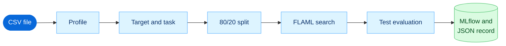
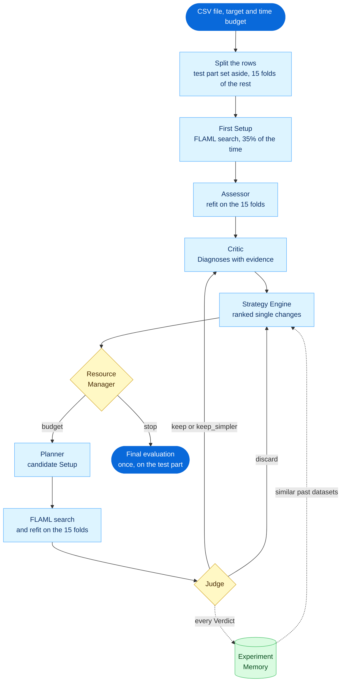
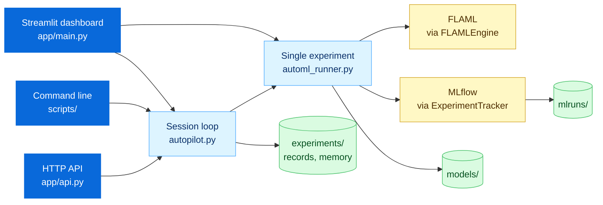

<div align="center">

# AutoPilot-ML

**An autonomous, self-optimizing machine learning experimentation framework**

Give it a CSV file and a time budget. It trains a model with FLAML, works out what is wrong with it,
tries one change at a time, keeps a change only when the statistics support it,
and remembers what worked for the next dataset.

[](https://www.python.org/)
[](https://github.com/microsoft/FLAML)
[](https://scikit-learn.org/)
[](https://streamlit.io/)
[](https://mlflow.org/)
[](https://fastapi.tiangolo.com/)

[](#testing)
[](#docker)
[](#quick-start)
[](#quick-start)
[](#quick-start)

[Overview](#overview) · [Features](#features) · [Quick start](#quick-start) · [How it works](#how-it-works) · [Results](#results) · [Usage](#usage) · [Limitations](#limitations)

</div>

## Overview

AutoML tools are good at one step: choosing a model and its hyperparameters for a dataset. The work around that step is still manual. Someone has to notice that the model overfits, that accuracy is misleading because one class dominates, or that a column is just an ID. Then they have to decide what to change, run it again and compare. What was learned on one dataset is usually lost by the next one.

AutoPilot-ML runs that outer loop by itself. It uses [FLAML](https://github.com/microsoft/FLAML) unchanged as its search engine and adds five components around it:

| Component | Role |
|:---|:---|
| **Critic** | Diagnoses the weaknesses of a model from measured evidence: 14 kinds, such as overfitting, class imbalance or a misleading high-cardinality column |
| **Strategy Engine** | Proposes changes that answer the Diagnoses: 12 Strategies, such as dropping a column, weighting the classes or searching smaller trees |
| **Judge** | Accepts a change only if a corrected resampled t-test on 15 fixed folds shows that it is better, or that it is simpler and not worse |
| **Resource Manager** | Divides the time budget between the steps and decides when the Session stops |
| **Experiment Memory** | Records every change with its measured effect and cost, so that later Sessions can order their changes by what worked on similar datasets |

<div align="center">

| 14 | 12 | 15 | 4 | 586 |
|:---:|:---:|:---:|:---:|:---:|
| kinds of Diagnosis | Strategies | paired folds per Assessment | ways to run it | automated tests |

</div>

### Motivation

- **Compute is scarce.** Most of us have a laptop CPU, no GPU and no budget for paid APIs, so compute has to be spent carefully.
- **Many problems follow familiar patterns.** A big train/test gap, a 90% majority class or a column with a unique value per row can be detected from numbers the first run already produces.
- **Fixes may carry over.** If the fixes that worked are recorded together with a description of the dataset, the next similar dataset should need fewer experiments. Testing that idea is the research part of this project, and the [results](#results) report what was measured.

## Features

### Single experiment

- **Load and profile data.** Upload a CSV file or pick one of four sample datasets. The profile shows rows, columns, types, missing values, duplicates and unique counts, and flags identifier-like, constant, high-cardinality and mostly-empty columns and the class balance of the target.
- **Choose the target and the task.** The app suggests up to three target columns, each with its reasons, and you confirm one. It detects binary classification, multiclass classification or regression and says why. You can override it, and an override that cannot work (for example regression on a text column) is refused with an explanation.
- **Catch possible leakage.** Each column is scored alone as a predictor of the target (5-fold cross-validation). A score of 0.99 or more raises a warning that the column may give the answer away. Nothing is changed automatically.
- **Train with FLAML.** An 80/20 train/test split (stratified for classification), then a FLAML search within your time budget, with your metric and random seed. The best model, its hyperparameters, every trial and a leaderboard per model family are kept.
- **Evaluate on unseen rows.** All metrics are computed on the 20% test set that FLAML never saw, next to the train scores and a trivial baseline (always the majority class, or the mean). The app warns you when accuracy would be misleading because of class imbalance.
- **Explain the model.** Permutation importance, the model's own feature importance, a confusion matrix and per-class report, a ROC curve for binary problems, and predicted-vs-actual and residual plots for regression.
- **Track every run.** Each experiment becomes an MLflow run in a local SQLite file, plus a JSON record that feeds the experiment history in the app.

| Task | Metrics on the test set |
|:---|:---|
| Classification | accuracy, balanced accuracy, precision, recall, F1, ROC-AUC, log loss |
| Regression | MAE, MSE, RMSE, R² |

### Autonomous Session

- **A test part that no decision sees.** 20% of the rows are set aside first. They are used once, at the end, to score the first and the final model side by side.
- **Fair comparisons.** Every Setup's best configuration is refitted on the same 15 folds of the training part (3 repeats of 5-fold cross-validation), so two Setups are compared fold by fold.
- **Diagnoses with evidence.** The rule-based Critic reports 14 kinds of Diagnosis, each with the numbers behind it. Its thresholds were tuned on synthetic data with planted problems.
- **One change at a time.** 12 Strategies answer the Diagnoses. Data changes are learned inside each fold, so no validation row shapes them. Target encoding is also cross-fitted on the training rows, and SMOTE adds synthetic rows to training rows only.
- **Statistical decisions.** The Judge keeps a change only if the paired fold differences support it, or if the change is simpler and not worse.
- **Budget control.** The first Experiment gets 35% of the time, and later ones get budgets from the measured time left.
- **Grouped data (optional).** Name a grouping column (for example several rows per patient or per store) and each group stays on one side of every split. The column is not used as a feature.
- **Replayable records.** Every step, Diagnosis and Verdict is saved in `experiments/SES-###/session.json` and can be replayed.

### Learning and explanation

- **Experiment Memory.** Every Verdict becomes a record in `experiments/memory/memory.jsonl`, with a description of the dataset, the change, its effect and its cost.
- **Learned order of changes.** The `thompson` (Thompson sampling) and `ucb1` selectors put first the changes that were kept, with a good gain per second, on the most similar past datasets. Changes with fewer than 3 past records keep their place in the rule order.
- **Ablation switches.** Turn off the Critic or the Resource Manager, or shuffle the order of changes, to measure what each part adds.
- **SHAP explanations.** On request, SHAP values of a Session's final model on at most 200 rows of the training part (the test part is not used): the columns it relies on most and the contributions to one chosen row.
- **Plain-language summary (optional).** A local language model (`qwen2.5:7b-instruct` through Ollama, on the same machine) writes a short summary from the Session record. The text is labelled as generated, numbers that are not in the record are listed next to it, and no decision reads it.

### Ways to run it

| Interface | What you get |
|:---|:---|
| **Streamlit dashboard** | Two modes, Single experiment and Autonomous run, with charts and the experiment history |
| **Command line** | One Session on a CSV file, with every step printed |
| **Local HTTP API** | A FastAPI service to start, list, read and stop Sessions; it listens on 127.0.0.1 and runs one Session at a time |
| **Docker image** | The dashboard and the API in one image, with the results kept in Docker volumes |

> [!TIP]
> Everything runs on your own machine: no OpenAI, Anthropic, Gemini or other paid API, no cloud service and no GPU.

## Quick start

**You need** [Miniconda](https://docs.conda.io/en/latest/miniconda.html) and about 1.1 GB of free disk space for the environment. No GPU is needed. The project was developed and tested on Windows 11 with Python 3.11.

```bash
# 1. Create the environment
conda create -n automl python=3.11 -y
conda activate automl

# 2. Install the pinned dependencies (run this in the repository folder)
pip install -r requirements.txt

# 3. Start the dashboard (local only, no usage statistics), then open http://localhost:8501
streamlit run app/main.py --server.address localhost --browser.gatherUsageStats false
```

Choose **Single experiment** or **Autonomous run** in the sidebar. To run a Session without the dashboard:

```bash
python scripts/run_autopilot.py --dataset data/sample/titanic.csv --target Survived --seconds 300
```

To change the defaults (time budget, seed, MLflow location), copy `.env.example` to `.env` and edit it; see [Configuration](#configuration). No API keys are needed.

> [!WARNING]
> The dashboard, the HTTP API and the Docker image have no login. `--server.address localhost` keeps the dashboard reachable from your own machine only. Keep the API and the Docker ports on 127.0.0.1 as well.

> [!NOTE]
> The libraries are cross-platform, but macOS has not been tried yet, and Linux only inside the Docker image (a short Session on 12 November 2026; the tests were not run there).

## Example: Titanic

1. Start the dashboard and choose **Sample dataset → Titanic passenger survival**.
2. The profile shows 891 rows and 12 columns, with missing values in `Age`, `Cabin` and `Embarked`. The Data quality tab flags `PassengerId` and `Name` as identifiers, and `Ticket` and `Cabin` as high-cardinality.
3. Choose `Survived` as the target. The app detects binary classification and pre-selects `PassengerId` and `Name` for exclusion.
4. Set a time budget (30 to 60 seconds is enough), keep F1 as the metric, and run.
5. Compare the test scores with the trivial baseline, and look at the train/test gap, the leaderboard and the feature importance.
6. Exclude `Ticket` and `Cabin` as well, run again, and compare both runs in the experiment history and in MLflow.

> [!NOTE]
> In the single-experiment mode you make the decision of step 6 by hand. In the autonomous mode the Session makes it. In the first Session on Titanic (SES-001, 300 s) the Critic found overfitting and the two high-cardinality columns. The Session dropped `Cabin` (kept as simpler) and then `Ticket` (kept as better, p = 0.010), and the final model's test F1 was **0.724** against **0.684** for its first model.

## How it works

### A single experiment



### An autonomous Session



A Session first sets the test part aside and fixes 15 folds of the training part. Every Setup is searched with FLAML and then assessed on those same folds. After each Assessment the Critic reads the evidence and writes Diagnoses, and the Strategy Engine turns them into a ranked list of single changes; each change is tried at most once per Session. The Resource Manager gives the next search its budget or stops the Session. The Judge compares the candidate with the accepted Setup fold by fold, and every Verdict goes into the Experiment Memory, which the learned selectors can read. At the end, the first and the final model are scored once on the test part.

A Session stops when its time or its Experiment limit is used up, when no change is left to try, after three discards in a row, or when you press Stop.

### The Judge

The Judge compares two Assessments on the same 15 folds with the corrected resampled t-test (Nadeau and Bengio, 2003). The correction matters because the folds overlap: an ordinary paired t-test would be far too confident. With $d_j$ the difference between the candidate and the accepted Setup on fold $j$, signed so that positive is better:

$$
t = \frac{\bar{d}}{\sqrt{\left(\frac{1}{J} + \frac{n_{\text{val}}}{n_{\text{train}}}\right) s_d^2}}, \qquad J = 15, \qquad \text{df} = J - 1
$$

| Verdict | Rule |
|:---|:---|
| `keep` | $\bar{d} \gt 0$ and the one-sided p-value for "better" is at most 0.20 |
| `keep_simpler` | the candidate is simpler, $\bar{d} \ge -0.005$, and the one-sided p-value for "worse" is above 0.20 |
| `discard` | otherwise |

The level 0.20 was chosen by the Judge study (see [Results](#results)).

### Diagnoses and Strategies

The Critic reports 14 kinds of Diagnosis:

| Area | Kinds of Diagnosis |
|:---|:---|
| Model | overfitting, underfitting, weak model families |
| Search time | budget limited, wasted budget |
| Data | class imbalance, missing values, high cardinality, identifier column, constant column, redundant features, unused words, possible leakage |
| Validation | unreliable validation |

Possible leakage is only a warning: no Strategy answers it, because only you know whether a column is known before the outcome. The two newest kinds, unused words and possible leakage, came after the Critic study and were not part of it.

The Strategy Engine answers the Diagnoses with 12 Strategies. Only the simpler ones can be kept with the `keep_simpler` Verdict.

| Strategy | What it changes | Answers | Complexity |
|:---|:---|:---|:---:|
| `drop_columns` | Removes a column and its data steps | identifier, constant, high cardinality, missing values (high only), redundant pair, overfitting |  |
| `class_weight_balanced` | Balanced sample weights in the search and the refits | class imbalance |  |
| `regularised_search_space` | Smaller trees: at most 32 leaves for LightGBM and XGBoost, depth at most 4 for depth-limited XGBoost, at most 64 leaves for the forests | overfitting |  |
| `frequency_encode` | A text value becomes the share of training rows that have it | high cardinality |  |
| `group_rare_categories` | Values seen in under 1% of training rows become one value | high cardinality |  |
| `missing_indicator` | Adds a 0/1 column that marks the empty cells of a numeric column | missing values |  |
| `restrict_model_families` | Searches only the learner families that were not weak | weak model families |  |
| `more_search_time` | The same setup with at least twice the search time | underfitting, budget limited |  |
| `smoother_search_metric` | Searches with log loss instead of the primary metric | class imbalance, unreliable validation |  |
| `smote` | Synthetic rows of the smaller classes, in each fold's training rows only | class imbalance |  |
| `target_encode` | Cross-fitted, smoothed mean target of each value | high cardinality |  |
| `token_features` | 0/1 columns for up to 20 frequent words of a text column | unused words |  |

### Architecture



The code has three layers. `app/main.py` and `app/components/` are the Streamlit UI, which only collects input and shows results. `app/services/` holds all the logic and never imports Streamlit, so it can be used from a script or a notebook. `app/core/` holds settings and logging. The HTTP API in `app/api.py` runs the same Session code as the dashboard. FLAML is only touched inside `FLAMLEngine`, and MLflow only inside `ExperimentTracker`.

## Results

All numbers were measured on one laptop (CPU only, 16 logical cores).

| Study | Setup | Finding |
|:---|:---|:---|
| **Critic study** | 270 synthetic datasets with planted problems | The data-level Diagnoses raised no false alarm. Overfitting was found with precision 0.88 and recall 0.91. Unreliable validation is weak (precision 0.27). |
| **Judge study** | 84 pairs of Setups with a known true difference | On the reporting seeds the Judge kept 0 of 18 harmful changes and 10 of 12 helpful ones. |
| **Loop against FLAML alone** | 4 sample datasets, 3 seeds, 300 s | About the same final test scores on average (4 better, 4 equal, 4 worse), using about two thirds of the time. |
| **Full benchmark** | 390 runs on 6 evaluation datasets | At the same budget, one FLAML search was as good as the loop or better (see below). |
| **Judge agreement** | 20 real decisions, each checked by new searches on 5 inner splits | 8 of 20 verdicts agreed (Cohen's kappa 0.05), and the strict check cost 2.4 times as much. |

### The full benchmark

The second benchmark run used the final code and completed all 390 runs on 12 and 13 November 2026, with no failure.

| Part | Setting |
|:---|:---|
| **Systems** | a manual LightGBM baseline, FLAML alone, AutoGluon, AutoPilot-ML with the rule order (which is also AutoPilot-ML without the memory) and the full AutoPilot-ML (Thompson sampling with the memory) |
| **Ablations** | random order, no Critic, no Resource Manager (300 s only) |
| **Data** | 6 evaluation datasets, seeds 1 to 5 |
| **Budgets** | 120 s and 300 s in total |
| **Measures** | test score, time to reach a target score, number of experiments, compute cost and consistency across datasets |

> [!IMPORTANT]
> On these datasets, at the same budget, one FLAML search was as good as the loop or better. The loop's decisions are recorded and explained, but its changes rarely added to the test score beyond FLAML alone.

| Budget | Full system minus FLAML alone (median difference in test score) | 95% interval |
|:---:|:---|:---:|
| 120 s | -0.0137, behind on all 6 datasets | -0.0183 to -0.0022 |
| 300 s | -0.0010, level within the interval | -0.0051 to 0.0205 |

FLAML reached the target score at an earlier budget in 10 of 30 (dataset, seed) pairs, the full system in 2. The memory, the learned order of changes, the Critic and the Resource Manager made no difference beyond the intervals. With 6 datasets, the Wilcoxon tests cannot reach significance after Holm's correction.

| Hypothesis | Outcome |
|:---|:---:|
| **H1:** The full system needs less time (median) than FLAML to reach the target score, with the same total budget. |  |
| **H2:** Without the memory, more experiments are needed to reach the target, on datasets that were not used to build the memory. |  |
| **H3:** Without strategy selection (random or fixed order), the best-score-over-time curve is lower. |  |
| **H4:** At the same budget, the final score of the full system is not worse than FLAML's, while using fewer experiments. |  |

<details>
<summary><b>Earlier and secondary results</b></summary>

<br/>

- **First benchmark run** (stopped early: 23 usable runs on pc4 and cylinder-bands, seed 1): the full system was never below FLAML alone (pc4 F1 0.600 and 0.613 against 0.590 at 120 and 300 s; cylinder-bands equal at 120 s, 0.872 against 0.870 at 300 s). With 2 datasets no test can confirm this.
- **Development Sessions:** only changes kept as significantly better raised the test score (+0.016 on average, 8 of 11 Sessions better). Three flaws found in the records were fixed: rounding noise counted once as a gain, unchanged models counted as successes in the memory, and changes seen on only one dataset steered the learned order.

</details>

## Usage

Run these from the repository folder with the `automl` environment active.

### Command line

```bash
python scripts/run_autopilot.py --dataset data/sample/titanic.csv --target Survived --seconds 300 --max-experiments 8 --cores -1 --seed 42
```

The script prints every step. Records go to `experiments/`, `models/` and `mlruns/`, or to another folder with `--project-root`.

<details>
<summary><b>All options of <code>run_autopilot.py</code></b></summary>

<br/>

| Option | Meaning |
|:---|:---|
| `--dataset`, `--target` | the CSV file and its target column |
| `--task` | `binary`, `multiclass` or `regression` (default: detected) |
| `--metric` | the primary metric (default: the task's default) |
| `--exclude` | columns to leave out, separated by commas |
| `--seconds` | the total time budget of the Session |
| `--max-experiments` | the largest number of Experiments |
| `--cores` | CPU cores for every search and refit (`-1`: all) |
| `--seed`, `--test-size` | the random seed and the share of rows in the test part |
| `--selector` | how the next change is chosen: `rules`, `random`, `thompson` or `ucb1` (the last two learn from the memory) |
| `--use-memory` | let the selector read the Experiment Memory |
| `--group-column` | keep rows with the same value of this column together, in the test part and in every fold (the column is not used as a feature) |
| `--no-critic` | ablation: random valid changes, no Diagnoses |
| `--no-resource-manager` | ablation: equal search budgets; only the time and Experiment limits stop the Session |
| `--no-mlflow` | do not log to MLflow |
| `--project-root` | the folder for `experiments/`, `models/` and `mlruns/`, for example a temporary folder |

</details>

### Explain and summarise a finished Session

SHAP values of the final model on the training part (give the CSV file the Session ran on), and a plain-language summary by a local language model, which needs [Ollama](https://ollama.com) running on this machine:

```bash
python scripts/explain_session.py SES-001 --dataset data/sample/titanic.csv   # writes experiments/SES-001/shap_summary.json
ollama pull qwen2.5:7b-instruct                                               # once, for the summaries
python scripts/summarise_session.py SES-001                                   # writes experiments/SES-001/summary_generated.json
```

### HTTP API

```bash
python scripts/run_api.py    # http://127.0.0.1:8000, interactive documentation at /docs
```

| Method | Path | What it does |
|:---|:---|:---|
| `GET` | `/health` | the status, the version and the running Session, if any |
| `GET` | `/sessions` | every Session with its status, dataset, target, stop reason and number of steps |
| `GET` | `/sessions/{id}` | the full record of one Session |
| `POST` | `/sessions` | starts a Session in the background (one at a time) |
| `POST` | `/sessions/{id}/stop` | stops a Session after its current step; it then scores the first and the final model |

A dataset must be a CSV file inside the project's `data/` folder:

```bash
curl -X POST http://127.0.0.1:8000/sessions -H "Content-Type: application/json" -d '{"dataset": "data/sample/titanic.csv", "target": "Survived", "seconds": 300}'
```

### Docker

The image runs the dashboard (port 8501) and the API (port 8000), and keeps `experiments/`, `models/` and `mlruns/` in volumes. Publish the ports on 127.0.0.1 only, because the API has no login.

```bash
docker build -t autopilot-ml:0.1.0 .
docker run --rm -p 127.0.0.1:8501:8501 -p 127.0.0.1:8000:8000 \
    -v autopilot-experiments:/app/experiments -v autopilot-models:/app/models -v autopilot-mlruns:/app/mlruns \
    autopilot-ml:0.1.0
```

The local summaries are not available inside the image: they need Ollama, which the image does not contain, and the app only talks to a model on its own machine. Records made in a container have no commit hash, because the image holds no git history.

### MLflow UI

```bash
mlflow ui --backend-store-uri sqlite:///mlruns/mlflow.db --port 5000 --workers 1    # then open http://127.0.0.1:5000
```

On Windows, `--workers 1` is needed: with several workers we got a socket error (WinError 10022). The database file is created by the first experiment.

### From Python

```python
import pandas as pd
from app.services.automl_runner import AutoMLRunner

df = pd.read_csv("data/sample/titanic.csv")
result = AutoMLRunner().run(
    dataframe=df,
    target_column="Survived",
    task="binary",                  # or None to detect it
    time_budget=60,
    primary_metric="f1",
    excluded_columns=["PassengerId", "Name"],
    dataset_name="titanic",
)
print(result.experiment_id, result.best_model_name, result.test_score)
```

### Configuration

Copy `.env.example` to `.env` to change these settings. No API keys are needed.

| Variable | Default | What it sets |
|:---|:---|:---|
| `AUTOPILOT_LOG_LEVEL` | `INFO` | the logging level: `DEBUG`, `INFO`, `WARNING` or `ERROR` |
| `AUTOPILOT_MLFLOW_TRACKING_URI` | empty | the MLflow backend; empty means `mlruns/mlflow.db`, with the files in `mlruns/artifacts` |
| `AUTOPILOT_MLFLOW_EXPERIMENT_NAME` | `autopilot-ml-baseline` | the MLflow experiment name |
| `AUTOPILOT_DEFAULT_TIME_BUDGET` | `60` | the time budget shown in the UI, in seconds |
| `AUTOPILOT_DEFAULT_SEED` | `42` | the random seed shown in the UI |
| `AUTOPILOT_DEFAULT_TEST_SIZE` | `0.2` | the share of rows in the test set |
| `AUTOPILOT_N_JOBS` | `-1` | the CPU cores used by FLAML (`-1`: all) |
| `AUTOPILOT_MAX_UPLOAD_MB` | `200` | the largest CSV upload in the UI, in MB |

<details>
<summary><b>More tools: compare two setups, chart a search</b></summary>

<br/>

One run on one split can mislead. This script runs setup A and setup B on the same few random splits and prints the per-seed differences. It uses a temporary folder and does not touch the dashboard history.

```bash
python scripts/compare_seeds.py --dataset data/sample/titanic.csv --target Survived --exclude-a PassengerId,Name --exclude-b PassengerId,Name,Ticket,Cabin --seeds 1 2 3 4 5 --budget 30
```

Charts of one experiment's FLAML search: every trial over time, the search time each learner family got, and how the winning family's settings grew. The script only reads the experiment's saved files and writes PNG files to the folder given by `--out`.

```bash
python scripts/plot_search_history.py --experiment EXP-001 --out experiments/EXP-001/charts
```

</details>

<details>
<summary><b>Reproduce the studies and the benchmark</b></summary>

<br/>

The component studies and the Phase 2 measurement (each restarts where it stopped; summary CSV files go to `results/`):

```bash
python scripts/run_study.py critic run      # then: critic analyse [--freeze LABEL]
python scripts/run_study.py judge run       # then: judge analyse
python scripts/run_phase2.py run            # then: run_phase2.py analyse
python scripts/prepare_datasets.py download # the 12 OpenML datasets of research/datasets.json into data/raw/
```

The single-column leakage check and the target suggestion on every registered dataset, on the training part of the seed-42 split (summary in `results/leakage_check.csv`; on 12 November 2026 no column of the 16 datasets reached 0.99):

```bash
python scripts/check_single_columns.py
```

The Phase 3 benchmark (records go to `experiments/benchmark/` and `models/benchmark/`, one row per finished cell to `results/benchmark/`; a restart skips finished cells):

```bash
python scripts/build_memory.py run                       # 30 Sessions on the development datasets (about 2 h)
python scripts/build_memory.py freeze                    # -> results/benchmark/frozen_memory.jsonl
python scripts/run_benchmark.py run --smoke --memory results/benchmark/frozen_memory.jsonl
python scripts/run_benchmark.py run --memory results/benchmark/frozen_memory.jsonl   # the 390 cells
python scripts/run_benchmark.py status                   # cells done, failures, time per system, time left
python scripts/run_benchmark.py analyse                  # tests, tables and charts in results/benchmark/
python scripts/run_study.py agreement run                # the Judge agreement study; then: agreement analyse
```

The second, full run used `scripts/run_benchmark_v2.cmd`, a Windows batch file that runs the memory build, the freeze, the smoke setting and the grid, each with `--label v2`. With `--label v2`, `build_memory.py` and `run_benchmark.py` write to their own folders (`experiments/benchmark-v2*/`, `models/benchmark-v2*/` and `results/benchmark-v2/`), so a second run can never touch the first run's rows or its frozen memory.

AutoGluon needs pandas 2.3 and this project pins pandas 3.0, so the benchmark runs AutoGluon from its own conda environment. Create it once (versions in `research/requirements-autogluon.txt`):

```bash
conda create -n autogluon python=3.11 -y
conda run -n autogluon python -m pip install -r research/requirements-autogluon.txt
```

</details>

## Testing

```bash
python -m pytest -q                   # every test
python -m pytest -q -m "not slow"     # without the slow ones
```

All 586 tests passed on 17 November 2026 (Windows 11, Python 3.11, about 6 minutes). On a fresh clone, 4 of them are skipped, because they read local experiment records that are not in git. The tests marked slow are the study smoke tests, the dashboard tests and a few tests with real FLAML searches.

## Limitations

- **Tabular data only.** CSV files with a single table; no text, images, time series or clustering.
- **Target suggestion.** It uses simple signals (the name, the position, the values), and its points are design choices, not measured. You confirm the choice. On the 16 registered datasets the registered target came first on 15 (on penguins it came third).
- **Leakage check.** It scores one column at a time and only warns. A column that gives the answer away together with other columns is not found, and only you can tell whether a flagged column is known before the outcome.
- **One change at a time.** Each change is tried at most once per Session. By default the changes follow a fixed rule order. The learned order needs a memory with records of similar datasets (at least 3 records from at least 2 datasets for a change), and the second benchmark run did not show that it helps.
- **One verdict is evidence, not proof.** The Judge decides on refits of the configurations the searches found. A study that searched again for 20 of its decisions agreed with it on 8 (Cohen's kappa 0.05). Both scores are also a little optimistic, because FLAML chose both configurations on the same training part; pairing removes much of this, not all.
- **Assessment cost.** Every Setup is refitted 15 times, which takes a share of the budget, more so on bigger data.
- **Limited feature engineering.** The only changes are the 12 Strategies: no threshold tuning, feature interactions or outlier handling. In the second benchmark run `token_features` was kept 3 of 26 times, `smote` 2 of 4 and `target_encode` 0 of 7.
- **Single-experiment mode.** ID-like and constant columns are suggested for exclusion; high-cardinality columns are only flagged.
- **Run-to-run variation.** FLAML's search is limited by time, so two runs with the same seed can differ slightly.
- **Explanations.** Permutation importance can understate features that are strongly correlated with each other. SHAP is only available for a Session's final model, not in the single-experiment mode. For learners other than tree models it uses a slower estimate on fewer rows (50 rows against 25 background rows).
- **Generated summaries.** In the checks of 12 November 2026 one summary misread a verdict and another added judgements of its own, which is why the text is labelled and never used for decisions. They need Ollama and the model on the same machine.
- **Security.** Models are saved with pickle, so only load model files this app created. The dashboard, the API and the Docker ports have no login; keep them on localhost.
- **Moving the project.** MLflow stores absolute file paths, so moving the project folder breaks the file links of old MLflow runs (the JSON records are not affected).
- **Killed processes.** A Session that is killed together with its process (for example when the API server is stopped while it runs) cannot mark itself as stopped, so its record stays at "running".

## Project structure

```text
autopilot-ml/
├── app/
│   ├── main.py             Streamlit entry point (mode switch)
│   ├── api.py              local HTTP API (FastAPI)
│   ├── components/         UI sections, including autopilot_viewer.py (autonomous mode)
│   ├── core/               settings and logging
│   └── services/           all the logic: the single experiment and the autonomous layer
├── research/               synthetic data, the Critic and Judge studies, the Phase 2 measurement,
│                           the dataset registry, the comparison systems, the benchmark harness,
│                           statistics and analysis, the memory build, the Judge agreement study
├── scripts/                run_autopilot.py: one Session from the command line
│                           run_study.py: the Critic, Judge and Judge agreement studies
│                           run_phase2.py: Sessions against FLAML alone
│                           prepare_datasets.py: the OpenML datasets of research/datasets.json
│                           build_memory.py: the frozen memory of the benchmark
│                           run_benchmark.py: the Phase 3 benchmark and its analysis
│                           run_benchmark_v2.cmd: the second, full benchmark run
│                           compare_seeds.py: compare two setups over several splits
│                           plot_search_history.py: charts of one experiment's search
│                           explain_session.py: SHAP values of a Session's final model
│                           summarise_session.py: a plain-language summary by a local model
│                           check_single_columns.py: the leakage check on every registered dataset
│                           run_api.py: the local HTTP API
│                           docker_entry.sh: starts the API and the dashboard in the image
├── tests/                  pytest tests
├── data/sample/            four small public demo datasets
├── experiments/            JSON records of experiments and Sessions, and the memory (generated, not in git)
├── models/                 saved models (generated, not in git)
├── mlruns/                 MLflow database and files (generated, not in git)
├── results/                summary CSV files of the studies and the benchmark (generated, not in git)
├── Dockerfile              the image with the dashboard and the API
└── requirements.txt        pinned dependencies
```

<details>
<summary><b>The modules in <code>app/services/</code></b></summary>

<br/>

| Module | What it does |
|:---|:---|
| `profiler.py`, `task_detector.py` | the dataset profile, the frequent words of text columns, the single-column leakage scores, the target suggestion and the task detection |
| `automl_runner.py` | a single experiment: the split, the FLAML search through `FLAMLEngine`, the evaluation and the saved model |
| `evaluator.py` | test and train metrics, the trivial baseline and permutation importance |
| `experiment_tracker.py` | the MLflow runs and the JSON records |
| `autopilot.py` | the Session loop, its records, the final evaluation and the ablation switches |
| `splits.py` | the outer split and the fixed folds of the training part; with a grouping column, both keep each group on one side |
| `experiment_planner.py` | the first Setup and each candidate Setup, warm-started from the best configurations found so far |
| `assessor.py` | refits a Setup's best configuration on every fold and records the fold scores |
| `critic.py`, `critic_thresholds.toml` | the Diagnoses and their thresholds (version `v1-critic-study`) |
| `strategies.py`, `strategy_engine.py` | the 12 Strategies, the rule table that ranks them and the learned selectors |
| `transforms.py` | the data changes, learned on training rows only and saved with the model |
| `resampling.py` | SMOTE for the `smote` Strategy, applied to training rows only |
| `judge.py` | the corrected resampled t-test and the `keep`, `keep_simpler` and `discard` rules |
| `resource_manager.py` | the budget of each step and the stop rules (and, for an ablation, equal shares) |
| `experiment_memory.py` | the memory records, the nearest past datasets and the statistics per Strategy |
| `search_summary.py` | how a search spent its time, for the budget Diagnoses |
| `explainer.py` | SHAP explanations of a Session's final model on rows of its training part |
| `narrator.py` | the plain-language summaries by a local language model; no decision module reads them |

</details>

## Tech stack

| Area | Tools (pinned in `requirements.txt`) |
|:---|:---|
| Language | Python 3.11 |
| Data | pandas 3.0.6, NumPy 2.4.6 |
| AutoML search | FLAML 2.7.0, with LightGBM 4.7.0, XGBoost 2.1.4 and scikit-learn learners |
| Machine learning and statistics | scikit-learn 1.9.1, SciPy 1.17.1, imbalanced-learn 0.14.2 (SMOTE) |
| Explanations | shap 0.51.0 and permutation importance |
| Tracking | MLflow 3.17.0, with a local SQLite backend |
| Dashboard and charts | Streamlit 1.65.0, Plotly 7.1.0, Matplotlib 3.11.2 |
| Service | FastAPI 0.142.2, uvicorn 0.54.0 |
| Configuration and tests | python-dotenv 1.2.4, pytest 9.1.1 |
| Optional | Docker for the image; Ollama, installed separately, for the local summaries |

Optuna is not used, so it is not installed.

## Roadmap

- [x] **Phase 1, baseline:** profiling, task detection, FLAML, evaluation, MLflow, the dashboard and the experiment history
- [x] **Phase 2, rule-based loop:** Assessor, Critic, Strategy catalogue and rule engine, Judge, Resource Manager, Planner, records and Experiment Memory, the dashboard's autonomous mode, the Critic and Judge studies, and the measurement against FLAML alone
- [x] **Phase 3, learning and evaluation:** learned strategy selection (bandits with the memory), benchmark datasets, ablation switches, comparison systems (manual, FLAML alone, AutoGluon), the benchmark harness with its statistics, the frozen memory and the Judge agreement study
- [x] **Extensions:** SMOTE, target encoding and word features, group-aware splits, SHAP, target suggestion and a leakage check, local language-model summaries, the HTTP API and the Docker image
- [x] **Second, full benchmark run** with the final code: all 390 runs, no failure
- [ ] More evaluation datasets, so that the Wilcoxon tests can reach significance after Holm's correction, and a measurement of the optional Strategies on them
- [ ] A larger share than 35% for the first search on short budgets, and a last, longer search with the time that Sessions left unused (about 30% at 300 s); ideas from the second benchmark run, not tested
- [ ] More feature engineering and data-level fixes, for example decision-threshold tuning and outlier handling
- [ ] PostgreSQL-backed tracking for multi-user use

## Acknowledgements

This project started from working with [FLAML](https://github.com/microsoft/FLAML), Microsoft Research's fast and lightweight AutoML library (Wang et al., MLSys 2021, MIT licence). FLAML finds good models quickly on ordinary hardware because its search methods (CFO and BlendSearch) take the cost of each trial into account. That is what made a fully local project like this realistic. AutoPilot-ML uses FLAML unchanged: we do not modify it, and we do not claim to outperform it. The benchmark also runs [AutoGluon](https://github.com/autogluon/autogluon) as a comparison system.

The sample datasets in `data/sample/`:

| File | Task | Target | Source |
|:---|:---|:---|:---|
| `titanic.csv` | binary classification | `Survived` | Kaggle "Titanic: Machine Learning from Disaster" training set, from [datasciencedojo/datasets](https://github.com/datasciencedojo/datasets) |
| `breast_cancer.csv` | binary classification | `diagnosis` | Breast Cancer Wisconsin (Diagnostic) from the UCI repository, exported from scikit-learn |
| `penguins.csv` | multiclass classification | `species` | Palmer Penguins (Horst, Hill and Gorman), from [mwaskom/seaborn-data](https://github.com/mwaskom/seaborn-data) |
| `california_housing.csv` | regression | `MedHouseVal` | California Housing (Pace and Barry, 1997), exported from scikit-learn |

## Use of AI tools

This project was developed in Kiro, an AI-assisted code editor built on VS Code. Kiro's AI agent wrote most of the code, the tests and the documents, following a written spec (requirements, design and ordered tasks) that is kept outside this repository, and it also ran the experiments and analysed their results. Priyanshu Verma set the goals and constraints, made the design and run decisions, and reviewed the work. The application itself uses no paid or cloud AI service: every decision in AutoPilot-ML comes from its own rules and statistics. The only language model it can call is the optional local one (through Ollama, on the same machine) that writes a labelled summary of a finished Session when you ask for it; no decision reads that text.

---

<div align="center">
<sub>A B.Tech Computer Science major project.<br/>
The project documents and the result files of the studies are not in the current tree; commit <code>9788b1a</code> is the last one that has them.</sub>
</div>
