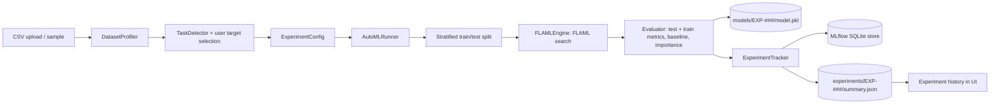
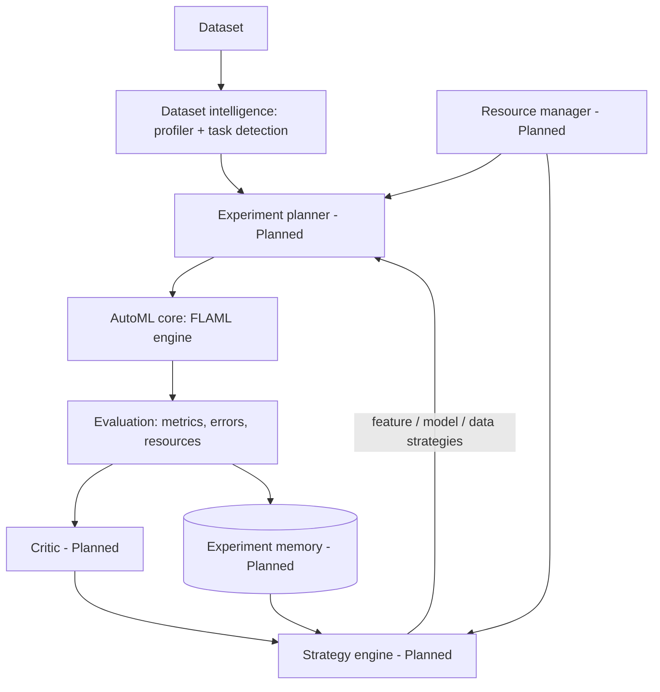

# AutoPilot-ML

### Autonomous Machine Learning Experimentation & Self-Optimization Framework

B.Tech Computer Science major project. AutoPilot-ML aims to turn an arbitrary tabular dataset into the best pipeline it can find under a user-defined compute budget, by running, diagnosing and improving experiments on its own.

The project is built in two clearly separated layers:

| Layer | Status | What it is |
|---|---|---|
| **CURRENT BASELINE** | Implemented (Phase 1) | CSV → dataset profiling → task detection → FLAML AutoML → evaluation → MLflow tracking → Streamlit dashboard |
| **PROPOSED RESEARCH SYSTEM** | Planned (Phase 2+) | Experiment planner, critic, strategy engine, experiment memory, resource-aware optimisation |

Nothing in the proposed layer is implemented yet. Where this README talks about it, it is labelled **Planned** or **Future Work**.

---

## 1. Problem

Building a good model for a new tabular dataset is an iterative loop: profile the data, pick a task and metric, train candidates, read the errors, decide what to change (features, model, data, hyperparameters), and repeat. Conventional AutoML automates the inner search (model + hyperparameters) but not the outer loop: it does not explain why a model is weak, does not choose corrective strategies, and does not learn from earlier experiments.

## 2. Motivation

- Experimentation time and compute are the real bottlenecks for students, small teams and labs without GPUs or paid APIs.
- Much of the outer-loop reasoning ("the model overfits", "accuracy is misleading on this imbalanced target", "this column is an identifier") follows recognisable patterns that can be detected and acted on.
- An experimentation layer that records what worked on which kind of dataset can, in principle, reach a target score with fewer experiments. Testing that claim is the research goal of this project.

## 3. Current capabilities (CURRENT BASELINE)

- **CSV ingestion**: upload through Streamlit or pick a bundled sample dataset; encoding and `;`-delimiter fallbacks.
- **Dataset profiling** (`DatasetProfiler`, UI-independent): rows, columns, dtypes, numerical/categorical features, missing values and ratios, duplicate rows, unique counts, identifier-like, constant, high-cardinality and high-missingness columns, class distribution and imbalance severity, compact meta-features.
- **Target selection and task detection** (`TaskDetector`): the user picks the target; binary / multiclass / regression is detected with a stated reason and confidence, and the user can override it (infeasible overrides are rejected with a clear message). Target-candidate information is shown for every column. Fully automatic target detection is **not** implemented.
- **AutoML with FLAML** (`AutoMLRunner` + `FLAMLEngine`): stratified hold-out test split, FLAML search under a time budget with a configurable primary metric and seed, captured best estimator, best configuration, best validation score, training time, full trial history and per-model leaderboard. FLAML is used unmodified, behind an engine interface.
- **Evaluation** (`Evaluator`, model-agnostic): accuracy, balanced accuracy, precision, recall, F1, ROC-AUC, log loss for classification; MAE, MSE, RMSE, R² for regression; train vs test metrics; a trivial reference baseline (majority class / training mean); warnings when accuracy is misleading because of class imbalance.
- **Basic explainability**: permutation importance on the held-out test set (model-agnostic), model-native importance when the estimator provides it, confusion matrix and per-class report, ROC curve (binary), predicted-vs-actual and residual plots (regression).
- **Experiment tracking**: every run is logged to a local MLflow store (SQLite, no server needed) with parameters, metrics and artifacts (model, dataset profile, evaluation, leaderboard, search history, feature importance, predictions), and to a lightweight JSON index in `experiments/`.
- **Experiment history**: table and chart of all past experiments, the seed of the future experiment memory.
- **Fully local**: no OpenAI / Anthropic / Gemini or any paid API, no cloud services, no GPU.

## 4. Architecture

### Current baseline



| Layer | Path | Responsibility |
|---|---|---|
| UI | `app/main.py`, `app/components/` | Streamlit rendering and input only |
| Services | `app/services/` | All business logic, usable without the UI |
| Core | `app/core/` | Settings (`.env`), logging |
| Storage | `experiments/`, `models/`, `mlruns/` | Local experiment records, model bundles, MLflow store |

More detail: [docs/architecture.md](docs/architecture.md).

## 5. Installation

Requirements: [Miniconda](https://docs.conda.io/en/latest/miniconda.html) and roughly 1.1 GB of disk for the environment (measured on Windows 11). No GPU needed. Developed and tested on Windows 11 with Python 3.11; the dependencies are cross-platform but macOS/Linux have not been tested yet.

```bash
conda create -n automl python=3.11 -y
conda activate automl
cd autopilot-ml
pip install -r requirements.txt
```

Optional: copy `.env.example` to `.env` to change defaults (time budget, seed, MLflow location). No API keys are required.

## 6. Usage

All commands are run from the `autopilot-ml/` folder with the `automl` environment active.

**Dashboard**

```bash
streamlit run app/main.py --server.address localhost --browser.gatherUsageStats false
```

Open http://localhost:8501. `--server.address localhost` keeps the app private to your machine (it has no authentication); `--browser.gatherUsageStats false` disables Streamlit's anonymous telemetry.

**MLflow UI** (browse every run, its parameters, metrics and artifacts)

```bash
mlflow ui --backend-store-uri sqlite:///mlruns/mlflow.db --port 5000 --workers 1
```

Open http://127.0.0.1:5000. `--workers 1` avoids a multi-process socket error seen on Windows. The database is created by the first experiment.

**Tests**

```bash
python -m pytest -q
```

**From Python** (no UI)

```python
import pandas as pd
from app.services.automl_runner import AutoMLRunner

df = pd.read_csv("data/sample/titanic.csv")
result = AutoMLRunner().run(
    dataframe=df,
    target_column="Survived",
    task="binary",                 # None = auto-detect
    time_budget=60,
    primary_metric="f1",
    excluded_columns=["PassengerId", "Name"],
    dataset_name="titanic",
)
print(result.experiment_id, result.best_model_name, result.test_score, result.mlflow_run_id)
```

## 7. Screenshots

_Placeholder: add screenshots of the dashboard sections (dataset profile, results, explainability, history) and of the MLflow UI here._

## 8. Example workflow (Titanic)

1. Start the dashboard, choose **Sample dataset → Titanic passenger survival**.
2. **Dataset**: the profile shows 891 rows, 12 columns and missing values in `Age`, `Cabin` and `Embarked`. The *Data quality* tab flags `PassengerId` and `Name` as identifier-like and `Ticket` / `Cabin` as high-cardinality.
3. **Target**: `Survived` is selected and detected as *Binary Classification*. `PassengerId` and `Name` are pre-selected for exclusion.
4. **Configuration**: time budget 60 s, metric F1, seed 42.
5. **Run**: press **🚀 Run Experiment** and follow the progress bar.
6. **Results**: best model, test F1 versus the majority-class baseline, train-vs-test gap, the FLAML leaderboard and search-progress curve.
7. **Explainability**: permutation importance, confusion matrix and ROC curve.
8. Re-run with `Ticket` and `Cabin` also excluded and compare both runs in **Experiment History** and in MLflow.

Step 8 is exactly the kind of decision (diagnose high-cardinality features, try removing them, keep the change if it helps) that the planned critic and strategy engine are meant to automate. In the baseline the user makes it manually.

## 9. Technology stack

| Purpose | Library (pinned in `requirements.txt`) |
|---|---|
| Data handling | pandas, NumPy |
| ML utilities, metrics, permutation importance | scikit-learn |
| AutoML engine | FLAML (with LightGBM, XGBoost and scikit-learn learners) |
| Experiment tracking | MLflow (local SQLite backend) |
| Dashboard and plots | Streamlit, Plotly |
| Configuration | python-dotenv |
| Tests | pytest |

Part of the intended stack but **not used yet**: Optuna (strategy-level search), SHAP (local explanations). They will be added when a feature actually needs them.

## 10. Current limitations

- CSV and single-table tabular data only; no NLP, vision, time-series forecasting or clustering.
- The target column must be chosen by the user; automatic target detection is a placeholder heuristic.
- One AutoML run per click; there is no automatic follow-up experiment, diagnosis or strategy selection yet.
- No feature engineering, resampling (e.g. SMOTE) or class weighting beyond what FLAML's learners do internally.
- Identifier and constant columns are suggested for exclusion; high-cardinality columns are only flagged.
- FLAML's search is time-based, so repeated runs with the same seed can differ slightly.
- Permutation importance is computed on raw input columns and can understate correlated features. SHAP is not integrated.
- Model bundles are saved with `pickle`; only load files produced by this application.
- The MLflow experiment stores absolute artifact paths; moving the project folder breaks artifact links in old runs (the JSON index is unaffected).
- Single-user local app without authentication; keep it bound to `localhost`.

## 11. Proposed autonomous architecture (PROPOSED RESEARCH SYSTEM, Planned)



Planned modules (each will live in `app/services/`):

| Module | Role |
|---|---|
| `experiment_planner.py` | Turns profile + memory + budget into the next `ExperimentConfig` |
| `critic.py` | Structured diagnoses: overfitting, underfitting, imbalance, feature problems, resource waste |
| `strategy_engine.py` | Maps diagnoses to candidate strategies (class weights, SMOTE, feature selection, regularisation, model change) and ranks them |
| `experiment_memory.py` | Stores dataset meta-features + strategy + model + result + cost; retrieves what worked on similar datasets |
| `resource_manager.py` | Enforces time / experiment / CPU budgets and decides where to spend them |

## 12. Research direction

> Can an autonomous experimentation layer improve the efficiency and effectiveness of conventional AutoML by learning from previous experiments, diagnosing model weaknesses, selecting appropriate improvement strategies, and allocating computational resources adaptively?

The evaluation will compare a manual baseline, FLAML, AutoGluon, AutoPilot-ML without memory, AutoPilot-ML without strategy selection and the full system, on predictive performance, time to reach a target score, number of experiments, compute cost, convergence and robustness across datasets. See [docs/research-direction.md](docs/research-direction.md) and [PROJECT.md](PROJECT.md).

## 13. Roadmap

| Phase | Scope | Status |
|---|---|---|
| 1 | Baseline: profiling, task detection, FLAML, evaluation, MLflow, dashboard, history | Done |
| 2 | Rule-based critic, strategy catalogue, planner loop, experiment memory, budget enforcement | Planned |
| 3 | Learned strategy selection (bandits / meta-learning), benchmark suite, AutoGluon baseline, ablations | Planned |
| 4 | Optional local LLM explanations, API and packaging | Future Work |

Details and exit criteria: [docs/development-roadmap.md](docs/development-roadmap.md).

## 14. Future work

- Automatic target detection and leakage checks.
- Feature engineering and data-level strategies (encoding of high-cardinality columns, resampling, outlier handling).
- SHAP-based global and per-prediction explanations.
- Resource-aware scheduling with explicit CPU limits and stopping rules.
- Optional local LLM (e.g. via Ollama) to *explain* diagnoses in plain language; decisions stay measurable and rule- or learning-based.
- FastAPI service, Docker image, PostgreSQL-backed tracking for multi-user setups.

## Project structure

```text
autopilot-ml/
├── app/
│   ├── main.py                 # Streamlit entry point
│   ├── components/             # UI sections (upload, profile, experiments, results)
│   ├── core/                   # settings and logging
│   └── services/               # profiler, task detector, AutoML runner, evaluator, tracker
├── data/sample/                # small public demo datasets
├── experiments/                # JSON experiment index + artifacts (generated, git-ignored)
├── models/                     # saved model bundles (generated, git-ignored)
├── mlruns/                     # MLflow SQLite store + artifacts (generated, git-ignored)
├── tests/                      # pytest suite
└── docs/                       # architecture, roadmap, research direction
```

## Sample datasets

| File | Task | Target | Source |
|---|---|---|---|
| `titanic.csv` | Binary classification | `Survived` | Kaggle "Titanic - Machine Learning from Disaster" training set, via [datasciencedojo/datasets](https://github.com/datasciencedojo/datasets) |
| `breast_cancer.csv` | Binary classification | `diagnosis` | Breast Cancer Wisconsin (Diagnostic), UCI ML Repository, exported from scikit-learn |
| `penguins.csv` | Multiclass classification | `species` | Palmer Penguins (Horst, Hill & Gorman), via [mwaskom/seaborn-data](https://github.com/mwaskom/seaborn-data) |
| `california_housing.csv` | Regression | `MedHouseVal` | California Housing (Pace & Barry, 1997), exported from scikit-learn |
