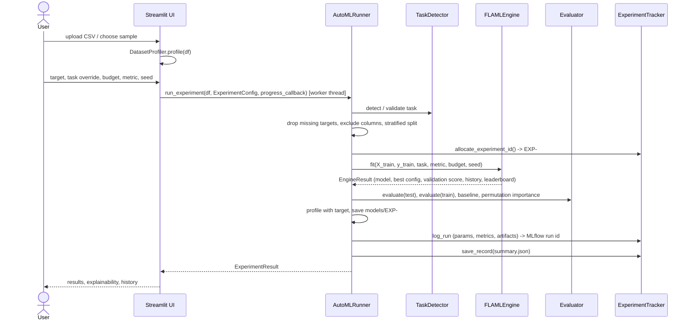

# Architecture

This document describes the **current baseline** (Phase 1) as implemented, and marks where the **planned** autonomous components will plug in. Planned components do not exist in the code yet.

## 1. Layers

```text
┌──────────────────────────────────────────────────────────────┐
│ UI (Streamlit)            app/main.py, app/components/*      │  input + rendering only
├──────────────────────────────────────────────────────────────┤
│ Services                  app/services/*                     │  all business logic
│   profiler · task_detector · automl_runner · evaluator ·     │
│   experiment_tracker                                         │
├──────────────────────────────────────────────────────────────┤
│ Core                      app/core/config.py, logging_config │  settings, logging
├──────────────────────────────────────────────────────────────┤
│ External libraries        FLAML · scikit-learn · MLflow ·    │  used unmodified
│                           pandas · Plotly                    │
├──────────────────────────────────────────────────────────────┤
│ Local storage             experiments/ · models/ · mlruns/   │  no cloud, no server
└──────────────────────────────────────────────────────────────┘
```

Rules the code follows:

- Services never import Streamlit. Every service can be used from a script, a notebook or tests.
- FLAML is only referenced inside `FLAMLEngine` (`app/services/automl_runner.py`). The rest of the application sees engine-neutral types (`EngineResult`, `ExperimentResult`).
- MLflow is only referenced inside `ExperimentTracker` (`app/services/experiment_tracker.py`).

## 2. Important classes

| Class | File | Responsibility |
|---|---|---|
| `Settings`, `get_settings()` | `core/config.py` | Paths, MLflow URI, defaults; reads `AUTOPILOT_*` variables / `.env` |
| `DatasetProfiler` → `DatasetProfile` | `services/profiler.py` | Structured profile, quality flags, class balance, `meta_features()` |
| `analyze_class_balance` → `ClassBalance` | `services/profiler.py` | Majority/minority shares, imbalance ratio, severity |
| `TaskDetector` → `TaskDetectionResult` | `services/task_detector.py` | Task detection, override validation, target candidates, default target hook |
| `TaskType` | `services/task_detector.py` | `binary`, `multiclass`, `regression` |
| `Evaluator` → `EvaluationResult` | `services/evaluator.py` | Metrics, confusion matrix, baseline scores, permutation importance |
| `METRICS`, `PRIMARY_METRICS` | `services/evaluator.py` | Metric registry and which metrics can be optimised per task |
| `ExperimentConfig` | `services/automl_runner.py` | Everything needed to reproduce one experiment |
| `AutoMLEngine` (Protocol), `FLAMLEngine` → `EngineResult` | `services/automl_runner.py` | Pluggable AutoML backend |
| `AutoMLRunner` → `ExperimentResult` | `services/automl_runner.py` | Orchestrates one experiment end to end |
| `ExperimentTracker` | `services/experiment_tracker.py` | MLflow runs + JSON index, experiment ids, history table |

## 3. Execution flow of one experiment



Notes:

- The test split is created **before** FLAML sees any data and is only used once, for the final evaluation. FLAML's own validation (cross-validation for small data, holdout for larger data, chosen by FLAML) runs on the training split. Both numbers are shown and labelled separately.
- The UI runs the experiment in a background thread and polls its progress, so the page stays responsive and survives Streamlit reruns. Progress during the search is estimated from elapsed time versus the budget because FLAML exposes no per-trial callback.
- Failed runs write `experiments/EXP-###/error.json` and are not listed as completed experiments.

## 4. Data contracts

`ExperimentConfig` (input):

```text
target_column, task_type (None = detect), primary_metric (None = task default),
time_budget, random_seed, test_size, excluded_columns, estimator_list (None = engine default),
dataset_name, n_jobs
```

`ExperimentResult` (output, JSON summary in `summary.json`):

```text
experiment_id, created_at, dataset_name, target_column, task_type, primary_metric,
time_budget, random_seed, test_size, engine, engine_version, n_train, n_test,
feature_columns, excluded_columns, best_estimator, best_model_name, best_config,
best_validation_score, validation_method, test_score, train_score,
test_metrics, train_metrics, baseline_metrics, training_time, total_time, n_trials,
leaderboard, feature_importance, native_feature_importance,
dataset_meta_features, warnings, model_path, artifact_dir, mlflow_run_id, status
```

In memory only (for plots): `search_history`, `test_evaluation` (true/predicted values, probabilities), `profile`.

Metric conventions: all reported scores are in the metric's natural units. FLAML minimises a loss; `FLAMLEngine` converts it back (`score = 1 − loss` for maximised metrics such as F1, ROC-AUC, accuracy, R²; `score = loss` for MAE, MSE, RMSE, log loss). For binary tasks the positive class is the last label in sorted order (the same convention FLAML's label encoder uses); multiclass precision/recall/F1/ROC-AUC are macro-averaged.

## 5. Storage layout

```text
experiments/EXP-001/
    summary.json                 # engine-independent record (drives the history table)
    profile.json                 # DatasetProfile with target
    evaluation.json              # test metrics, confusion matrix, per-class report, train + baseline metrics
    leaderboard.csv              # best validation score per model family
    search_history.csv           # every FLAML trial
    feature_importance.csv       # permutation importance
    native_feature_importance.csv
    predictions.csv              # test-set predictions (and probabilities / residuals)
    flaml_search.log             # raw FLAML log
models/EXP-001/model.pkl         # {"model", "feature_columns", "target_column", "task_type", "classes", ...}
mlruns/mlflow.db                 # MLflow SQLite backend
mlruns/artifacts/<run>/          # MLflow copies of the model and the files above
```

All three folders are git-ignored.

## 6. Where future components plug in (Planned)

| Planned module | Plugs in at | Consumes | Produces |
|---|---|---|---|
| `experiment_planner.py` | Before `AutoMLRunner.run_experiment` | `DatasetProfile`, memory, remaining budget | `ExperimentConfig` (the runner already accepts it) |
| `critic.py` | After `ExperimentResult` is produced | train vs test metrics, class balance, profile flags, leaderboard, timing | structured diagnoses, e.g. `{"overfitting": "high", "imbalance": "severe"}` |
| `strategy_engine.py` | Between critic and planner | diagnoses, memory statistics | ranked strategies mapped to config changes (`excluded_columns`, `estimator_list`, metric, resampling, class weights) |
| `experiment_memory.py` | Reads/writes the `experiments/` index | `dataset_meta_features`, config, result, cost | similarity-based retrieval of strategies that helped on similar datasets |
| `resource_manager.py` | Wraps the planner loop | user budget (time, experiments, CPU) | per-experiment budgets, stop decisions, utility accounting |
| `AutoGluonEngine` (baseline) | Implements `AutoMLEngine` | same as `FLAMLEngine` | `EngineResult` |

The baseline already records what these modules need: train and test metrics for overfitting diagnosis, class balance and column flags for data diagnoses, per-model leaderboards and trial histories for search behaviour, wall-clock times for cost, and meta-features for dataset similarity.

## 7. Design decisions

| Decision | Reason |
|---|---|
| Hold-out test split outside FLAML | Unbiased final score; FLAML's internal validation score alone is optimistically biased by the search |
| Engine interface around FLAML | Keeps FLAML replaceable and enables the AutoGluon baseline required by the research plan |
| `MlflowClient` instead of MLflow's global "active run" API | Explicit run ids, safe from a background thread, no hidden global state |
| SQLite MLflow backend | Current MLflow defaults to a database backend; SQLite needs no server |
| JSON index next to MLflow | Small, readable, engine-independent records for the future experiment memory |
| Permutation importance as the default explanation | Model-agnostic, works on raw columns for every FLAML learner; SHAP deferred until it is needed |
| Rule-based task detection with override | Transparent and testable; ambiguous cases (integer codes) are reported with lower confidence |
