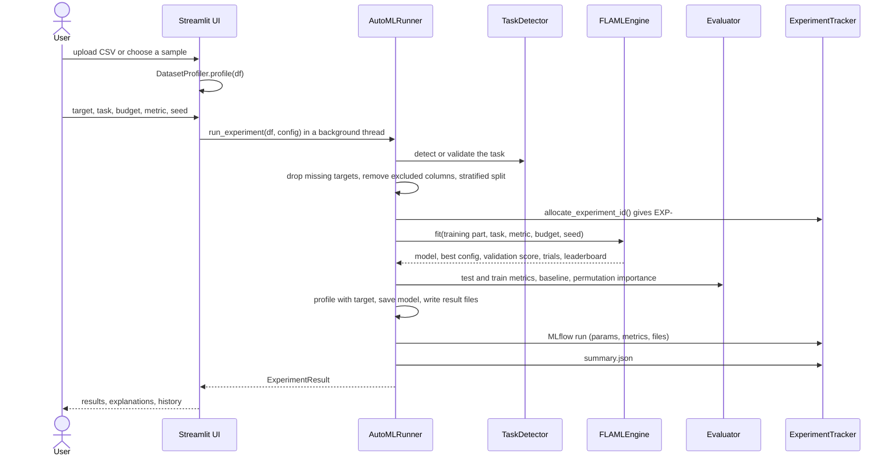

# Architecture

This page describes the code as it is now (the Phase 1 baseline) and shows where the planned autonomous parts will connect. The planned parts do not exist in the code yet.

## Layers

```text
UI (Streamlit)        app/main.py, app/components/      collects input, shows results
Services              app/services/                     all the logic
Core                  app/core/                         settings (.env) and logging
External libraries    FLAML, scikit-learn, MLflow,      used as normal dependencies,
                      pandas, Plotly                    never modified
Local storage         experiments/, models/, mlruns/    no cloud, no server
```

We stick to three rules:

- Services never import Streamlit. Everything in `app/services/` can be used from a script, a notebook or a test.
- FLAML is only used inside `FLAMLEngine` in `automl_runner.py`. The rest of the code works with our own result types (`EngineResult`, `ExperimentResult`), so another engine can be added without touching the UI.
- MLflow is only used inside `ExperimentTracker`.

## Main classes

- `Settings` / `get_settings()` (`core/config.py`): paths, MLflow location and default values. Reads `AUTOPILOT_*` environment variables or a `.env` file.
- `DatasetProfiler` → `DatasetProfile` (`services/profiler.py`): the dataset profile, quality flags, class balance and meta-features.
- `analyze_class_balance` → `ClassBalance` (`services/profiler.py`): majority and minority share, imbalance ratio and severity.
- `TaskDetector` → `TaskDetectionResult` (`services/task_detector.py`): task detection, checking overrides, describing target candidates, and the default target suggestion.
- `TaskType` (`services/task_detector.py`): `binary`, `multiclass` or `regression`.
- `Evaluator` → `EvaluationResult` (`services/evaluator.py`): metrics, confusion matrix, trivial baseline and permutation importance.
- `METRICS`, `PRIMARY_METRICS` (`services/evaluator.py`): every metric we know about, and which ones can be optimised for each task.
- `ExperimentConfig` (`services/automl_runner.py`): everything needed to repeat an experiment. The planned planner will produce these.
- `AutoMLEngine`, `FLAMLEngine` → `EngineResult` (`services/automl_runner.py`): the engine interface and its FLAML implementation.
- `AutoMLRunner` → `ExperimentResult` (`services/automl_runner.py`): runs one experiment from start to finish.
- `ExperimentTracker` (`services/experiment_tracker.py`): MLflow runs, JSON records, experiment IDs and the history table.

## What happens during one experiment



A few things worth knowing:

- The test split is made before FLAML sees any data, and it is used once, at the end. FLAML does its own validation on the training part (cross-validation for small data, holdout for larger data, chosen by FLAML). The app shows both numbers and labels them separately.
- The UI runs the experiment in a background thread and keeps the thread in the Streamlit session. If the page reruns during an experiment, the progress bar simply picks up again. FLAML gives no progress updates during its search, so the bar is estimated from elapsed time against the budget.
- A failed experiment writes `experiments/EXP-###/error.json` and does not appear in the history as completed.
- FLAML prints a warning on every prediction when a column has categories it never saw during training. During permutation importance that happens dozens of times, so we silence that one message and add a single note per column to the experiment instead.

## Data passed around

`ExperimentConfig` (input): `target_column`, `task_type` (None means detect it), `primary_metric` (None means the default for the task), `time_budget`, `random_seed`, `test_size`, `excluded_columns`, `estimator_list` (None means the engine decides), `dataset_name`, `n_jobs`.

`ExperimentResult` (output, saved as `summary.json`): the ID and time; the dataset, target, task and metric; the budget, seed and test size; the engine and its version; the train/test sizes and feature columns; the best estimator and its configuration; the validation, test and train scores; the full test, train and baseline metrics; the timings and number of trials; the leaderboard; the feature importances; the dataset meta-features; the warnings; the model path, the result folder and the MLflow run ID.

Kept in memory only, for the charts: the trial history, the test predictions and probabilities, and the full dataset profile.

Score conventions: every score is in the metric's normal units. FLAML minimises a loss, so `FLAMLEngine` converts it back (score = 1 − loss for F1, ROC-AUC, accuracy and R²; score = loss for MAE, MSE, RMSE and log loss). In binary problems the positive class is the last label in sorted order, the same as FLAML's label encoder. Multiclass precision, recall, F1 and ROC-AUC are macro averages.

## Files on disk

```text
experiments/EXP-001/
    summary.json                   the record the history table reads
    profile.json                   dataset profile including the target
    evaluation.json                test metrics, confusion matrix, per-class report, train and baseline metrics
    leaderboard.csv                best validation score per model family
    search_history.csv             every FLAML trial
    feature_importance.csv         permutation importance
    native_feature_importance.csv  the model's own importance (if it has one)
    predictions.csv                test predictions (with probabilities or residuals)
    flaml_search.log               FLAML's raw log
models/EXP-001/model.pkl           model + feature columns + target + task + classes
mlruns/mlflow.db                   MLflow database (SQLite)
mlruns/artifacts/                  MLflow copies of the model and the files above
```

These three folders are generated and are not committed to git.

## Where the planned parts connect

- `experiment_planner.py` comes before `AutoMLRunner.run_experiment`. It reads the profile, the memory and the remaining budget, and outputs an `ExperimentConfig`, which the runner already accepts.
- `critic.py` comes after each `ExperimentResult`. It reads the train vs test metrics, class balance, column flags, unseen-category notes, leaderboard and timings, and outputs structured diagnoses such as `{"overfitting": "high", "imbalance": "severe"}`.
- `strategy_engine.py` sits between the critic and the planner. It turns diagnoses (plus memory statistics) into ranked strategies, and each strategy is a change to the config: excluded columns, model list, metric, resampling, class weights.
- `experiment_memory.py` reads and writes the `experiments/` records. It stores meta-features, config, result and cost, and finds strategies that helped on similar datasets.
- `resource_manager.py` wraps the planner loop. It takes the user's budget (time, experiments, CPU), and decides per-experiment budgets, when to stop, and how much each experiment was worth.
- `AutoGluonEngine` will implement `AutoMLEngine` and return an `EngineResult` like `FLAMLEngine` does.

Most of what these modules need is already recorded by the baseline: train and test metrics for overfitting, class balance and column flags for data problems, leaderboards and trial histories for search behaviour, timings for cost, and meta-features for comparing datasets.

## Why it is built this way

- **Test split outside FLAML:** FLAML's validation score is the number it optimised, so it is a bit optimistic. A separate test set gives an honest final score.
- **Engine interface around FLAML:** FLAML can be replaced, and AutoGluon is needed later as a comparison.
- **`MlflowClient` instead of MLflow's global "active run":** run IDs are explicit, there is no hidden global state, and it works from a background thread.
- **SQLite for MLflow:** recent MLflow versions default to a database backend, and SQLite needs no server.
- **JSON records next to MLflow:** small, readable and independent of the engine, which is what the experiment memory needs.
- **Permutation importance first:** it works on the original columns for every model FLAML can return. SHAP can be added when it is actually needed.
- **Rule-based task detection with an override:** easy to explain and to test. Unclear cases, such as integer codes, are reported with lower confidence.
