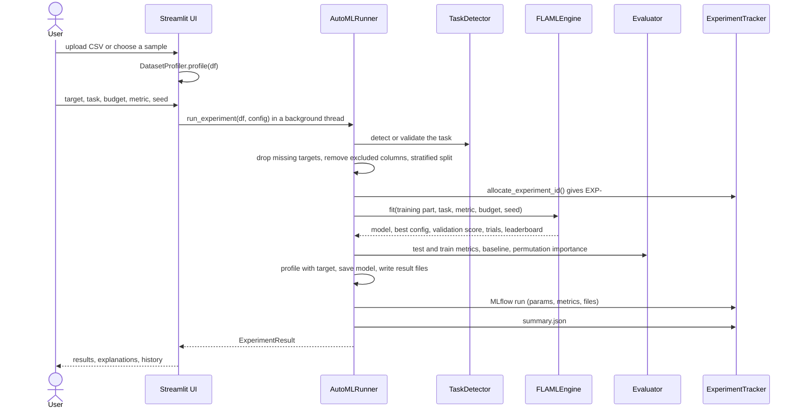
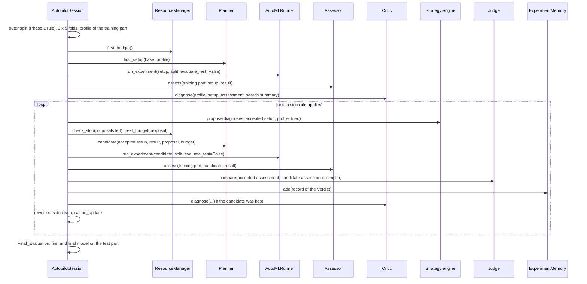

# Architecture

This page describes the code as it is now: the Phase 1 baseline (one experiment), the Phase 2 autonomous layer (a Session of experiments), the Phase 3 parts (learned strategy choice, ablation switches, comparison systems, the benchmark harness with its statistics and analysis, the frozen memory build and the judge agreement study) and the optional extensions built from 1 to 12 November 2026 (tasks 29 to 35: SMOTE, target encoding and word features, group-aware splits, SHAP, target suggestion and a leakage check, local language-model summaries, an HTTP API and a Docker image). The benchmark was stopped after 33 of its 390 cells, and the judge agreement study ran on 20 pairs; the results are in the report notes (sections 9.16 to 9.18). Both ran before the optional extensions, and a second, full benchmark run with the final code is planned but has not been run. For a plain-language walkthrough of the same system and of how FLAML works inside it, see [how-it-works.md](how-it-works.md); the full design and the code shapes are in the spec's `design.md`.
 
## Layers

```text
UI (Streamlit)        app/main.py, app/components/      collects input, shows results
HTTP API (FastAPI)    app/api.py                        starts and reads Sessions; 127.0.0.1, no login
Services              app/services/                     all the logic
Core                  app/core/                         settings (.env) and logging
External libraries    FLAML, scikit-learn, MLflow,      used as normal dependencies,
                      pandas, Plotly, imbalanced-learn, never modified
                      shap, FastAPI, uvicorn
Local language model  Ollama (optional, same machine)   only writes labelled Session summaries
Local storage         experiments/, models/, mlruns/    no cloud, no server
Research code         research/, scripts/, results/     studies and measurements; the app never imports it
```

We stick to three rules:

- Services never import Streamlit. Everything in `app/services/` can be used from a script, a notebook, a test or the HTTP API.
- FLAML is only used inside `FLAMLEngine` in `automl_runner.py`. The rest of the code works with our own result types (`EngineResult`, `ExperimentResult`), so another engine can be added without touching the UI.
- MLflow is only used inside `ExperimentTracker`.

## Main classes

- `Settings` / `get_settings()` (`core/config.py`): paths, MLflow location and default values. Reads `AUTOPILOT_*` environment variables or a `.env` file.
- `DatasetProfiler` → `DatasetProfile` (`services/profiler.py`): the dataset profile, quality flags, class balance and meta-features; since the optional tasks also `frequent_words` (task 30) and, when asked (`check_leakage=True`), `single_column_scores` and `single_column_metric` (task 33).
- `analyze_class_balance` → `ClassBalance` (`services/profiler.py`): majority and minority share, imbalance ratio and severity.
- `TaskDetector` → `TaskDetectionResult` (`services/task_detector.py`): task detection, checking overrides, describing target candidates, and the target suggestion: `suggest_targets` → `TargetSuggestion`s (column, score, task, reasons; optional task 33), and `suggest_target`, the first of them, as the default.
- `TaskType` (`services/task_detector.py`): `binary`, `multiclass` or `regression`.
- `Evaluator` → `EvaluationResult` (`services/evaluator.py`): metrics, confusion matrix, trivial baseline and permutation importance.
- `METRICS`, `PRIMARY_METRICS` (`services/evaluator.py`): every metric we know about, and which ones can be optimised for each task.
- `ExperimentConfig` (`services/automl_runner.py`): everything needed to repeat an experiment. In a Session the Planner produces these.
- `AutoMLEngine`, `FLAMLEngine` → `EngineResult` (`services/automl_runner.py`): the engine interface and its FLAML implementation.
- `AutoMLRunner` → `ExperimentResult` (`services/automl_runner.py`): runs one experiment from start to finish.
- `ExperimentTracker` (`services/experiment_tracker.py`): MLflow runs, JSON records, experiment and Session IDs, the history tables, and atomic writes of `session.json` and the step files.

Autonomous layer (Phase 2):

- `AutopilotSession` → `SessionResult` (`services/autopilot.py`): runs a Session; `SessionSettings` (base Setup, `SessionBudget`, 5 folds x 3 repeats, `JudgeSettings`, thresholds file, selector) and `SessionStep` (one per Experiment). `run(df, settings, progress, stop_requested, on_update)`.
- `make_outer_split` → `OuterSplit`, `make_session_folds` → `SessionFolds` (`services/splits.py`): the Phase 1 split and the fixed folds, each with a fingerprint. With `groups` (optional task 31, from `SessionSettings.group_column` through `group_codes`) both keep each group on one side and record `grouped`; without it nothing changes, fingerprints included.
- `Planner` (`services/experiment_planner.py`): `first_setup`, `candidate`, `safe_exclusions`.
- `Assessor` → `Assessment` of `FoldScore`s (`services/assessor.py`): refits on the folds, with a cache per Setup and configuration.
- `summarize_search` → `SearchSummary` (`services/search_summary.py`): search time, time to the best trial, share after it, gain in the last quarter.
- `Critic` → `Diagnosis` (`services/critic.py`), with `CriticThresholds` read from `critic_thresholds.toml` (`tomllib`). `DiagnosisKind` has 14 kinds; `unused_words` (optional task 30) reads no threshold from the file, and `possible_leakage` (optional task 33) has an optional threshold with a default of 0.99, so the frozen thresholds file stayed as it was.
- `StrategySpec`, `Strategy` and `CATALOGUE` (12 Strategies, `services/strategies.py`); `propose` → `Proposal`, `RulesSelector` (`services/strategy_engine.py`). The rows added by the optional tasks come after the earlier candidates of each diagnosis kind, so their positions did not change.
- `DataStepSpec`, `DataPipeline`, `PipelineModel` (`services/transforms.py`): the data changes and the model wrapper that applies them to raw rows. Optional task 30 added the kinds `target_encode` (the only step that reads the target; `fit_transform` gives cross-fitted encodings of the fitted rows, `transform` the encodings learned from all of them, so the runner and the Assessor train on `fit_transform`) and `token_features` (with `frequent_tokens`).
- `FoldSafeSmote`, `make_resampler` (`services/resampling.py`, optional task 29): SMOTE, SMOTE-NC or SMOTE-N, chosen by the columns FLAML hands the resampler.
- `Judge` → `JudgeDecision`, `JudgeSettings`, `corrected_resampled_t` (`services/judge.py`).
- `ResourceManager`, `SessionBudget`, `StepCost`, `StopReason` (`services/resource_manager.py`).
- `ExperimentMemory`, `MemoryRecord`, `StrategyStats`, `dataset_fingerprint` (`services/experiment_memory.py`).
- `FLAMLEngine.fit_config` refits one fixed configuration, and `fit` accepts `starting_points`, `search_space_limits`, `sample_weight` and `max_iter` (all FLAML's public options; FLAML is not changed); since optional task 29 both also accept `resampler`, passed only when set.

Optional extensions outside the loop (tasks 32, 34 and 35):

- `explain`, `explain_session` → `ShapExplanation` (`services/explainer.py`, task 32): SHAP values of a Session's final model on at most 200 rows of its rebuilt training part; the split is rebuilt from the recorded settings and refused if its fingerprint differs. shap is imported inside `explain`, so the rest of the app does not load it.
- `session_facts`, `narrate` → `Narration`, `unsupported_numbers`, `save` (`services/narrator.py`, task 34): the facts of a Session record, the request to a local Ollama server (other addresses are refused), the numbers not in the facts, and `summary_generated.json`. No decision module imports it.
- `create_app`, `SessionRequest`, `dataset_path` (`app/api.py`, task 35): the FastAPI app around `AutopilotSession`, one Session at a time in a background thread; `uvicorn app.api:app` builds the default app on first use, so importing the module creates no folders.

## What happens during one experiment



A few things worth knowing:

- The test split is made before FLAML sees any data, and it is used once, at the end. FLAML does its own validation on the training part (cross-validation for small data, holdout for larger data, chosen by FLAML). The app shows both numbers and labels them separately.
- The UI runs the experiment in a background thread and keeps the thread in the Streamlit session. If the page reruns during an experiment, the progress bar simply picks up again. FLAML gives no progress updates during its search, so the bar is estimated from elapsed time against the budget.
- A failed experiment writes `experiments/EXP-###/error.json` and does not appear in the history as completed.
- FLAML prints a warning on every prediction when a column has categories it never saw during training. During permutation importance that happens dozens of times, so we silence that one message and add a single note per column to the experiment instead.

## Data passed around

`ExperimentConfig` (input): `target_column`, `task_type` (None means detect it), `primary_metric` (None means the default for the task), `time_budget`, `random_seed`, `test_size`, `excluded_columns`, `estimator_list` (None means the engine decides), `dataset_name`, `n_jobs`. Phase 2 added the Setup fields `data_steps`, `class_weight`, `search_metric`, `search_space_limits` and `starting_points` (and `max_iter`, for tests), and optional task 29 added `resampler` (`"smote"` or None; the setup key holds it only when set, so earlier Setups keep their keys); with their defaults the runner behaves exactly as in Phase 1. A Setup's identity is its `setup_key`, a hash of the fields that change what is learned; the time budget, the trial limit, the starting points, the dataset name and the CPU cores are left out.

Phase 2 records: `ExperimentResult` gained `schema_version` 2, `search_metric`, `test_evaluated`, `best_config_per_estimator`, `search_summary`, `session_id`, `parent_experiment_id`, `proposal`, `setup_key`, `setup` and `profile_rows`; Phase 1 records still load. A Session step holds the Proposal, the Diagnoses it answered, the brief Assessment (mean and spread of the primary metric over the folds), the Judge's decision and the `StepCost` (budget, search, Assessment and other seconds, overrun, utility).

`ExperimentResult` (output, saved as `summary.json`): the ID and time; the dataset, target, task and metric; the budget, seed and test size; the engine and its version; the train/test sizes and feature columns; the best estimator and its configuration; the validation, test and train scores; the full test, train and baseline metrics; the timings and number of trials; the leaderboard; the feature importances; the dataset meta-features; the warnings; the model path, the result folder and the MLflow run ID.

Kept in memory only, for the charts: the trial history, the test predictions and probabilities, and the full dataset profile.

Score conventions: every score is in the metric's normal units. FLAML minimises a loss, so `FLAMLEngine` converts it back (score = 1 − loss for F1, ROC-AUC, accuracy and R²; score = loss for MAE, MSE, RMSE and log loss). In binary problems the positive class is the last label in sorted order, the same as FLAML's label encoder. Multiclass precision, recall, F1 and ROC-AUC are macro averages.

## Files on disk

```text
experiments/EXP-001/
    summary.json                   the record the history table reads
    profile.json                   dataset profile including the target
    evaluation.json                test metrics, confusion matrix, per-class report, train and baseline metrics
    leaderboard.csv                best validation score per model family
    search_history.csv             every FLAML trial
    feature_importance.csv         permutation importance
    native_feature_importance.csv  the model's own importance (if it has one)
    predictions.csv                test predictions (with probabilities or residuals)
    flaml_search.log               FLAML's raw log
models/EXP-001/model.pkl           model + feature columns + target + task + classes
mlruns/mlflow.db                   MLflow database (SQLite)
mlruns/artifacts/                  MLflow copies of the model and the files above
```

These three folders are generated and are not committed to git.

## What happens during one Session



- Every Experiment of a Session runs with `evaluate_test=False`, `compute_importance=False` and `profile_rows="train"`; the Session raises an error if a result says the test part was used.
- A failed candidate (search, Assessment or Judge) is recorded as a discard and the loop goes on; a failed first Experiment ends the Session with status "failed" and stop reason "error".
- Settings errors (bad selector, folds, thresholds file, group column, data) are raised before any file is written.

## Files of a Session

```text
experiments/SES-002/session.json        settings, code version, split and fold fingerprints, every step
                                        (proposal, Diagnoses, brief Assessment, decision, cost),
                                        stop reason and Final_Evaluation; rewritten after every step
experiments/SES-002/train_profile.json  the training-part profile behind the Diagnoses
experiments/SES-002/shap_summary.json   SHAP summary of the final model (scripts/explain_session.py)
experiments/SES-002/summary_generated.json  plain-language summary by a local model, labelled
                                        as generated text, with its facts; read by no decision
experiments/EXP-0xx/                    each Experiment's usual files (no test files), plus
    assessment.json                     every fold score
    diagnoses.json                      the Diagnoses of a kept Setup
    decision.json                       the Judge's numbers and reason
experiments/memory/memory.jsonl         one record per Verdict, append-only
experiments/studies/                    saved inputs of the critic study (for replay)
experiments/benchmark/, models/benchmark/   the benchmark's Sessions, Experiments and models
                                        (benchmark-smoke/ for the smoke setting), MLflow off
experiments/benchmark-memory/           the 30 Sessions that built the frozen memory, and its log
experiments/studies/judge_agreement/    the judge agreement study's searches
results/studies/, results/phase2/       summary CSV files (in git)
results/benchmark/benchmark_cells.csv   one row per finished benchmark cell (in git)
results/benchmark/excluded_cells.csv    rows that must not be scored, with the reason (in git)
results/benchmark/frozen_memory.jsonl   the frozen memory the benchmark reads (in git), with
                                        frozen_memory_summary.csv and memory_sessions.csv
results/studies/judge_agreement_*.csv   the judge agreement study's rows and summaries (in git)
results/leakage_check.csv               the single-column leakage check on all 16 datasets (in git)
experiments/benchmark-v2*/, models/benchmark-v2*/, results/benchmark-v2/
                                        a later run with --label v2 (planned, not run yet)
```

## Phase 3: built so far and planned

- Built (task 20): `research/datasets.py` and `research/datasets.json`, the fixed development and evaluation datasets.
- Built (task 21): `RandomSelector`, `ThompsonSelector` and `UCB1Selector` next to `RulesSelector` (`services/strategy_engine.py`), with `SelectionContext(memory, meta_features, task_type, fingerprint, rng)`; they read `ExperimentMemory.strategy_stats` for the nearest past datasets when `SessionSettings.use_memory` is on, and each step records its `selection`.
- Built (task 22): ablation switches in `SessionSettings`: `selector="random"`, `use_critic=False` (no Diagnoses; `random_proposals` picks random valid changes) and `use_resource_manager=False` (`EqualShareManager` in `services/resource_manager.py`: equal shares, no reserve, only the time and Experiment limits stop), next to `use_memory`; each is recorded in `session.json` and has a command-line flag.
- Built (task 23): `research/systems.py`. `Problem` is one benchmark cell and `prepare(problem, settings)` gives every system the same `Prepared` split and columns; `ManualSystem` (LightGBM defaults through `fit_config`), `FlamlSystem` (`AutoMLRunner` with the whole budget), `AutoGluonSystem` (runs `research/autogluon_worker.py` in the conda environment `autogluon` as a separate process and scores its predictions with the shared `Evaluator`) and `AutopilotSystem` (a Session with the settings of `AUTOPILOT_VARIANTS` and a read-only memory) each return a `SystemResult`, and a failure is a result, not an exception.
- Built (task 24): `research/benchmark.py`. `grid` and `smoke_grid` make the `Cell`s (system, dataset, budget, seed); `run` appends one row per finished cell to `results/benchmark/benchmark_cells.csv`, skips cells that have a row, and checks the frozen memory's hash; `preflight` checks the datasets, the AutoGluon Python and the memory's sources before a run; `read_cells`, `latest` and `timing` read the rows back. `scripts/run_benchmark.py run | status [--smoke]` is the command line.
- Built (task 25): `research/stat_tests.py`, the benchmark statistics: `friedman` (with Iman and Davenport's F), `nemenyi_cd` and `cliques` (the bars of a critical-difference diagram), `compare_pairs` (Wilcoxon with Holm's correction, rank-biserial correlation, bootstrap interval of the median difference) and `time_to_target`. It is not called `statistics.py`: the AutoGluon worker runs as a script from `research/`, and a `statistics.py` there would hide Python's own module from it.
- Built (task 26): `research/memory_build.py` with `scripts/build_memory.py run | status | freeze` builds the frozen memory (30 Sessions on the development datasets in a random order; only finished Sessions' records are copied to `results/benchmark/frozen_memory.jsonl`, which is never rewritten). `research/benchmark_analysis.py` with `scripts/run_benchmark.py analyse` turns the rows into the tests, per-dataset tables, time-to-target and charts; it compares systems only on the (dataset, seed) blocks where all of them completed.
- Built (task 27): `research/judge_agreement.py` with `scripts/run_study.py agreement run | analyse`: the judged steps of the memory-build Sessions, each compared again with new FLAML searches on 5 inner splits of the Session's training part and the Judge's own rules; agreement, Cohen's kappa and the cost ratio.
- Changed on 31 October 2026, after reading the results: `Judge.compare` treats a mean difference within `REPEAT_TOLERANCE` as 0; `Assessor.refit_key(columns, config, estimator, best_config)` replaces the cache key, so identical refits reuse their fold scores (`Assessment.reused_from`); `SelectionContext.min_datasets` (2) and `StrategyStats.datasets` keep an arm seen on one dataset in rule order, and `MemoryRecord.counts_as_kept` leaves out kept steps that changed no fold score; the benchmark and the judge agreement study wait while the laptop is on battery and exclude a cell or pair that ends on battery (`results/benchmark/excluded_cells.csv`, status `excluded`).
- Built on 12 November 2026, for the second, full run with the final code: a run label, `benchmark.folders(root, smoke, label)`, `memory_build.folders(root, label)` and `--label` in `scripts/run_benchmark.py` and `scripts/build_memory.py`. With `--label v2` every `benchmark` folder name becomes `benchmark-v2`, so the run can never touch the first run's rows or its frozen memory.
- Planned: that second, full run. It has not been run yet.

## Optional extensions (tasks 29 to 35): where they plug in

- Inside a Session (tasks 29 to 31). The `smote` Strategy sets `ExperimentConfig.resampler`; the runner passes it to FLAML, which resamples the training rows of each search fold and of the final model, and the Assessor gives it to every refit, so validation rows are never resampled. `target_encode` and `token_features` are Data_Steps: the runner and the Assessor train on `fit_transform` and score other rows with `transform`. `Critic.diagnose(..., restorable=...)` gets the columns the first Setup left out by itself (`Planner.safe_exclusions`, recorded as `first_setup_exclusions`), so `unused_words` can bring back a column such as Titanic's `Name` with only its words, never one the user excluded. `SessionSettings.group_column` is added to the exclusions and its values go to both splits as `groups`; the choice is recorded in `session.json` and MLflow.
- Before and after a Session (tasks 32 to 34). The leakage scores are computed for the dashboard's target profile and the Session's training-part profile only; the runner's profile of every Experiment does not ask for them, so nothing else gets slower. The SHAP explanation (from the record, the saved final model and the dataset) and the plain-language summary (from the record only) run on request after a Session. The summary is saved in `summary_generated.json` and `scripts/explain_session.py` writes `shap_summary.json`, both next to `session.json`, which neither changes; no decision module reads these files.
- As a service (task 35). `app/api.py` runs the same `AutopilotSession` as the dashboard. It accepts only CSV files inside `data/` (checked before anything runs) and session IDs of the form `SES-001`. The Docker image (`Dockerfile`, Python 3.11 slim) runs `scripts/docker_entry.sh`, which starts the API on port 8000 and the dashboard on 8501, both on 0.0.0.0 inside the container (the only way to reach them through published ports), so the ports must be published on 127.0.0.1 only. Its health check calls `/health`, its processes run as a non-root user, and `experiments/`, `models/` and `mlruns/` are volumes. `.gitattributes` keeps LF line endings for the entry script and the Dockerfile, which run under Linux.

## Why it is built this way

- **Test split outside FLAML:** FLAML's validation score is the number it optimised, so it is a bit optimistic. A separate test set gives an honest final score.
- **Engine interface around FLAML:** FLAML can be replaced. (The benchmark runs AutoGluon as a separate comparison system in its own environment, not through this interface.)
- **`MlflowClient` instead of MLflow's global "active run":** run IDs are explicit, there is no hidden global state, and it works from a background thread.
- **SQLite for MLflow:** recent MLflow versions default to a database backend, and SQLite needs no server.
- **JSON records next to MLflow:** small, readable and independent of the engine, which is what the experiment memory needs.
- **Permutation importance first:** it works on the original columns for every model FLAML can return. SHAP was added later (optional task 32) for a Session's final model only, on training-part rows, and it explains the learner's own inputs after the Data_Steps and FLAML's preparation.
- **Rule-based task detection with an override:** easy to explain and to test. Unclear cases, such as integer codes, are reported with lower confidence. The target suggestion (optional task 33) follows the same idea: points for simple signals, shown with their reasons, and the user confirms.
- **SMOTE through FLAML's resampler, target encoding cross-fitted:** FLAML applies the resampler to training rows only (checked in task 1), so validation rows are scored as they are; cross-fitting keeps a row's own label out of its encoding, so the model cannot learn the answer from the encoding (target leakage).
- **The leakage check only warns:** only the user knows whether a column is known before the outcome, so no Strategy answers `possible_leakage`.
- **The language model outside the decisions:** it writes labelled text from the saved record, on this machine only, and nothing in the loop reads it, so every decision stays a measurable rule or statistic.
- **API on 127.0.0.1 without a login:** a single-user local service, like the dashboard. The checks on datasets and session IDs keep a request from reaching files outside `data/` and the Session folders, and the request fields have ranges.
- **Assessments on fixed folds instead of FLAML's validation score:** FLAML's score is optimistic and comes from its own folds, so two searches cannot be compared fairly with it; refits on the same 15 folds can, fold by fold.
- **Search once, judge cheaply:** each Setup gets one search; the Judge compares refits, not repeated searches, so judging fits inside the loop's budget.
- **Decisions as pure functions of saved records:** the Critic, the Strategy engine and the Judge only read their inputs, which are saved, so every Diagnosis and Verdict can be replayed and tested.
- **Thresholds in a versioned file:** the Critic's numbers can be tuned by a study and frozen under a label without changing code.
- **The test part read once, at the end:** decisions use only the training part, so the final scores are not chosen by the test rows they are measured on.
