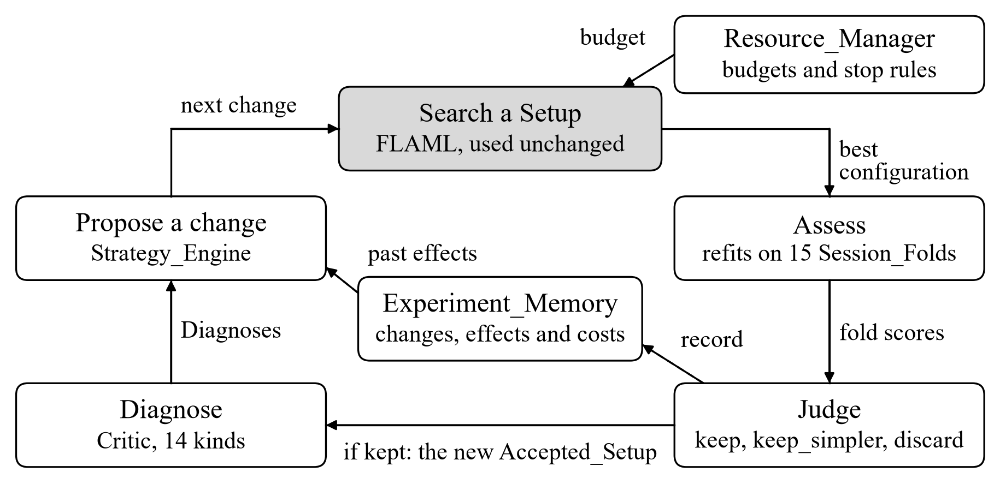
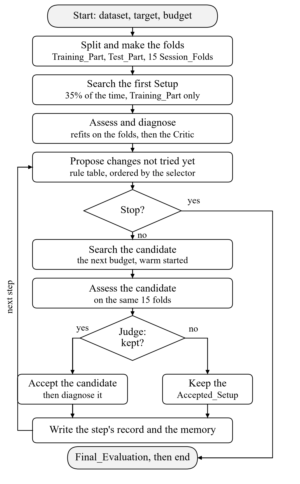
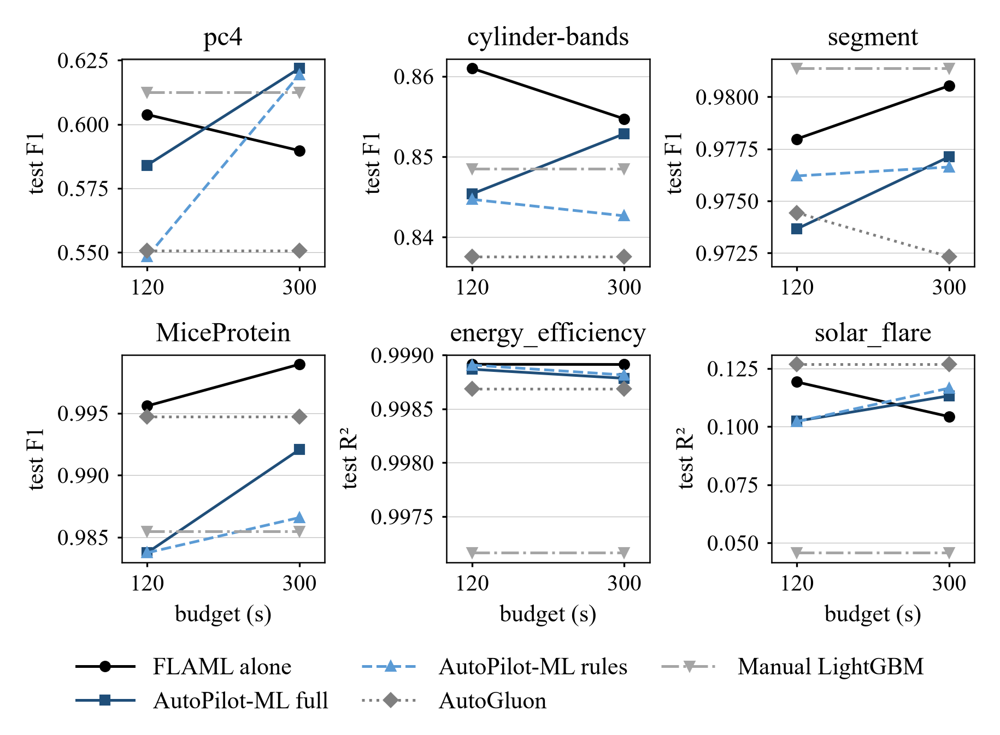
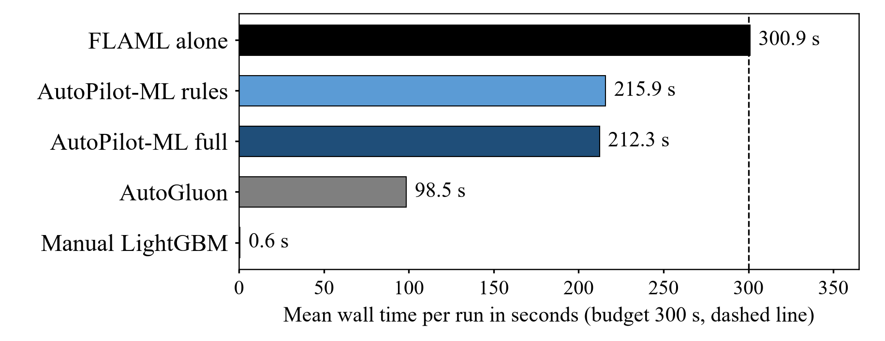
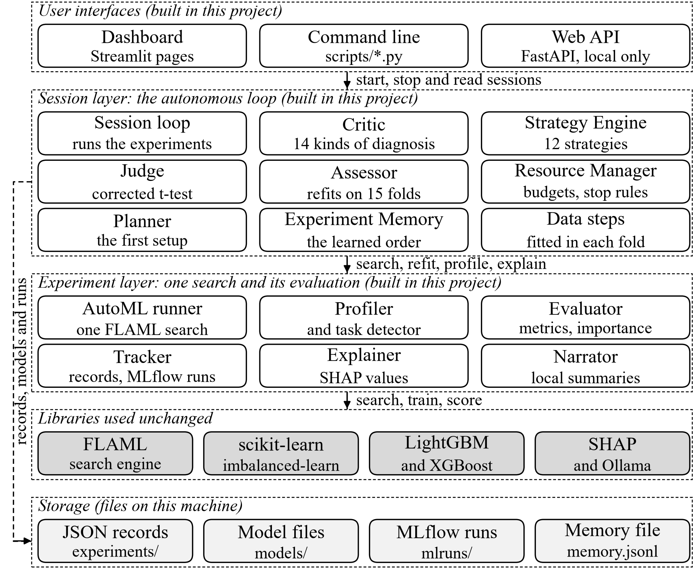
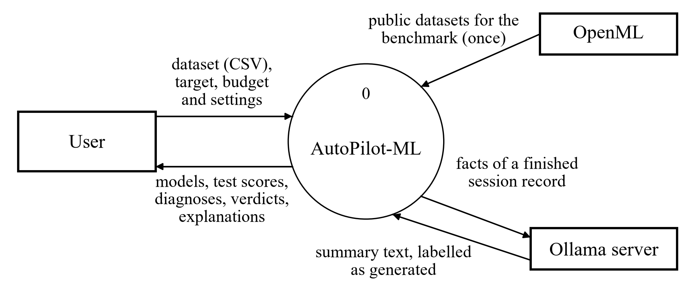
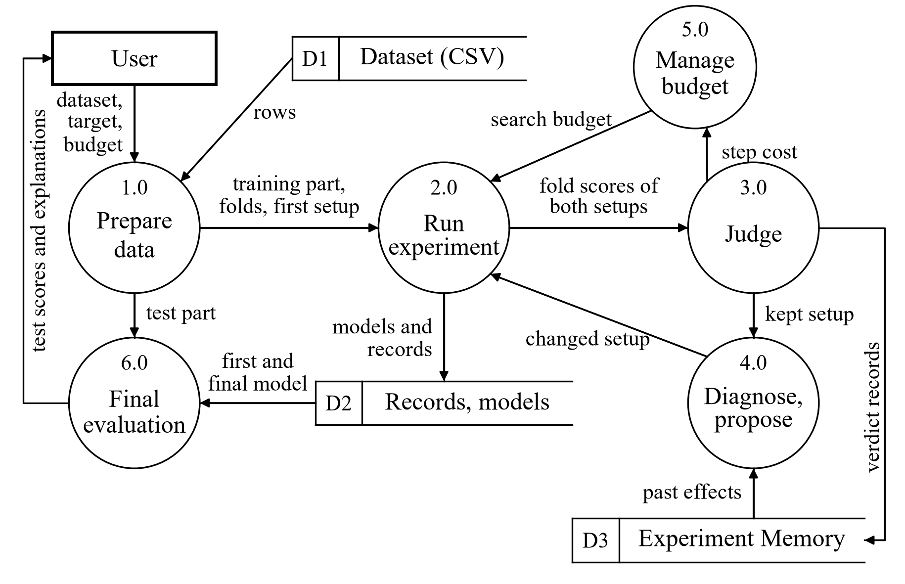
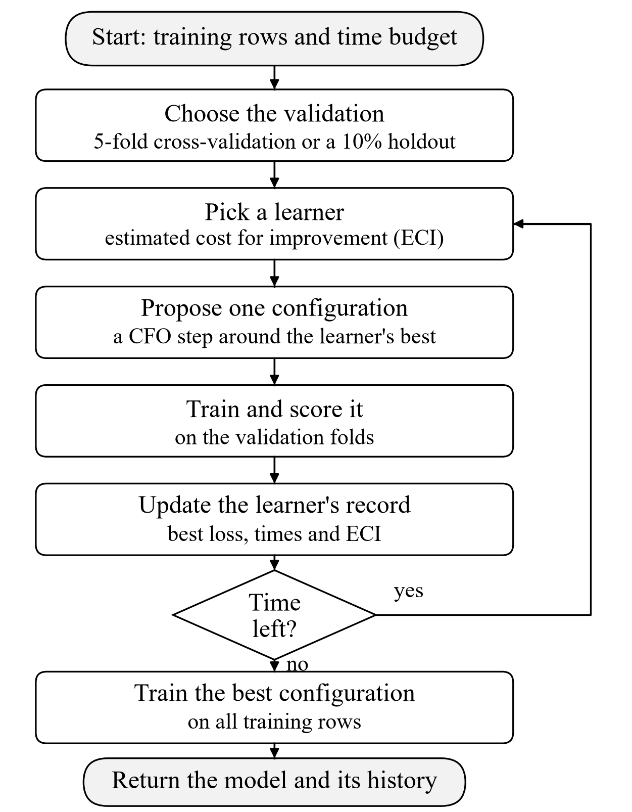

# AutoPilot-ML: An Autonomous, Self-Optimizing Machine Learning Experimentation Framework

**Project explanation and demonstration**

B.Tech Major Project, Department of Computer Science and Engineering, Indian Institute of Information Technology Bhopal
Priyanshu Verma (23U02016) and Salil Kushwah (23U02003), November 2026

---

## Summary

AutoPilot-ML is an autonomous experimentation layer for tabular machine learning. It runs the loop that a data scientist usually runs by hand: it diagnoses why a model is weak, proposes a change to the data or the settings, accepts the change only when a statistical test supports it, and decides when to stop. The search for models and hyperparameters inside each step is done by FLAML, an open-source AutoML library from Microsoft Research, which the project uses unchanged. The system runs offline on a laptop, records every decision with its numbers, and is covered by 586 automated tests.

## Outline

| Section | Content | Time |
|---|---|---|
| 1 | Problem statement | 1 minute |
| 2 | Proposed solution | 1.5 minutes |
| 3 | Main workflow, with a worked example on the Titanic dataset | 3 minutes |
| 4 | Results | 1.5 minutes |
| 5 | Conclusion | 0.5 minutes |
| Appendix A | Live demonstration, presented only on request | 4 minutes |
| Appendix B | Anticipated questions | As needed |
| Appendix C | Supporting figures and tables from the report | As needed |

---

## 1. Problem statement

AutoML libraries such as FLAML search automatically for a learning algorithm and its hyperparameters within a time budget. The experimentation around that search is still manual. Someone has to establish why a model is weak, decide which change to the data or the settings to try, check whether the change has really improved the model rather than only by chance, and decide when to stop.

This project addresses the following question: can an autonomous experimentation layer make conventional AutoML more efficient and more effective, by diagnosing model weaknesses, selecting improvement strategies, learning from earlier experiments and allocating the time budget adaptively?

## 2. Proposed solution

Figure 1 shows the experimentation loop of AutoPilot-ML. Each box is one step and each arrow names what passes to the next step. Only the grey box, the search itself, is performed by FLAML; every other step was designed and built in this project.

<p align="center"></p>
<p align="center"><em>Figure 1: The experimentation loop of AutoPilot-ML; the search inside each experiment is done by FLAML (report Figure 1)</em></p>

Table 1 lists the five components that form the loop and the role of each.

*Table 1: Components of the autonomous layer*

| Component | Role |
|---|---|
| Critic | Diagnoses the weaknesses of a model from measured evidence: 14 kinds, such as overfitting, class imbalance or a misleading high-cardinality column |
| Strategy Engine | Proposes changes that answer the diagnoses: 12 strategies, such as dropping a column, weighting the classes or searching smaller trees |
| Judge | Accepts a change only if a corrected resampled t-test on 15 fixed folds shows that it is better, or that it is simpler and not worse |
| Resource Manager | Divides the time budget between the steps and decides when the session stops |
| Experiment Memory | Records every change with its measured effect and cost, so that later sessions can order their changes by what worked on similar datasets |

---

## 3. Main workflow: one autonomous session

### 3.1 Flow of a session

Figure 2 follows one session from the split of the data to the final evaluation. Its key property is that the loop can only leave through the stop check of the Resource Manager. As a result, every session ends with a final evaluation and a complete record, also when the user stops it early.

<p align="center"></p>
<p align="center"><em>Figure 2: Flowchart of one session (report Figure 6)</em></p>

A session proceeds in the following order.

1. **Split.** 20% of the rows form the test part, which stays locked until the end. The remaining 80%, the training part, is divided into 15 folds (3 repeats of 5-fold cross-validation). Every decision is taken on these folds only.
2. **First setup.** Identifier-like and constant columns are left out, and FLAML searches with 35% of the time budget.
3. **Assess and diagnose.** The configuration found by FLAML is refitted on the 15 folds, and the Critic turns the measured evidence into diagnoses.
4. **Propose and judge.** The Strategy Engine proposes a change, FLAML searches the changed setup, and the Judge compares it with the best setup so far on the same 15 folds. A kept change becomes the new best setup.
5. **Stop and evaluate.** When the Resource Manager stops the session, the first and the final model are scored once on the locked test part.

### 3.2 Worked example on the Titanic dataset

Table 2 shows each step of the first recorded session: the Titanic passenger data, target `Survived`, a budget of 300 seconds, at most 8 experiments and seed 42. For each step the table gives the change tried, its search budget, the mean validation F1 over the 15 folds, and the Judge's mean difference, p-value and verdict.

*Table 2: Steps of the first autonomous session on Titanic, 300 s, seed 42 (report Table 7)*

| Step | Change tried | Search budget (s) | Validation F1 | Mean difference | p(better) | Verdict |
|---|---|---|---|---|---|---|
| 0 | First setup | 105 | 0.7056 | | | Start |
| 1 | drop_columns: Cabin | 25 | 0.7143 | +0.0087 | 0.284 | keep_simpler |
| 2 | drop_columns: Ticket | 23 | 0.7649 | +0.0506 | 0.010 | keep |
| 3 | regularised_search_space | 23 | 0.7628 | −0.0022 | 0.561 | keep_simpler |

The first setup left out `PassengerId` and `Name` as identifier-like columns. The Critic then found strong overfitting: an F1 of 0.996 on the training rows against 0.706 on the folds. It also found high cardinality in `Ticket` and `Cabin`, with 72% of the validation rows carrying a ticket number the model had never seen.

The Judge kept all three changes that followed:

- **Dropping `Cabin`** was not proven better, but the setup was simpler and not worse, so it was kept as **keep_simpler**.
- **Dropping `Ticket`** gave a proven gain of +0.0506 (p(better) 0.010), so it was kept as **keep**.
- **Smaller trees** were simpler and not worse, so they were kept as **keep_simpler**.

The session stopped after 206 of its 300 seconds because no change was left to try.

Table 3 compares the first and the final model on the locked test part, which no decision had used.

*Table 3: First and final model of the Titanic session on the 179 test rows*

| Metric | First model | Final model |
|---|---|---|
| F1 | 0.6838 | 0.7244 |
| Accuracy | 0.7933 | 0.8045 |
| ROC AUC | 0.7808 | 0.8123 |
| Log loss (lower is better) | 0.6411 | 0.5261 |

The final model is better on every metric. The system found by itself the change that a data scientist would make here, dropping `Ticket`, confirmed it with a statistical test, and recorded the evidence for each decision.

---

## 4. Results

### 4.1 Reliability of the decision components

Before the benchmark, the Critic and the Judge were tested on synthetic data with planted problems and known true effects. Table 4 summarises how often their decisions were right.

*Table 4: Reliability of the Critic and the Judge on data with known answers*

| Component | Test | Result |
|---|---|---|
| Critic | 135 synthetic datasets, each with one planted problem or none | No false alarm in any of the six data-level kinds of diagnosis (precision 1.000); overfitting found with precision 0.879 and recall 0.906 |
| Judge | 84 pairs of setups with known true effects | None of the 18 harmful changes accepted; 10 of the 12 helpful changes found |

This matters most for an autonomous loop: it tries many changes, so it must reject the harmful ones.

### 4.2 Benchmark against existing systems

The benchmark compared AutoPilot-ML with FLAML alone, AutoGluon and a LightGBM baseline with default settings. It used 390 runs on 6 public OpenML datasets, with 5 seeds and budgets of 120 and 300 seconds. Every system received the same training and test rows. AutoPilot-ML ran in two forms: with the fixed rule order (rules) and with Thompson sampling on a memory built beforehand (full).

Table 5 gives the mean test score of each system at the 300-second budget, with the best value of each row in bold. The scores are F1 for the classification datasets (macro F1 for the multiclass ones) and R² for energy_efficiency and solar_flare.

*Table 5: Mean test score over 5 seeds at the 300 s budget (report Table 8)*

| Dataset | Manual LightGBM | FLAML alone | AutoGluon | AutoPilot-ML rules | AutoPilot-ML full |
|---|---|---|---|---|---|
| pc4 | 0.6125 | 0.5897 | 0.5507 | 0.6194 | **0.6218** |
| cylinder-bands | 0.8485 | **0.8547** | 0.8375 | 0.8426 | 0.8529 |
| segment | **0.9814** | 0.9805 | 0.9723 | 0.9766 | 0.9771 |
| MiceProtein | 0.9855 | **0.9989** | 0.9947 | 0.9866 | 0.9921 |
| energy_efficiency | 0.9972 | **0.9989** | 0.9987 | 0.9988 | 0.9988 |
| solar_flare | 0.0457 | 0.1043 | **0.1268** | 0.1166 | 0.1132 |

At 300 seconds the full system was level with FLAML alone. The median difference over the six datasets was −0.0010, and its 95% bootstrap interval, from −0.0051 to +0.0205, contains zero. The full system also scored:

- higher than AutoGluon on 4 of the 6 datasets;
- higher than the LightGBM baseline on 5 of the 6;
- the best score of all systems on the imbalanced pc4 dataset (F1 0.6218 against 0.5897 for FLAML alone).

Figure 3 shows the scores of the five systems at both budgets. From 120 to 300 seconds the score of the full system rose on 5 of the 6 datasets, more than for any other system, while FLAML alone rose on 2. The median gap to FLAML alone closed from 0.0137 to 0.0010.

<p align="center"></p>
<p align="center"><em>Figure 3: Mean test score of the five systems at 120 s and 300 s on the six evaluation datasets (report Figure 8)</em></p>

Table 6 gives the average rank of each system over the six datasets, where 1 is best. The two AutoPilot-ML systems were the only ones whose rank improved with the larger budget: the full system moved from fourth to second place.

*Table 6: Average rank of the five systems at each budget (report Table 9)*

| System | 120 s | 300 s |
|---|---|---|
| AutoPilot-ML full | 3.58 | 2.50 |
| AutoPilot-ML rules | 3.75 | 3.00 |
| FLAML alone | 1.50 | 2.17 |
| AutoGluon | 3.33 | 3.67 |
| Manual LightGBM | 2.83 | 3.67 |

Figure 4 shows the mean wall time per run at the 300-second budget. FLAML alone uses the whole budget by design, while a session stops once no promising change is left. The full system needed 212.3 seconds on average against 300.9 seconds for FLAML alone, which is 29% less time for the same level of score. The saving held on every dataset, from 16% on MiceProtein to 64% on solar_flare.

<p align="center"></p>
<p align="center"><em>Figure 4: Mean wall time per run of the five systems at the 300 s budget (report Figure 9)</em></p>

---

## 5. Conclusion

The project delivered all seven of its objectives. The main outcomes are the following.

1. A complete autonomous experimentation layer around FLAML: 14 kinds of diagnosis, 12 strategies, a statistical Judge, a Resource Manager and an Experiment Memory. It runs offline through a dashboard, a command line, a local web API or a Docker image, and it is covered by 586 automated tests.
2. Reliable decisions on data with known answers: no false data-level alarm from the Critic, and no harmful change accepted by the Judge.
3. At the 5-minute budget, the score level of FLAML alone with 29% less time, second place among five systems, and the best score on pc4.
4. Every decision explained, recorded and repeatable from its saved numbers.

The future scope includes a larger share of short budgets for the first search, a larger memory and benchmark, new kinds of diagnosis, and language models as proposers of changes, with the Judge kept as the gate that accepts or rejects them.

---

## Appendix A: Live demonstration (presented only on request)

### A.1 Preparation

1. Connect the laptop to mains power and disable sleep, since a search that is paused by sleep gives worse results.
2. Start the dashboard and keep the browser tab open:

   ```
   conda activate automl
   cd C:\Users\priya\Desktop\project\AutoML\autopilot-ml
   streamlit run app/main.py --server.address localhost
   ```

   The dashboard opens at http://localhost:8501.
3. Carry out one practice run with the settings of A.2 beforehand. A run takes about 2.5 minutes.

### A.2 Procedure

1. In the sidebar, set **Mode** to **Autonomous run**.
2. In **1 · Dataset**, select **Sample dataset** and then **Titanic passenger survival**. The **Data quality** tab flags `Ticket` for its very large number of different values (681 in 891 rows).
3. In **2 · Target**, select `Survived`. The task is detected as binary classification, and the identifier-like columns `PassengerId` and `Name` are already selected to be left out.
4. In **3 · Session settings**, set **Total time** to 2.5 minutes, **Maximum Experiments** to 6 and **Random seed** to 42. Keep the default metric (F1) and the default advanced settings.
5. In **4 · Autonomous run**, select **Start autonomous run**. The timeline is filled in step by step while the session runs.

### A.3 Expected outcome

Table 7 shows what a rehearsal with exactly these settings produced on 14 November 2026. The record is kept in `results/demo-rehearsal/session.json`.

*Table 7: Rehearsal of the demonstration, Titanic, 150 s, at most 6 experiments, seed 42*

| Step | Action of the session | Verdict |
|---|---|---|
| 0 | First setup without `PassengerId` and `Name`, searched for 52 s. The Critic found overfitting (training F1 0.963 against 0.696 on the folds), high cardinality in `Ticket` and empty cells in `Cabin` | Start |
| 1 | Drop `Cabin`: +0.0082, p(better) 0.380 | keep_simpler |
| 2 | Drop `Ticket`: +0.0586, p(better) 0.008 | keep |
| 3 | Smaller trees: −0.0001 | keep_simpler |
| 4 | Word features from `Name`: +0.0013, p(better) 0.467 | discard |

The session stopped when its time was used up, after 141 seconds. On the locked test part, the F1 rose from 0.6949 to 0.7143 and the ROC AUC from 0.8026 to 0.8276.

Exact values can differ slightly between runs, because FLAML's search is limited by time; the pattern is the same, with dropping `Ticket` as the change that helps. The run shows all three verdicts of the Judge:

- **keep**: the change is proven better on the 15 folds;
- **keep_simpler**: the change is not proven better, but the setup is simpler and not worse, so it is preferred;
- **discard**: the change showed no real gain, as with the word features from `Name`, and is rejected.

### A.4 After the run

1. The first and the final model are shown side by side, scored on the test part that no decision used.
2. **Explain the final model** shows SHAP values, which split each prediction into one contribution per column. In the rehearsal, the final model relied most on `Sex` and then on `Pclass`: the test score dropped most when those columns were shuffled.
3. **5 · Experiment memory for this dataset** lists one record per verdict, with its effect and cost. These records are what later sessions learn from.

### A.5 Contingency

If a run is too slow, **Stop** ends the session after its current step, and the test part is still scored. If the dashboard cannot be used, Table 2 of this document and the recorded session `experiments/SES-001/session.json` show the same workflow, already completed.

---

## Appendix B: Anticipated questions

**Was FLAML developed in this project?**
No. FLAML is an open-source library from Microsoft Research, released under the MIT licence, and it is used unchanged. Section 2.4 of the report explains its search from its paper and source code. The contribution of this project is the layer around it: the Critic, the Strategy Engine, the Judge, the Resource Manager, the Experiment Memory, the user interfaces and the complete evaluation.

**How does this differ from a conventional AutoML system?**
A conventional AutoML system searches models on the data it is given. AutoPilot-ML also diagnoses the data and the model, changes them, accepts each change only on statistical evidence, and records the reason for every decision. Table 8 in Appendix C compares it with existing systems.

**Why are 15 folds and a corrected t-test used?**
A single split is too noisy to show whether a change helped. The 15 folds share most of their training rows, so an ordinary paired t-test would be too confident. The Judge therefore uses the corrected resampled t-test of Nadeau and Bengio:

$$t = \frac{\bar{d}}{\sqrt{\left(\frac{1}{J} + \frac{n_{\mathrm{val}}}{n_{\mathrm{train}}}\right)\hat{\sigma}^{2}}}$$

Here, $\bar{d}$ is the mean difference between the two setups over the $J = 15$ folds, $\hat{\sigma}^{2}$ is the variance of these differences, and $n_{\mathrm{val}}/n_{\mathrm{train}} = 1/4$ is the correction for the overlap.

**Why is the test part kept locked?**
If the decisions used the test part, the final score would be optimistic. All decisions use the folds of the training part, and the test part is used only once, at the end.

**Why are the decisions not made by a large language model?**
A hosted model would need an internet connection, and its decisions are difficult to check and to repeat. The decisions of AutoPilot-ML are rules and statistics that run offline. A small local model only writes an optional, labelled summary that no decision reads.

**Why is AutoPilot-ML behind FLAML at the 2-minute budget?**
The first search receives 35% of the budget, and every change is checked on 15 folds, so a short budget leaves less time for the search itself. At 5 minutes the system reaches the level of FLAML alone with 29% less time. A larger first share for short budgets is the first item of the future scope.

**How is correctness established?**
All 586 automated tests pass. The Critic and the Judge were checked on data with known answers (Table 4), and the benchmark is repeatable, with fixed datasets, fixed seeds and a frozen memory.

---

## Appendix C: Supporting figures and tables

This appendix brings together the remaining figures and tables of the report, so that any part of the project can be explained without the report.

### C.1 Comparison with existing systems

Table 8 compares AutoPilot-ML with existing systems on five abilities. The AutoML systems search models well, but none of them explains why a model is weak or changes the data on its own. Language-model agents can make such changes, but not with a measured, repeatable rule.

*Table 8: Comparison of AutoPilot-ML with existing systems (report Table 1)*

| System | Search of models and settings | Changes to data and features | Explains why a model is weak | Learns across datasets | Budget across experiments |
|---|---|---|---|---|---|
| Auto-sklearn | Bayesian optimisation of pipelines | Preprocessing inside the search space | No | Warm start from earlier datasets | Time limit of one search |
| TPOT | Genetic programming of pipelines | Pipeline operators | No | No | Generations or time limit |
| AutoGluon-Tabular | Strong defaults and stacking | Built-in preprocessing | No | Fixed presets | Time limit and presets |
| FLAML | Cost-frugal search (ECI and CFO) | Built-in preprocessing | No | Zero-shot defaults | Cost-aware in one search |
| LLM agents | Code written by the model | Yes, written by the model | In text, not checked | Not as a rule | No explicit rule |
| AutoPilot-ML (this work) | Through FLAML, unchanged | Yes: 12 strategies, fitted in each fold | Yes: 14 kinds of diagnosis with evidence | Memory of changes, effects and costs | Budgets and stop rules |

### C.2 Objectives and deliverables

Table 9 pairs each of the seven objectives with the part of the system that delivers it. All seven were achieved.

*Table 9: Objectives of the project and what was delivered (report Table 2)*

| No. | Objective | Delivered |
|---|---|---|
| O1 | A baseline: profiling, task detection, FLAML search, held-out evaluation, explanations, experiment tracking and a dashboard | The complete baseline pipeline with a Streamlit dashboard and MLflow tracking |
| O2 | A Critic: automatic, structured diagnoses of each experiment, with their evidence | 14 kinds of diagnosis, each with its evidence numbers, checked on data with known answers |
| O3 | A Strategy Engine: map diagnoses to candidate changes and rank them by rules, bandits and memory | 12 strategies, a rule table and four ways to order them, including Thompson sampling and UCB1 |
| O4 | A planner and autonomous loop with a fair comparison of every change over several splits | The session loop, the Assessor on 15 folds and the Judge's corrected resampled t-test |
| O5 | An Experiment Memory that reuses what worked on similar datasets | An append-only memory of every change with its effect and cost, read by the learned selectors |
| O6 | A Resource Manager that shares the time and CPU budget and decides when to stop | Budgets, a time reserve, stop rules and the utility of every step |
| O7 | An evaluation against FLAML, AutoGluon and a manual baseline on public datasets and several seeds | A benchmark of 390 runs on 6 OpenML datasets with 5 seeds and two budgets |

### C.3 Architecture

Figure 5 shows the layers of the system. The dashboard, the command line and the web API all call the same services. The session layer holds the autonomous loop, and the experiment layer runs one FLAML search and evaluates it. The grey boxes are external libraries, used unchanged.

<p align="center"></p>
<p align="center"><em>Figure 5: Block diagram of AutoPilot-ML; grey boxes are external libraries used unchanged (report Figure 3)</em></p>

Figure 6, the context diagram, shows what crosses the boundary of the system:

- the user gives a dataset, a target and a budget, and receives models, scores, diagnoses and explanations;
- OpenML supplies the benchmark datasets;
- a local language model server returns only an optional summary.

No data leaves the laptop.

<p align="center"></p>
<p align="center"><em>Figure 6: Data flow diagram, level 0 (report Figure 4)</em></p>

Figure 7 opens the system into its processes and data stores:

- 1.0 prepares the data;
- 2.0 to 4.0 form the loop of search, judgement, diagnosis and proposal;
- 5.0 controls the budget;
- 6.0 makes the final evaluation.

The test part flows only into process 6.0, so no decision of the loop can see it.

<p align="center"></p>
<p align="center"><em>Figure 7: Data flow diagram, level 1 (report Figure 5)</em></p>

### C.4 How FLAML searches

Figure 8 summarises FLAML's search loop as read from its source code (version 2.7.0). FLAML chooses the next learner at random, with a probability that favours learners whose estimated cost for improvement is low. It then proposes one configuration with its cost-frugal local search (CFO), trains and scores it, and repeats until the time budget is used. It searches only the columns it is given, which is why the changes to the data are made by the layer around it.

<p align="center"></p>
<p align="center"><em>Figure 8: FLAML's search loop as read from its source code, version 2.7.0 (report Figure 2)</em></p>

### C.5 The 14 kinds of diagnosis

Table 10 gives, for each kind of diagnosis, the evidence the Critic measures and the values at which it reports a moderate or a high severity. The overfitting gap g is the mean difference between the training and validation scores over the 15 folds. The thresholds were tuned on synthetic data with known answers.

*Table 10: The 14 kinds of diagnosis and their thresholds (report Table 3)*

| Kind | Evidence | Moderate | High |
|---|---|---|---|
| overfitting | Gap g between the training and validation scores | 0.11 or more | 0.20 or more |
| underfitting | Skill over the trivial baseline, the share of the possible gain that the model reaches, only when the gap is below 0.03 | Below 0.50 | Below 0.25 |
| budget_limited | Gain of the search's best score in the last quarter of its time | 0.005 or more | 0.02 or more |
| wasted_budget | Share of the search time after its best configuration | 0.50 or more | 0.75 or more |
| class_imbalance | Largest over smallest class; validation recall of the smallest class | Ratio 3 or more, or recall below 0.5 | Ratio 9 or more, or recall below 0.3 |
| missing_values | Share of empty cells in a used column | 0.30 or more | 0.70 or more |
| high_cardinality | Different values of a used text column; share of validation rows with an unseen value | Over 50 values, or 0.30 unseen | 0.60 unseen |
| identifier_column | The profiler's identifier flag | | Always |
| constant_column | One value, or the same value in 98% or more of rows | Low | |
| redundant_features | Absolute correlation of two used numeric columns | 0.95 or more | 0.99 or more |
| unreliable_validation | Standard deviation of the validation score over the folds | 0.05 or more | 0.08 or more |
| weak_model_families | A learner family 0.10 or more behind the best one after 5% or more of the search time | Low | |
| unused_words | A text column with frequent words that no encoding uses | Low if used whole | Moderate if left out |
| possible_leakage | Cross-validated score of one column alone | | 0.99 or more |

### C.6 The 12 strategies

Table 11 lists the 12 strategies. For each one it gives what the strategy changes, the diagnoses it answers, and whether it makes the setup simpler, the same or more complex. The Judge's keep_simpler verdict applies only to the simpler ones.

*Table 11: The 12 strategies, what they change and what they answer (report Table 4)*

| Strategy | What it changes | Answers | Complexity |
|---|---|---|---|
| drop_columns | Removes a column and its data steps | Identifier, constant, high cardinality, missing values (high only), redundant pair, overfitting | Simpler |
| class_weight_balanced | Balanced sample weights in the search and the refits | Class imbalance | Same |
| regularised_search_space | Smaller trees: at most 32 leaves for LightGBM and XGBoost, depth at most 4 for depth-limited XGBoost, at most 64 leaves for the forests | Overfitting | Simpler |
| frequency_encode | A text value becomes the share of training rows that have it | High cardinality | Same |
| group_rare_categories | Values seen in under 1% of training rows become one value | High cardinality | Simpler |
| missing_indicator | Adds a 0/1 column that marks the empty cells of a numeric column | Missing values | More complex |
| restrict_model_families | Searches only the learner families that were not weak | Weak model families | Simpler |
| more_search_time | The same setup with at least twice the search time | Underfitting, budget limited | Same |
| smoother_search_metric | Searches with log loss instead of the primary metric | Class imbalance, unreliable validation | Same |
| smote | Synthetic rows of the smaller classes, in each fold's training rows only | Class imbalance | More complex |
| target_encode | Cross-fitted, smoothed mean target of each value | High cardinality | Same |
| token_features | 0/1 columns for up to 20 frequent words of a text column | Unused words | More complex |

### C.7 Implementation

Table 12 lists the software used and the versions run; the Python libraries are pinned to these versions in the project's requirements files. Everything except Docker Desktop is open source, Docker Desktop is free for personal and educational use, all of it runs offline on a laptop CPU, and each tool is the work of its own authors.

*Table 12: Tools and libraries used, with their versions (report Table 5)*

| Area | Tool | Version | Used for |
|---|---|---|---|
| Language | Python | 3.11.16 | All the code |
| Environment | Miniconda (conda) | 26.5.3 | The environments `automl` and `autogluon` |
| Data | pandas | 3.0.6 | Loading and handling tables |
| Numerics | NumPy | 2.4.6 | Arrays and numeric work |
| Statistics | SciPy | 1.17.1 | Student t distribution and statistical tests |
| Machine learning | scikit-learn | 1.9.1 | Splits, metrics, permutation importance |
| AutoML engine | FLAML | 2.7.0 | Model and hyperparameter search, used unchanged |
| Learners | LightGBM, XGBoost | 4.7.0, 2.1.4 | Gradient-boosted trees searched by FLAML |
| Resampling | imbalanced-learn | 0.14.2 | SMOTE, SMOTE-NC and SMOTE-N |
| Explanations | SHAP | 0.51.0 | SHAP values of the final model |
| Tracking | MLflow | 3.17.0 | Experiment runs in a local SQLite file |
| Dashboard | Streamlit, Plotly | 1.65.0, 7.1.0 | Web interface and its interactive charts |
| Static charts | Matplotlib | 3.11.2 | Charts in the documents and the report |
| Web API | FastAPI, Uvicorn | 0.142.2, 0.54.0 | The local HTTP service |
| Local language model | Ollama with Qwen2.5 7B Instruct | 0.32.1 | Labelled plain-language summaries only |
| Container | Docker Desktop | 29.6.1 | The image with the API and the dashboard |
| Comparison system | AutoGluon-Tabular | 1.6.3 | The AutoGluon baseline of the benchmark |
| Datasets | OpenML | API v1 | Downloading the 12 benchmark datasets once |
| Testing | pytest | 9.1.1 | The 586 automated tests |
| Version control | Git | 2.55.0 | History, one change per commit |

Table 13 lists the main modules of the autonomous layer with their size and their task. The work is spread over small, separate services: the largest is the experiment runner around FLAML, and the session loop coordinates the others in 680 lines.

*Table 13: Main modules of the autonomous layer (report Table 6)*

| Module | Lines | What it does |
|---|---|---|
| services/autopilot.py | 680 | The session loop, its settings, step records and the final evaluation |
| services/automl_runner.py | 1,368 | One experiment: checks, split, FLAML search with warm starts and search limits, evaluation, records |
| services/assessor.py | 254 | Refits of a configuration on the 15 session folds, with reuse of identical refits |
| services/critic.py | 504 | The 14 rules that turn evidence into diagnoses, with thresholds read from a file |
| services/strategies.py | 430 | The 12 strategies and the changes they make to a setup |
| services/strategy_engine.py | 415 | The rule table, the proposals and the four selectors |
| services/judge.py | 161 | The corrected resampled t-test and the three verdicts |
| services/resource_manager.py | 257 | Budgets, the reserve, the stop rules and the cost ledger |
| services/experiment_memory.py | 218 | The append-only memory, similar datasets and arm statistics |
| services/transforms.py | 400 | The data steps, fitted on training rows only, and the saved pipeline model |
| services/splits.py | 249 | The outer split and the session folds, also by groups |
| services/explainer.py, narrator.py | 197, 203 | SHAP explanations and labelled local summaries |
| api.py | 180 | The local web API |

Listing 1 shows the centre of the Judge, from `app/services/judge.py`:

1. The fold differences are signed so that a positive value favours the candidate.
2. If all the differences are equal, the verdict is decided on the mean alone.
3. Otherwise the corrected t statistic of Appendix B gives the two p-values that decide the verdict.

*Listing 1: The decision of the Judge, shortened and re-wrapped (report Figure 7)*

```python
sign = 1.0 if METRICS[metric].greater_is_better else -1.0
raw = sign * (candidate.values(metric, "validation") - accepted.values(metric, "validation"))
d = raw[np.isfinite(raw)]
mean, std = float(d.mean()), float(d.std(ddof=1))
if std <= REPEAT_TOLERANCE:  # all equal: decide on the mean alone
    gain = mean if abs(mean) > REPEAT_TOLERANCE else 0.0
    keep = gain > s.min_gain
    keep_simpler = candidate_is_simpler and gain >= -s.non_inferiority_margin
else:
    t, df = corrected_resampled_t(d, self.test_train_ratio)
    p_better = float(stats.t.sf(t, df))
    p_worse = float(stats.t.cdf(t, df))
    keep = mean > s.min_gain and p_better <= s.alpha
    keep_simpler = (candidate_is_simpler and mean >= -s.non_inferiority_margin
            and p_worse > s.alpha)
verdict = "keep" if keep else "keep_simpler" if keep_simpler else "discard"
```
