# How AutoPilot-ML works today, and how FLAML works inside it

This guide explains the current system (the Phase 1 baseline) in plain language: what each part does, how the parts fit together, and what FLAML does, step by step, when we ask it to find a model. It ends with the limits of the current setup and where the next phase connects to it.

Everything here has been checked. The numbers come from our own runs, mostly EXP-001 (Titanic, 60 second budget, seed 42). The descriptions of FLAML come from reading the source code of FLAML 2.7.0, the version we use (Appendix C lists the files).

- To see the diagrams, open this file in Kiro and press Ctrl+Shift+V (Markdown preview). The diagrams are drawn by Mermaid; the charts are PNG files in the `images` folder next to this file.
- The technical reference for the same code is `architecture.md`. The notes for the final report are in `report-notes.md`.
- Not covered here: how the planned parts (critic, judge, strategy engine, planner, memory, resource manager) will work. Section 9 only shows where they will connect.

Last updated: 22 October 2026

## Contents

1. The big picture
2. Words used in this guide
3. Our code, part by part
4. One experiment, step by step
5. How the data is split, and the three scores
6. How FLAML works inside
7. One real run from start to finish: EXP-001
8. What the current setup cannot do yet
9. Where the next phase connects
- Appendix A. Where each step lives in the code
- Appendix B. Commands
- Appendix C. Sources

---

## 1. The big picture

You give the app a table (a CSV file) and choose the column to predict. The app then:

1. describes the table: its columns, missing values and problem columns,
2. works out what kind of question it is: one of two answers, one of several classes, or a number,
3. locks away 20% of the rows as a final exam,
4. asks FLAML to find a good model with the other 80%, within your time limit,
5. gives the final exam to the model FLAML found, and shows which columns the model relies on,
6. saves everything, so that experiments can be compared later.

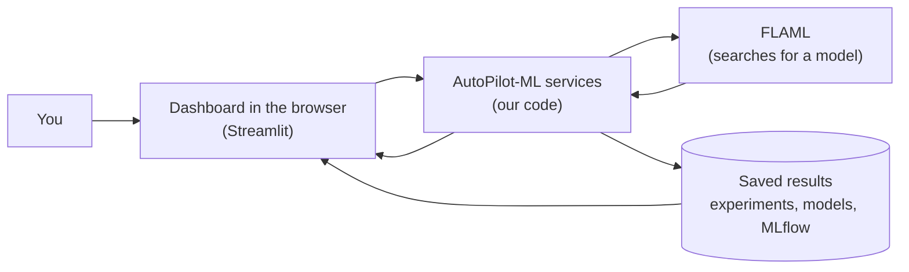

FLAML is the only part that searches for a model. It is an open-source library from Microsoft Research, and we use it unchanged. Everything around it is our code:

| Part | Written by | Job |
|---|---|---|
| Dashboard | us, using the Streamlit library | The web page: collects your choices and shows the results |
| Services | us | All the logic: describe the data, detect the task, run the experiment, score it, save it |
| FLAML | Microsoft Research (open source) | Finds the best kind of model and its settings |
| scikit-learn | open source | Splits data, computes scores, measures how much the model relies on each column |
| MLflow | open source | Stores every experiment so it can be browsed later |
| Plotly | open source | Draws the charts in the dashboard |

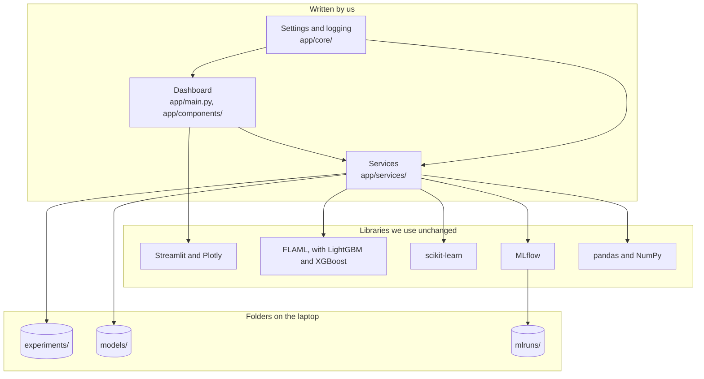

Everything runs on the laptop: no internet service, no paid API, no GPU.

---

## 2. Words used in this guide

| Word | Meaning | Example from our project |
|---|---|---|
| Dataset | A table of examples: one row per example, one column per piece of information | Titanic: 891 passengers, 12 columns |
| Target | The column we want to predict | `Survived`: 1 survived, 0 died |
| Feature | Any other column the model may use | `Sex`, `Age`, `Pclass` (ticket class), `Fare` |
| Model | A rule learned from examples that turns features into a prediction | Something like "women in 1st or 2nd class survived", but learned automatically and far more detailed |
| Training | Learning a model from examples whose answer is known | |
| Task | The kind of question. Binary classification: one of two answers. Multiclass: one of several classes. Regression: a number | Titanic is binary, penguins multiclass, house prices regression |
| Decision tree | A model that asks a chain of yes/no questions ("female?", "younger than 10?") and ends in an answer | |
| Random forest, extra trees | Many decision trees, each built on a random part of the data, voting together | |
| Gradient boosting | Trees built one after another, each one fixing the mistakes of the trees before it. LightGBM and XGBoost are two fast versions | The winner of EXP-001 is XGBoost |
| Linear model | Adds up the features, each multiplied by a learned weight. Fast, but often weaker on tables like ours | SGD and L1 logistic regression |
| Learner, learner family | One kind of model that FLAML can try | FLAML's default list for classification has 7 |
| Hyperparameter, setting | A choice made before training that shapes the model | Number of trees, leaves per tree, learning rate |
| Configuration | One complete set of settings for one learner | XGBoost with 304 trees and at most 11 leaves per tree, plus 7 other settings |
| Trial | Training and scoring one configuration once | EXP-001 ran 290 trials in 60 seconds |
| Search | Trying many configurations to find a good one | |
| Time budget | How long FLAML may search, in seconds | 60 s in EXP-001 |
| Cost | How long a trial takes. Bigger models cost more | A trial with a 4-tree model took about 0.1 s |
| Training part, test part | Our outer split. FLAML only ever sees the training part (80%). The test part (20%) is used once, at the end | 712 and 179 passengers |
| Validation | Scoring during the search, on rows held back from training, to compare configurations | |
| Cross-validation, fold | Cut the training part into 5 pieces called folds. Train on 4, score on the 5th, do this 5 times so every fold is scored once, and average the 5 scores | Section 5 |
| Holdout | A quicker kind of validation: keep back one piece (FLAML uses 10% of the training part) and score on it | Used for larger datasets |
| Overfitting | The model learned the training rows too closely, including their noise, so it is much better on rows it has seen than on new rows | EXP-001: F1 0.93 on training rows, 0.67 on test rows |
| Metric, score | A number that says how good the predictions are | Explained below this table |
| Loss | A score where lower is better. FLAML always minimises a loss; for F1 it uses 1 - F1 | |
| Trivial baseline | The score of a "model" that learns nothing, such as "always predict died". A useful model must beat it | Titanic test part: F1 0.000, accuracy 0.615 |
| Categorical column | A column of labels instead of numbers | `Sex`, `Embarked`, `Ticket` |
| High cardinality | A categorical column with very many different labels | `Ticket`: 681 labels for 891 passengers |
| Unseen label | A label in the test part that never appears in the training part, so the model knows nothing about it | 63% of test tickets in EXP-001 |
| Missing value | An empty cell | `Age` is empty for 177 passengers |
| Median | The middle value when the values are sorted | Used to fill missing ages |
| Seed | A number that fixes "random" choices so they can be repeated | 42 |
| Stratified split | A split that keeps the share of each class the same in every part | About 38% survivors in both parts |
| Permutation importance | Shuffle one column and see how much the score drops. A big drop means the model relies on that column | `Sex` is the most important column on Titanic |
| MLflow run, artifact | One experiment's record in MLflow, and a file saved with it | The model file, `profile.json` |
| Pickle | Python's way of saving an object, such as a trained model, to a file | `models/EXP-001/model.pkl` |
| CFO | Cost-Frugal Optimization: FLAML's way of choosing settings. "Frugal" means careful with cost: start small, grow only when it pays off | Section 6.7 |
| Local search, step, converged | Searching close to the best point found so far. A step is one small change of the settings. Converged means the steps have become so small that nothing new is being found | Section 6.7 |

The metrics, in short:

- Accuracy: the share of correct answers.
- Precision: when the model says "survived", how often it is right.
- Recall: of the passengers who really survived, how many the model found.
- F1: one number that balances precision and recall, from 0 to 1, higher is better. It is our default for classification, because accuracy can look good while the smaller class is ignored.
- ROC-AUC: how well the model ranks survivors above non-survivors. 0.5 is a coin flip, 1 is perfect.
- For numbers (regression): R² (1 is perfect, 0 is no better than always guessing the average), and RMSE and MAE (the typical size of the error, lower is better).

---

## 3. Our code, part by part

### 3.1 Code map

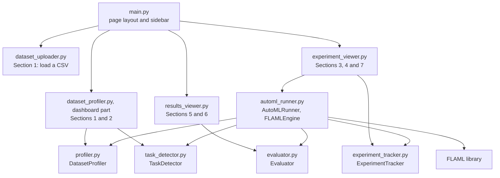

The code has three layers:

- `app/main.py` and `app/components/` are the dashboard. They only collect your choices and show the results.
- `app/services/` holds all the logic. None of it uses Streamlit, so the same code also runs from a script, a notebook or a test.
- `app/core/` holds the settings (`config.py`) and the logging setup (`logging_config.py`).

Two rules keep the parts independent: FLAML is used in exactly one class (`FLAMLEngine`), and MLflow in exactly one class (`ExperimentTracker`). Replacing either of them later only touches that one class.

### 3.2 The five services

**Dataset profiler** (`app/services/profiler.py`). Describes the table before any training: the number of rows and columns, the type of each column, missing values, duplicate rows, and how many different values each column has. It also flags problem columns:

| Flag | Rule | Titanic |
|---|---|---|
| Identifier-like | Every value is different, nothing is missing, and the column is not decimal or a date. Or the name looks like an ID and more than 95% of the values are different | `PassengerId`, `Name` |
| Constant | Only one value | none |
| High cardinality | A text column with more than 50 different values | `Ticket` (681), `Cabin` (147) |
| Mostly missing | At least 40% empty | `Cabin` (77% empty) |
| Class imbalance | The biggest class divided by the smallest: under 1.5 none, 1.5 to 3 mild, 3 to 9 moderate, 9 or more severe | 549 died, 342 survived: 1.61, mild |

Identifier-like and constant columns are pre-selected for exclusion, because a column that is different in every row cannot teach the model anything general. The profiler also computes "meta-features": a few numbers that describe the whole dataset (its size, the share of missing values, the imbalance and so on). Nothing uses them yet; the planned memory will use them to find similar datasets.

**Task detector** (`app/services/task_detector.py`). Looks at the target column:

- text or yes/no values with 2 different values: binary; with more: multiclass,
- numbers with exactly 2 different values: binary,
- whole numbers with at most 20 different values: multiclass, with a note that it might really be a count,
- anything else: regression.

You can override its choice. Overrides that cannot work are refused with a clear message, for example "Multiclass classification needs at least 3 classes".

**AutoML runner** (`app/services/automl_runner.py`). Runs one experiment from start to finish (section 4). It contains `FLAMLEngine`, the only place that talks to FLAML. FLAML sits behind a small interface, so another engine, such as AutoGluon for the planned comparison, can be added without changing anything else.

**Evaluator** (`app/services/evaluator.py`). Scores any model: every metric on the test part and on the training part, the trivial baseline, the confusion matrix (a table of right and wrong answers per class) and permutation importance. It only needs the model's predictions, so it does not depend on FLAML.

**Experiment tracker** (`app/services/experiment_tracker.py`). Gives each experiment its ID (EXP-001, EXP-002 and so on), writes the MLflow run, writes the small `summary.json` record, and builds the history table. An ID is reserved by creating its folder, so two experiments started at the same time can never get the same ID.

### 3.3 The dashboard

| Section | What you see |
|---|---|
| 1. Dataset | Upload or pick a sample; cards with rows, columns, missing values and duplicates; tabs for the columns, a preview, data-quality warnings and target candidates |
| 2. Target | Choose the target; the detected problem with its reason; override; a chart of the classes; the columns to exclude |
| 3. Experiment configuration | Time budget, primary metric, random seed, test split |
| 4. Run AutoML | The Run Experiment button and a progress bar |
| 5. Results | Best model, test score, validation score, training time; notes; every test metric against the baseline; train vs test; the leaderboard; a chart of all trials |
| 6. Explainability | Permutation importance, the model's own importance, the confusion matrix, a ROC curve (binary) or residual plots (regression), the winning settings |
| 7. Experiment history | All past experiments in one table, with a chart |

The experiment runs in the background. Streamlit runs the whole page script again after every click, so a long experiment started directly by the page would block it or get lost. Instead the page starts a background worker and checks on it twice a second:

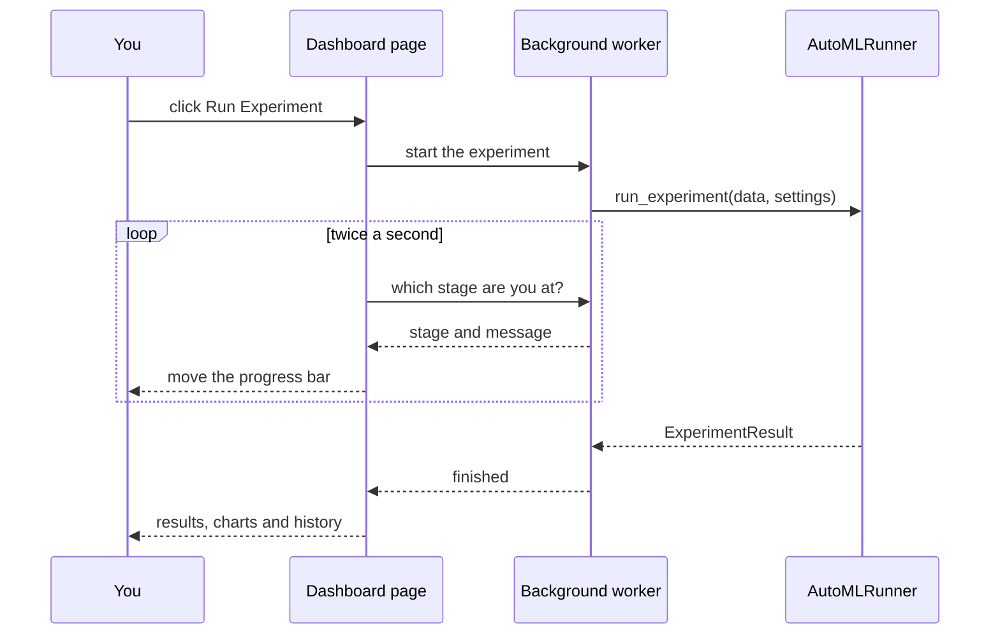

FLAML reports nothing while it searches, so during the search the progress bar is estimated from the elapsed time against the budget.

---

## 4. One experiment, step by step

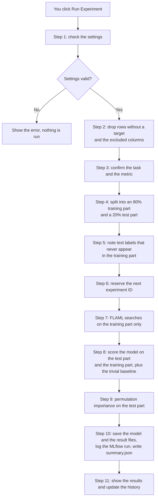

What each step did in EXP-001:

| Step | What happens | EXP-001 |
|---|---|---|
| 1. Check | The target and the excluded columns exist, the budget is 5 to 3600 seconds, the test share is 0.05 to 0.5 | Passed |
| 2. Prepare | Rows with an empty target are dropped and the excluded columns removed; at least 20 rows and one feature column must remain | No empty targets; `PassengerId` and `Name` removed, 9 feature columns left |
| 3. Task and metric | Detected, or checked if you overrode it | Binary, F1 |
| 4. Split | Stratified 80/20 split with your seed | 712 training rows (273 survivors, 38.3%), 179 test rows (69 survivors, 38.5%) |
| 5. Unseen labels | For each text column, the share of test rows whose label never appears in the training part | `Ticket` 63%, `Cabin` 11% |
| 6. ID | Creates the folder `experiments/EXP-001/` | |
| 7. Search | FLAML, section 6 | 290 trials in 60 s; winner XGBoost |
| 8. Score | Every metric on both parts, and the trivial baseline on the test part | Test F1 0.673, train F1 0.934, baseline F1 0.000 |
| 9. Importance | Each column of the test part is shuffled 5 times; the average drop in F1 is its importance | `Sex` 0.219, `Pclass` 0.098, `Ticket` 0.043 |
| 10. Save | See the file list below | |
| 11. Show | Sections 5 to 7 of the dashboard | |

If anything fails after step 6, the runner writes `error.json` instead of `summary.json`, and the failed experiment does not appear in the history.

Files written by one experiment:

```text
experiments/EXP-001/
    summary.json                   the record the history table reads
    profile.json                   the dataset profile, including the target
    evaluation.json                test metrics, confusion matrix, per-class scores, train and baseline metrics
    leaderboard.csv                the best validation score of each learner family
    search_history.csv             every FLAML trial
    feature_importance.csv         permutation importance
    native_feature_importance.csv  the model's own importance
    predictions.csv                the test rows' true answers, predictions and probabilities
    flaml_search.log               FLAML's raw log, one line per trial
models/EXP-001/model.pkl           the trained model, the feature columns, the target, the task and the classes
mlruns/                            the MLflow store (mlflow.db), with copies of the model and the files above
```

---

## 5. How the data is split, and the three scores

There are two splits, one inside the other.

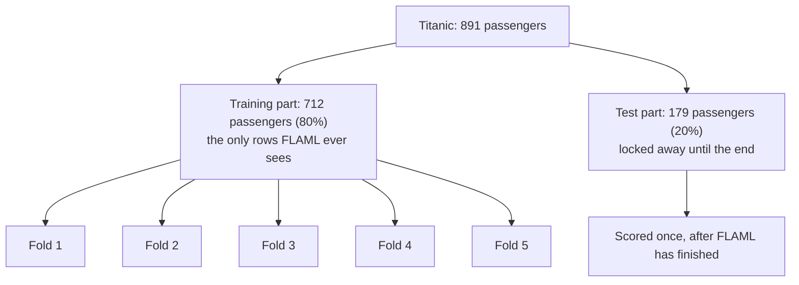

1. Our outer split (step 4) makes the training part and the test part. We do it before FLAML starts, so FLAML cannot see the test part, not even by accident.
2. Inside the training part, FLAML validates each trial. On Titanic it uses 5-fold cross-validation, with about 142 or 143 passengers in each fold.

How one trial is scored with 5-fold cross-validation:

| Round | Fold 1 | Fold 2 | Fold 3 | Fold 4 | Fold 5 |
|---|---|---|---|---|---|
| 1 | score | learn | learn | learn | learn |
| 2 | learn | score | learn | learn | learn |
| 3 | learn | learn | score | learn | learn |
| 4 | learn | learn | learn | score | learn |
| 5 | learn | learn | learn | learn | score |

So one trial trains 5 models, each on 4 folds, and scores each one on the fold it did not learn from. The trial's validation score is the average of the 5 scores. The 5 models are then thrown away: FLAML only keeps the score and the settings.

The app shows three scores for the final model. They answer different questions:

| Score | Measured on | EXP-001 (F1) | How far to trust it |
|---|---|---|---|
| Train score | The 712 rows the final model learned from | 0.934 | Too optimistic: the model has seen these answers |
| Validation score | FLAML's 5-fold average for the winning settings | 0.802 | Better, but it is the number FLAML used to pick the winner out of 290 trials, so it is still a little optimistic |
| Test score | The 179 rows nobody touched | 0.673 | The honest number |

A big gap between the train score and the other two means overfitting.

Why is the validation score above the test score here? Two reasons. First, the best of 290 trials usually looks a little better than it really is, because part of its lead is luck. Second, this particular split (seed 42) put harder passengers into the test part: on five other splits the same setup scored 0.73 to 0.81 on its test part. The second reason is measured in `report-notes.md`, sections 9.6 and 9.7.

---

## 6. How FLAML works inside

### 6.1 The idea

FLAML answers one question: which learner family, with which settings, gives the best validation score within the time limit?

It treats time as money. Think of a cook who has one minute to find the best recipe. The cook first makes small, quick tasting portions of several recipes, notices which ones are promising, and spends most of the remaining time improving those. A big, slow dish is only made when a small step in that direction already tasted better. FLAML does the same with models: the first trials are tiny models that train in a fraction of a second, and the models only grow when growing improves the score.

Two decisions are repeated in every round of the search:

1. which learner family to try next (section 6.6),
2. which settings to try for it (section 6.7, CFO).

### 6.2 What we ask FLAML to do

`FLAMLEngine.fit` calls FLAML with these settings:

| Setting | Our value | Meaning |
|---|---|---|
| `task` | `"classification"` or `"regression"` | FLAML works out binary or multiclass from the labels |
| `metric` | `"f1"`, `"roc_auc"`, `"accuracy"`, `"log_loss"`, `"r2"`, `"rmse"`, `"mae"` or `"mse"`; for multiclass, F1 becomes `"macro_f1"` and ROC-AUC becomes `"roc_auc_ovr"` | What to optimise. "Macro" means the average over the classes |
| `time_budget` | your budget, for example 60 | Seconds for the search |
| `seed` | your seed, for example 42 | Used for CFO's random steps (section 6.10) |
| `n_jobs` | -1 | Each model may use every CPU core. Trials still run one at a time |
| `estimator_list` | `"auto"` | FLAML's default learner families (section 6.6) |
| `eval_method` | `"auto"` | FLAML chooses cross-validation or holdout (section 6.5) |
| `retrain_full` | `True` | Retrain the winner on the whole training part at the end |
| `early_stop` | `True` | FLAML may stop before the budget runs out if every search has settled (section 6.8) |
| `log_type` | `"all"` | Write every trial to the log, not only the improvements |
| `mlflow_logging` | `False` | We write to MLflow ourselves |
| `verbose` | 0 | Print nothing |

### 6.3 Inside one FLAML call

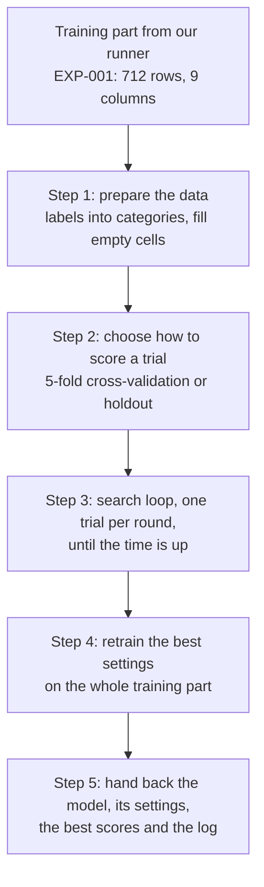

### 6.4 Step 1: FLAML prepares the data

Before searching, FLAML cleans the training part in its own way (its `DataTransformer` class). We checked these rules on the EXP-001 split:

| Rule | Titanic example |
|---|---|
| A text column with only one value, or with a different value in every filled row, is dropped | `Name` (every name is different). We exclude it ourselves, but FLAML would drop it anyway |
| A number column with fewer than 2 different values is dropped. Other number columns are kept, even when every value is different | `PassengerId` would be kept and used as if it meant something. This is why our own exclusion matters |
| Other text columns become categories. An empty text cell becomes a category called `__NAN__` | `Sex`, `Ticket`, `Cabin`, `Embarked`. Empty `Cabin` and `Embarked` cells become `__NAN__` |
| Empty number cells are filled with the median of the training part | The 137 missing ages in the training part become 28.5 |
| Date columns are split into year, month, day, weekday and so on | none on Titanic |
| The target's labels become 0, 1, 2 and so on, and are turned back into the original labels when predicting | |
| A class with fewer than 20 rows is copied until it has at least 20 | does not happen on our datasets |

Then each learner family sees the categories in its own way:

- LightGBM understands categories directly.
- XGBoost, random forest, extra trees and the linear models need numbers, so each category is replaced by its position in an alphabetical list: `female` is 0 and `male` is 1, and the 571 tickets of the training part become 0 to 570.
- A label that never appeared in the training part, such as a new ticket number, becomes `__NAN__` when predicting. For XGBoost that is position 571, so the model treats every unseen ticket as if it came just after "WE/P 5735", the alphabetically last ticket it knows. That is meaningless, and it applied to 112 of the 179 test passengers in EXP-001, whose winner was XGBoost. This is one concrete way a high-cardinality column can hurt.

### 6.5 Step 2: FLAML chooses how to score each trial

FLAML picks 5-fold cross-validation when the data is small compared with the time budget, and a holdout otherwise. The exact rule in FLAML 2.7.0:

```text
use cross-validation if   rows x columns / 0.9   is below   10,000,000 x budget in seconds / 3600
                    and   rows is below 100,000
otherwise use a holdout of 10% of the training part
```

| Dataset (training part) | rows x columns / 0.9 | Limit at 10 s | Limit at 60 s | Result |
|---|---|---|---|---|
| Titanic (712 x 9) | 7,120 | 27,778 | 166,667 | Cross-validation at every budget the app allows (even at 5 s the limit is 13,889) |
| California housing (16,512 x 8) | 146,773 | 27,778 | 166,667 | Holdout up to 52 s; cross-validation from 53 s (limit 147,222) |

Two details:

- The folds and the holdout are made with FLAML's own fixed seed (1), not with ours. For a given training part they are always the same.
- A trial's validation score is the average of its fold scores, or simply the holdout score.

### 6.6 Step 3: the search loop

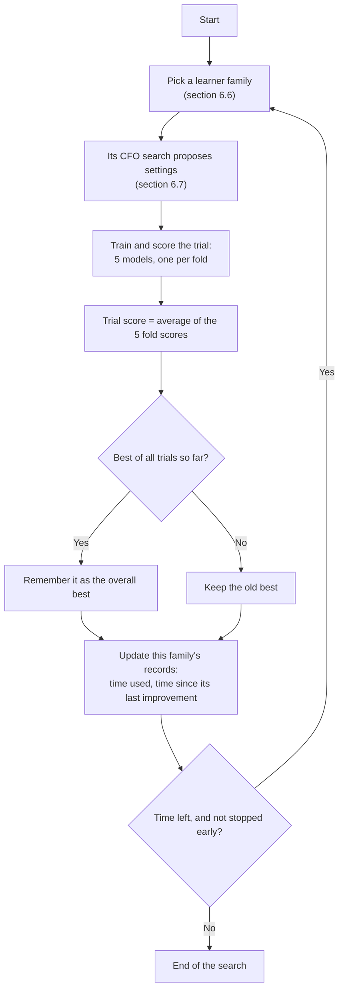

Each round runs exactly one trial. EXP-001 went round this loop 290 times in 60 seconds, and spent 59.7 of those seconds training and scoring models. FLAML's own decision making takes very little time.

#### The learner families

| Name in the logs | Name in the app | Kind | Starting cost guess | Settings tuned | First tried in EXP-001 |
|---|---|---|---|---|---|
| `lgbm` | LightGBM | gradient boosting | 1 | 8 | trial 0, at 0.1 s |
| `sgd` | SGD Linear Model | linear | 1 | 9 | trial 3, at 0.4 s |
| `xgboost` | XGBoost | gradient boosting | 1.6 | 9 | trial 12, at 1.4 s |
| `extra_tree` | Extra Trees | many random trees | 1.9 | 4 | trial 14, at 1.7 s |
| `rf` | Random Forest | many random trees | 2 | 4 | trial 21, at 2.8 s |
| `xgb_limitdepth` | XGBoost (depth-limited) | gradient boosting | 64 | 9 | trial 258, at 52.4 s |
| `lrl1` | Logistic Regression (L1) | linear | 160 | 1 | trial 289, at 60.0 s |

The starting cost guess is built into FLAML: how expensive a first trial of this family is expected to be, compared with LightGBM. EXP-001 tried the families for the first time in exactly this order, cheapest first. For regression the list is the same without logistic regression. CatBoost would be added if it were installed; it is not.

The two linear models did badly on Titanic (best F1 0.531 and 0.454). FLAML keeps them in the list because they are cheap and sometimes win on other data. The "did not converge" warnings we hid in Phase 1 came from these linear models.

#### How FLAML picks the next learner family

For every family it has already tried, FLAML keeps two clocks: how much of that family's time its last improvement took, and how much of its time has passed since that improvement. The larger of the two is the family's expected cost of its next improvement. A family that is behind the leader also gets a penalty: roughly the time it would need to catch up at its recent pace, doubled. A family that has not been tried yet uses its starting cost guess (multiplied by the time of the very first trial).

Then:

1. If a family that has not been tried yet looks cheapest, it gets its first turn.
2. Otherwise FLAML draws lots among the tried families. Each family's chance is proportional to 1 divided by its expected cost, so a family that is improving cheaply is picked often, and a stuck one rarely.
3. A family whose best trial took longer than the time that is left is skipped.

The tried families' expected costs grow while they stop improving, because their "time since the last improvement" keeps growing. Sooner or later an untried family looks cheapest and gets its turn. That is why XGBoost (depth-limited), with a starting cost guess 64 times LightGBM's, waited until 52 seconds in EXP-001. In EXP-002 it got its first turn at 20 seconds, and the best trial of that whole run came from it 3 seconds later.

In EXP-001 most of the time went to the family that won:


XGBoost got 34.6 of the 59.7 seconds of trials (58%) and 114 of the 290 trials. The draw favours families that improve cheaply, and XGBoost kept improving until 42.9 seconds.

### 6.7 How FLAML picks the settings: CFO

Each learner family has a list of settings, each with an allowed range. For XGBoost on Titanic, for example: the number of trees from 4 to 712 and the maximum leaves per tree from 4 to 712 (FLAML caps both at the number of training rows), the learning rate from about 0.001 to 1, and 6 more.

CFO (Cost-Frugal Optimization; Wu, Wang and Huang, AAAI 2021) chooses the settings for each family separately:

1. **Start small.** The settings that make training slower as they grow (the number of trees, the leaves) start at small values; for most families at the smallest allowed. The others start at sensible defaults, such as a learning rate of 0.1. The first XGBoost trial in EXP-001 had 4 trees with at most 4 leaves each.
2. **Step in a random direction.** Picture every setting as a slider scaled from 0 to 1 (wide ranges, like 0.001 to 1, are spread out evenly on a log scale). From the best point so far, CFO moves all the sliders a little, in a random direction.
3. **Try the opposite direction.** If that step was not better, it tries the same step backwards.
4. **Move when better.** As soon as a step improves the score, that point becomes the new best, and the next steps start from there.
5. **Shrink the step.** After many failed steps in a row, the step gets smaller.
6. **Restart.** When the step becomes tiny, the search has converged: it is stuck around one point. CFO then starts again from near the small starting point, with some randomness, to look elsewhere.

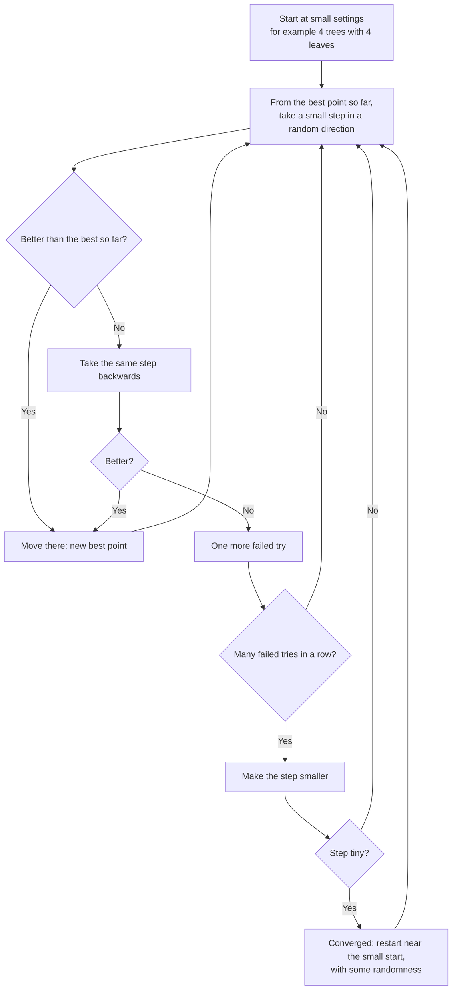

Because every family starts small and only grows when growing helps, the first trials take only 0.1 to 0.2 seconds, and slow, large models are trained only after smaller ones have shown that size pays off. That is the "frugal" part.

XGBoost in EXP-001, every time it set a new best of its own (its first trial counts as the first):

| XGBoost trial | Time (s) | Trees | Max leaves per tree | Validation F1 |
|---|---|---|---|---|
| 1 | 1.35 | 4 | 4 | 0.6313 |
| 3 | 2.55 | 4 | 7 | 0.7127 |
| 5 | 3.54 | 5 | 8 | 0.7486 |
| 7 | 3.73 | 9 | 13 | 0.7518 |
| 11 | 8.45 | 19 | 8 | 0.7739 |
| 17 | 9.40 | 18 | 26 | 0.7835 |
| 18 | 9.61 | 57 | 15 | 0.7853 |
| 53 | 24.29 | 39 | 43 | 0.7861 |
| 60 | 30.20 | 63 | 14 | 0.7915 |
| 75 | 34.16 | 123 | 10 | 0.8001 |
| 95 | 42.90 | 304 | 11 | 0.8017 |

The number of trees grew from 4 to 304 over 43 seconds. The other 103 XGBoost trials were steps that did not help.

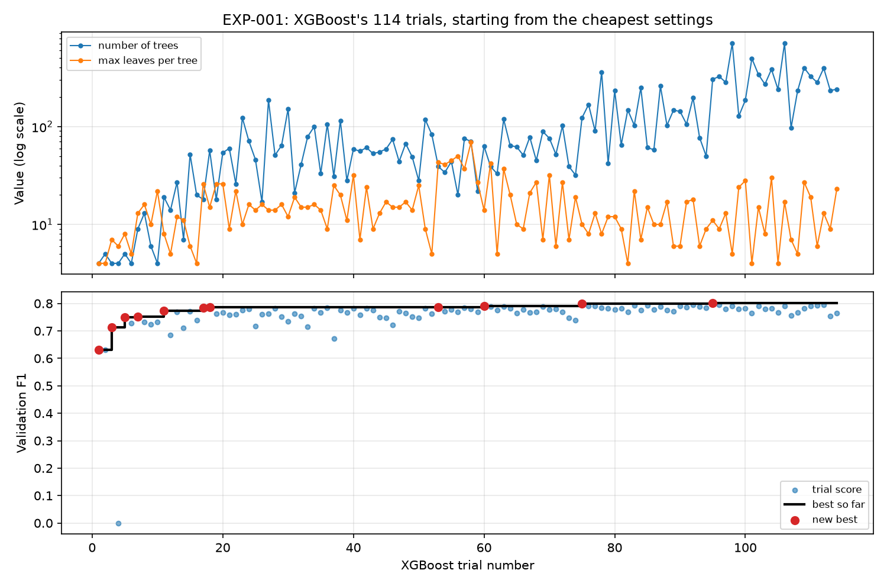

The exact numbers behind steps 2 to 6, from FLAML's source (useful for the report):

- The first step has a length of 0.1 x the square root of the number of settings, in the 0 to 1 slider space: 0.3 for XGBoost's 9 settings.
- The step only starts to shrink after 2 to the power of the number of settings failed tries in a row, at most 512: that is 512 for XGBoost and 256 for LightGBM. In EXP-001, XGBoost never had more than 34 failed tries in a row, so its step never shrank.
- Our seed (42) drives the random directions.

### 6.8 When the search stops

The search stops when the time budget is used up. With `early_stop`, it may stop sooner, but only if both of these are true:

1. every family's CFO search has converged at least once, and
2. the search has already run more than 10 times as long as it took to find the current best.

In EXP-001 neither was true: XGBoost's search never converged, and the best was found at 42.9 seconds, so stopping early would have needed 429 seconds anyway. In EXP-002 the best came at 23.2 seconds, so the second condition alone would have needed 232 seconds. So on small datasets like ours, the search normally uses the whole budget, even after it stops improving: EXP-001 found nothing better in its last 17 seconds, and EXP-002 nothing in its last 37 seconds.

### 6.9 Steps 4 and 5: retrain the winner and hand back the result

During cross-validation, every model is trained on only 4 of the 5 folds. So after the search, FLAML trains the winning settings once more, on all 712 training rows. This happens after the budget, with no time limit. That is why an experiment takes a little longer than its budget: EXP-001's FLAML call took 60.1 seconds, and California housing with a 10 second budget took 16.9 seconds, mostly because the final model was retrained on 16,512 rows.

FLAML then hands back:

- the trained model, ready to predict (it applies the same data preparation to new rows, and turns the 0/1 answers back into the original labels),
- the name of the winning family, its settings and its validation loss,
- the best loss and the best settings of every family it tried,
- the log file, with one line per trial.

One real line of EXP-001's log (trial 0, with the numbers shortened and two fields left out):

```json
{"record_id": 0, "learner": "lgbm", "trial_time": 0.1086, "wall_clock_time": 0.1232,
 "validation_loss": 0.3687, "sample_size": 712,
 "config": {"n_estimators": 4, "num_leaves": 4, "min_child_samples": 20, "learning_rate": 0.1,
            "log_max_bin": 8, "colsample_bytree": 1.0, "reg_alpha": 0.00098, "reg_lambda": 1.0}}
```

A validation loss of 0.3687 means an F1 of 1 - 0.3687 = 0.631.

`FLAMLEngine` turns all this into the result we keep: losses become scores again (1 - loss for F1, ROC-AUC, accuracy and R²; the loss itself for error measures such as RMSE), the log becomes the trial history and the "Search progress" chart, and the best of each family becomes the leaderboard.

### 6.10 Randomness: what our seed controls

| What | Controlled by |
|---|---|
| Our 80/20 split into the training and test parts | our seed |
| The random directions of each CFO search | our seed, passed to FLAML |
| FLAML's shuffling of the training part, its folds and its holdout | FLAML's own fixed seed (1) |
| FLAML's draw between learner families | FLAML's own fixed seed (1) |
| Randomness inside each model (for example which rows each random-forest tree sees) | fixed numbers built into FLAML |
| How many trials fit into the budget | the speed of the laptop at that moment |

So two runs with the same seed make the same choices in the same order, as long as the timings are the same. But the search stops on time, and the choice of family uses measured times, so a run on a busier laptop can finish a different number of trials, and occasionally pick a different winner. When we ran the same 30 second experiment twice (Titanic, seed 1), the trial counts were 213 and 210, and the test F1 was the same.

### 6.11 Things FLAML can do that our runs do not use

- **Sampling.** For big data (a holdout and more than 40,000 training rows), FLAML first trains on a sample of about 10,000 rows and grows the sample for promising settings. None of our datasets is that big, so every trial used the whole training part.
- **Parallel trials and BlendSearch.** With the Ray library, FLAML can run several trials at once and use BlendSearch, which mixes CFO with a broader search. We run one trial at a time with CFO.
- **Ensembles.** FLAML can combine several good models into one ("stacking"). It is off by default and we do not use it.

---

## 7. One real run from start to finish: EXP-001

Titanic, target `Survived`, 60 second budget, seed 42, run on 7 October 2026.

| Stage | What happened |
|---|---|
| Data | 891 passengers, 12 columns, 866 empty cells (`Age` 177, `Cabin` 687, `Embarked` 2), no duplicate rows |
| Profile flags | `PassengerId` and `Name` identifier-like; `Ticket` (681 values) and `Cabin` (147) high cardinality; `Cabin` 77% empty; mild imbalance (549 died, 342 survived) |
| Task | Binary classification, metric F1 |
| Excluded | `PassengerId`, `Name` |
| Split | 712 training rows, 179 test rows, 38% survivors in each |
| Unseen labels | `Ticket`: 63% of test rows; `Cabin`: 11% |
| FLAML preparation | 4 category columns (`Sex`, `Ticket`, `Cabin`, `Embarked`) and 5 number columns; 137 missing ages filled with 28.5 |
| Validation | 5-fold cross-validation |
| Search | 290 trials, 7 families, 59.7 s of training and scoring |
| Improvements | 12 new overall bests: 5 from LightGBM in the first 0.8 s, then 7 from XGBoost between 8.5 s and 42.9 s |
| Failed trials | 6 trials scored F1 0 (they found no survivors at all); 19% of all trials scored below 0.70 |
| Winner | XGBoost: 304 trees, at most 11 leaves per tree, learning rate 0.03, and 6 more settings; validation F1 0.802, found at 42.9 s |
| Retrain | The winning settings were trained again on all 712 rows; the whole FLAML call took 60.1 s |
| Test part | F1 0.673, accuracy 0.793, precision 0.864, recall 0.551, ROC-AUC 0.792. It found 38 of the 69 survivors, and wrongly flagged 6 passengers who died |
| Training part | F1 0.934: a large gap, so the model overfits |
| Trivial baseline | "Everyone died": F1 0.000, accuracy 0.615 |
| Importance | `Sex` 0.219, `Pclass` 0.098, `Ticket` 0.043, `Fare` 0.027, `SibSp` 0.021 |
| Saved | `experiments/EXP-001/`, `models/EXP-001/model.pkl`, one MLflow run |

The whole search on one chart:


Each dot is one trial, coloured by family; the black line is the best validation F1 so far. Three things stand out:

1. **Most of the gain came almost at once.** The best F1 was 0.769 after 0.8 seconds (8 trials) and 0.785 after 10 seconds. The remaining 50 seconds added about 0.016.
2. **Cheap families first, then the promising one.** LightGBM led in the first second; XGBoost took over at 8.5 seconds and got most of the remaining time.
3. **The last 17 seconds found nothing.** The budget was used up anyway (section 6.8).

The charts were drawn with `python scripts/plot_search_history.py --experiment EXP-001` from the saved trial history. The same command works for any experiment.

---

## 8. What the current setup cannot do yet

The baseline works, and its numbers are honest. These are its limits, each one seen in our own runs:

| Limit | What we saw |
|---|---|
| FLAML only changes the learner family and its settings. It cannot drop a column, encode one differently, add a feature, rebalance the classes or change the metric | In EXP-001 the winner leaned on `Ticket` (third most important), although 63% of the test tickets were unseen and all became position 571 (section 6.4). Dropping `Ticket` and `Cabin` was our own manual decision, in EXP-002 |
| The whole budget goes into one search, whether or not more time helps | EXP-001 reached 0.785 in 10 seconds, then spent 50 more seconds to gain about 0.016; EXP-002 found nothing new after 23 seconds |
| The validation score is the number FLAML optimised, and one split is noisy | EXP-001: validation 0.802, test 0.673. Changing only the split moved this setup's test F1 between 0.67 and 0.81 (`report-notes.md`, sections 9.6 and 9.7) |
| Every run starts from zero | Nothing learned in EXP-001 was used in EXP-002 |
| Nothing explains why a model is weak | The app shows the train vs test gap and the data flags, but a person has to read them and decide what to do |
| One click runs one experiment | The comparison of EXP-001 and EXP-002 was done by hand |

---

## 9. Where the next phase connects

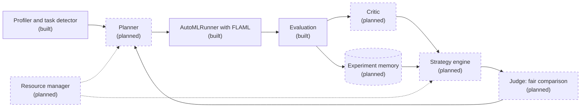

The dashed boxes are planned. Each one answers one limit from section 8:

| Planned part | Answers the limit | Plugs in at | Uses what the baseline already records |
|---|---|---|---|
| Critic | "Nothing explains why a model is weak" | After each experiment's result | Train, validation and test scores; data flags; unseen-label notes; the trial history |
| Strategy engine | "FLAML only changes models and settings" | Between the critic and the planner | The critic's diagnoses and, later, the memory |
| Judge | "The validation score is optimistic and one split is noisy" | Before a change is kept | Validation scores over several splits of the training part, never the test part |
| Planner | "One click runs one experiment" | Before the runner | `ExperimentConfig`, which the runner already accepts |
| Experiment memory | "Every run starts from zero" | Around the `experiments/` records | The meta-features and results in every `summary.json` |
| Resource manager | "The whole budget goes into one search" | Around the whole loop | Training time, total time, and the improvements over time in every trial history |

How each of these will work is the next thing we study, starting with the judge and the critic.

---

## Appendix A. Where each step lives in the code

| Step | File | Function or class |
|---|---|---|
| Read the CSV | `app/components/dataset_uploader.py` | `read_csv_bytes`, `render_dataset_uploader` |
| Profile | `app/services/profiler.py` | `DatasetProfiler.profile`, `analyze_class_balance`, `DatasetProfile.meta_features` |
| Detect the task | `app/services/task_detector.py` | `TaskDetector.detect`, `TaskDetector.validate` |
| Dashboard sections | `app/components/` | `render_dataset_profile`, `render_target_selection`, `render_experiment_config`, `render_run_section`, `render_results`, `render_explainability`, `render_experiment_history` |
| Background worker | `app/components/experiment_viewer.py` | `_start_run`, `_wait_for_run` |
| Run an experiment | `app/services/automl_runner.py` | `AutoMLRunner.run`, `run_experiment`, `_prepare`, `_split`, `_execute` |
| Unseen labels | `app/services/automl_runner.py` | `unseen_category_warnings` |
| Call FLAML | `app/services/automl_runner.py` | `FLAMLEngine.fit`, `_read_history`, `_leaderboard` |
| Score | `app/services/evaluator.py` | `Evaluator.evaluate`, `compute_metrics`, `baseline_metrics`, `feature_importance` |
| Save the model and files | `app/services/automl_runner.py` | `_save_model`, `_write_artifacts` |
| Track | `app/services/experiment_tracker.py` | `allocate_experiment_id`, `log_run`, `save_record`, `history_frame` |
| Settings | `app/core/config.py` | `Settings`, `get_settings` |

## Appendix B. Commands

Run these from the `autopilot-ml` folder with the `automl` environment active (`conda activate automl`).

```bash
# dashboard, then open http://localhost:8501
streamlit run app/main.py --server.address localhost --browser.gatherUsageStats false

# MLflow, then open http://127.0.0.1:5000
mlflow ui --backend-store-uri sqlite:///mlruns/mlflow.db --port 5000 --workers 1

# tests
python -m pytest -q

# compare two setups over several splits
python scripts/compare_seeds.py --dataset data/sample/titanic.csv --target Survived --exclude-a PassengerId,Name --exclude-b PassengerId,Name,Ticket,Cabin --seeds 1 2 3 4 5 --budget 30

# charts of one experiment's search (written to docs/imp/images)
python scripts/plot_search_history.py --experiment EXP-001
```

## Appendix C. Sources

FLAML 2.7.0 source files read for section 6 (in the `automl` environment, under `Lib/site-packages/flaml/`):

| File | What it showed |
|---|---|
| `config.py` | Fixed values: 5 folds, FLAML's own seed 1, the holdout share of 0.1, the cross-validation and sampling thresholds |
| `automl/automl.py` | The search loop, how a learner family is picked, early stopping, the cross-validation rule, retraining after the budget |
| `automl/state.py` | Each family's records and its expected cost of the next improvement |
| `automl/data.py` | Data preparation (`DataTransformer`) |
| `automl/task/generic_task.py` | The default learner list, the folds and the holdout, the averaging of fold scores |
| `automl/model.py` | Each learner's settings, ranges, starting values and starting cost guess; how categories become numbers |
| `tune/searcher/flow2.py`, `tune/searcher/blendsearch.py` | CFO: steps, opposite steps, shrinking, restarts, and the use of our seed |

Papers:

- Wang, C., Wu, Q., Weimer, M., and Zhu, E. (2021). FLAML: A Fast and Lightweight AutoML Library. MLSys.
- Wu, Q., Wang, C., and Huang, S. (2021). Frugal Optimization for Cost-related Hyperparameters. AAAI. (The paper behind CFO.)

Our own data: the trial logs and summaries in `experiments/EXP-001/` and `experiments/EXP-002/`, and checks of FLAML's data preparation on the EXP-001 split, run on 22 October 2026.
