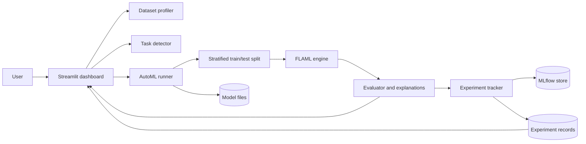
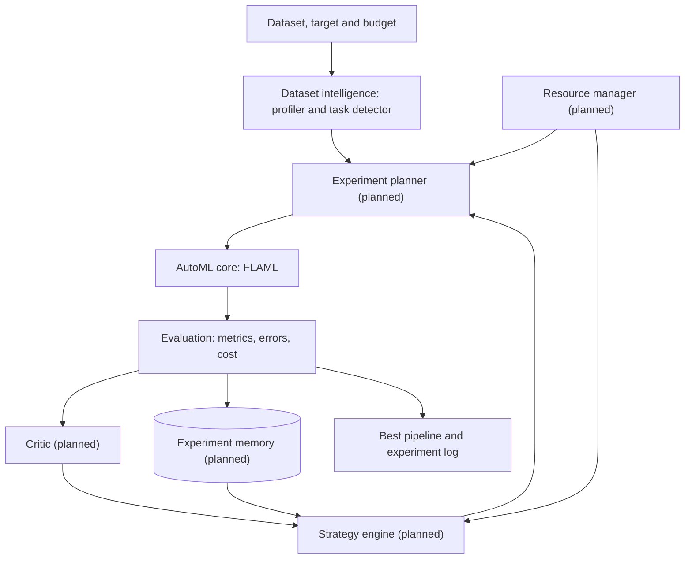
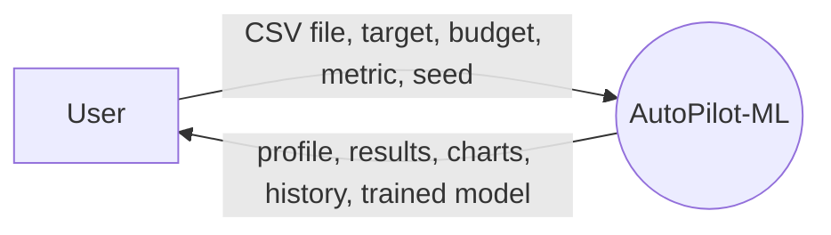
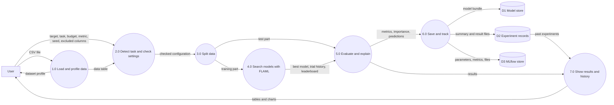
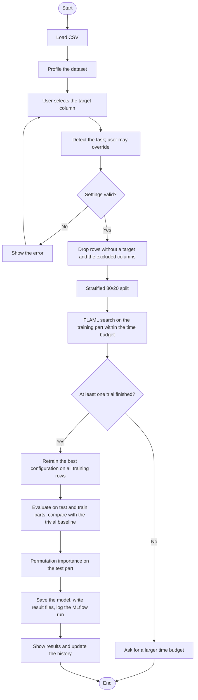
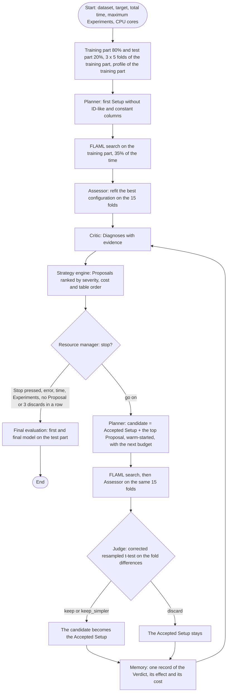

# Notes for the final project report

This file collects the material for the final report while the project is being built, so nothing has to be dug out of old chats or commits later. It is a set of notes, not the report itself.

Chapters 1 to 10 follow the report format. Each chapter has notes and a short "still to add" list. The appendices hold the references, the work log, the figure checklist, open items and where the raw data is.

Rules for keeping it up to date:

- After each piece of work (a module, a design decision, an algorithm, a problem solved, an experiment), add the facts to the right chapter and one line to the work log in Appendix B.
- Only real, measured numbers, each with its settings (dataset, time budget, seed, date) and where the raw files are.
- Mark anything that is not built yet as planned.
- Longer text that is already written lives in `PROJECT.md` (same folder). This file points to it instead of copying it.

Last updated: 2026-10-26

---

## 0. Front matter

- Title submitted to the department: **AutoPilot-ML - An Autonomous, Self-Optimizing Machine Learning Experimentation Framework**. The repository and `PROJECT.md` use the subtitle "Autonomous Machine Learning Experimentation & Self-Optimization Framework". Use the submitted title everywhere in the final report.
- Members (B.Tech CSE): Priyanshu Verma, Sch. No. 23U02016; Salil Kushwah, Sch. No. 23U02003.
- Group number, guide, department and institute: to fill in.
- Phase 1 review: October 2026, completed successfully (exact date to fill in).
- Abstract: write it last, from the final results. Starting points are the abstract in `PROJECT.md` and the project description posted for the department, copied below. When it was posted only the baseline existed; the critic, strategy engine, memory, resource manager and SHAP were still planned.

> AutoPilot-ML is an autonomous machine learning experimentation framework that goes beyond conventional AutoML. Instead of a single model search, it works like a data scientist in a loop. It profiles the dataset (data types, missing values, duplicates, class imbalance, high-cardinality and identifier columns), detects the problem type (binary, multiclass or regression) and trains models with FLAML as its AutoML engine. It then evaluates them on held-out data against baseline models and with explainability. A Critic module diagnoses model weaknesses such as overfitting, underfitting, class imbalance and misleading validation scores. A Strategy Engine then selects the next improvement (feature engineering, class weighting, SMOTE, regularisation or a change of model family) using rule-based selection, multi-armed bandits and meta-learning. An Experiment Memory stores dataset meta-features, strategies, results and compute cost, so the system learns from past experiments and tries first the strategies that worked on similar datasets. A Resource Manager spends the user's time and CPU budget on the experiments that give the most improvement per unit of compute. The system includes MLflow experiment tracking, explainability (permutation importance, SHAP) and an interactive Streamlit dashboard, and runs fully locally with no paid APIs. It will be evaluated against FLAML and AutoGluon with ablation studies. The baseline pipeline (profiling, task detection, FLAML training, evaluation, tracking and dashboard) is already implemented.

---

## 1. Introduction

Notes:

- Tabular data (records in rows and columns) is still the most common kind of data in applied machine learning. Gradient-boosted trees such as LightGBM and XGBoost are strong on it.
- AutoML libraries (auto-sklearn, TPOT, AutoGluon, FLAML) automate choosing a model and its hyperparameters, known as the combined algorithm selection and hyperparameter optimisation (CASH) problem (Thornton et al., 2013).
- They do not automate the loop around that search: reading the results, finding out why the model is weak, choosing what to change in the data, the features or the model family, running again, comparing fairly and deciding when to stop. What is learned on one dataset is rarely reused on the next.
- Motivating example, measured on Titanic (EXP-001, 60 s budget, seed 42): test F1 0.673 against train F1 0.934, so the model overfits. `Ticket` has 681 different values in 891 rows, and 63% of the test passengers have a ticket number the model never saw in training. A person would drop or re-encode the column, run again and compare. AutoPilot-ML aims to do this loop itself.
- Origin of the project: it started from working with FLAML (Microsoft Research; Wang et al., MLSys 2021; MIT licence). FLAML finds good models quickly on a laptop because its search takes the cost of each trial into account. The questions after every run were still left to the user, and that gap became this project. FLAML is used unchanged as the search engine. We do not modify it and do not claim to beat it; comparing against it is part of the evaluation.
- Constraints that shape the design: a laptop CPU, no GPU, no paid APIs, no cloud services. Every decision must be measurable and work offline.
- Research question: "Can an autonomous experimentation layer improve the efficiency and effectiveness of conventional AutoML by learning from previous experiments, diagnosing model weaknesses, selecting appropriate improvement strategies, and allocating computational resources adaptively?"
- Text already written: `PROJECT.md` Abstract, Acknowledgement, sections 1 and 2.

Still to add: a short paragraph on how the report is organised, written at the end.

---

## 2. Literature review

Notes by topic. Numbers in brackets refer to the reference list in `PROJECT.md` section 26; other sources are in Appendix A.2.

- Hyperparameter search: grid and random search [12]; Bayesian optimisation with SMAC [10], TPE [11] and Gaussian processes [13]; early stopping of weak configurations with Successive Halving [14], Hyperband [15] and BOHB [16].
- Model selection together with tuning (CASH): Auto-WEKA [8]; auto-sklearn [4, 5], which also starts its search from configurations that worked on similar datasets (meta-learning) and builds ensembles.
- Pipeline search: TPOT evolves whole pipelines with genetic programming [7].
- Ensembles with strong defaults: AutoGluon-Tabular stacks many models instead of searching for long [6].
- Cost-aware search: FLAML [1] with CFO [2] and BlendSearch [3]. FLAML also has a "zero-shot" mode that picks data-dependent default configurations mined offline from many datasets (Kayali and Wang, 2022).
- Time-limited model selection using other datasets: OBOE fits a low-rank model to a matrix of model errors across many datasets and uses it to choose promising models for a new dataset within a time budget (Yang et al., 2019).
- Meta-learning in general: survey by Vanschoren [17]. OpenML as a source of datasets and results [24]. The AutoML Benchmark for fair comparisons [23].
- Bandits, for choosing between options under uncertainty: UCB1 [18] and Thompson sampling (Thompson, 1933).
- Data problems the critic will look for: class imbalance and SMOTE [19]; data leakage, for example through ID-like columns (Kaufman et al., 2012).
- Honest evaluation: picking the best of many configurations on the same validation data makes the winner's validation score optimistic (Cawley and Talbot, 2010). Comparing methods over many datasets needs paired tests such as Wilcoxon and Friedman [22].
- Explanations: permutation importance, introduced with random forests [20], in its model-agnostic form (Fisher et al., 2019); SHAP [21] (planned).
- LLM-based data science: CAAFE for feature engineering [26] and MLAgentBench for agents that run ML experiments [27]. These depend on a large language model, and the papers used hosted models. Related work only: AutoPilot-ML does not use an LLM for decisions.
- Experiment tracking: MLflow [25].

Draft comparison. Check each cell against the papers before using it in the report.

| System | Model and hyperparameter search | Changes to data and features | Explains why a model is weak | Learns across datasets | Budget decisions across experiments |
|---|---|---|---|---|---|
| auto-sklearn | Yes, Bayesian optimisation | Partly: preprocessing steps inside the search space | No | Yes: warm start from data collected offline | Time limit only |
| TPOT | Yes, genetic programming | Yes: pipeline operators | No | No | Generations or time limit |
| AutoGluon-Tabular | Little: strong defaults and stacking | Built-in preprocessing | No | Fixed presets; newer versions also use portfolios built offline | Time limit and presets |
| FLAML | Yes, cost-aware | Built-in preprocessing | No | Zero-shot defaults mined offline | Cost-aware inside one search |
| OBOE | Model selection | No | No | Yes: error matrix over many datasets | Time-limited model selection |
| LLM agents (CAAFE, MLAgentBench) | Through the LLM | Yes, written by the LLM | Implicitly, inside the LLM | No | No |
| AutoPilot-ML (planned) | Through FLAML | Yes: strategy engine | Yes: critic | Yes: memory of changes with their effect and cost, from the user's own runs | Yes: resource manager |

Points to make in the chapter:

- Existing cross-dataset learning (auto-sklearn's warm start, FLAML's zero-shot defaults, OBOE) transfers good model and hyperparameter choices mined offline. AutoPilot-ML's memory stores changes to the experiment (drop or encode a column, class weights, resampling, another model family) with their measured effect and cost, collected from the user's own runs.
- None of the AutoML systems above explains why a model is weak or decides to change the data. LLM agents can, but they need a large language model and are hard to reproduce and measure.
- Phase 1 already showed why careful comparison matters (chapter 9). This connects to Cawley and Talbot (2010) and to Demšar [22].

Still to add: read the papers in Appendix A.3, check the comparison table, write one paragraph per group of works.

---

## 3. Problem definition and objectives

Problem (from `PROJECT.md` section 3): given a tabular dataset D with a target column y, a task T (binary classification, multiclass classification or regression), a primary metric m and a compute budget B (time, number of experiments, CPU cores):

1. find a pipeline p (data treatment, features, model, hyperparameters) with the best possible test performance m(p), and
2. reach it using as little of B as possible.

The baseline solves part 1 with one AutoML run. The research system works on both parts with a sequence of experiments e1, e2, ..., ek, where each next experiment is chosen from the diagnoses of the earlier ones and from a memory of experiments on other datasets.

| No. | Objective | Status |
|---|---|---|
| O1 | Baseline: profiling, task detection, FLAML training, held-out evaluation, explanations, experiment tracking, dashboard | Done (Phase 1) |
| O2 | Critic: automatic, structured diagnosis of each experiment, with evidence | Done (Phase 2: 12 kinds, measured by the critic study) |
| O3 | Strategy engine: map diagnoses to candidate changes and rank them (rules, then bandits, then memory) | Rules done (Phase 2: 9 Strategies); bandits on memory records built (Phase 3, task 21: Thompson sampling and UCB1); their effect is measured by the benchmark (planned) |
| O4 | Planner and autonomous loop, with a fair comparison of every change over several splits | Done (Phase 2: Assessor on 15 folds and the Judge, measured by the judge study) |
| O5 | Experiment memory: reuse what worked on similar datasets | Recording done (Phase 2); reuse built (Phase 3, task 21: the learned selectors read the nearest datasets' records); the frozen memory and its measured effect are planned (task 26) |
| O6 | Resource manager: share the time and CPU budget and decide when to stop (utility = improvement / cost) | Done (Phase 2: budgets, stop rules and the utility of each step recorded); stopping on expected utility needs the memory (Phase 3) |
| O7 | Evaluation against a manual baseline, FLAML and AutoGluon, with ablations, on public datasets and several seeds | Planned |

- Scope: CSV, single-table tabular data; binary, multiclass and regression; laptop CPU; fully offline.
- Out of scope: text, images, time series, clustering; LLMs as decision makers; cloud or paid services.
- Limits in the current code: time budget 5 to 3600 s, at least 20 labelled rows, test share 0.05 to 0.5. The user chooses the target column.
- Research questions RQ1 to RQ4 and hypotheses H1 to H4: `PROJECT.md` sections 15 and 16, and `research-direction.md`.

Still to add: success criteria with numbers, once the first Phase 2 results exist.

---

## 4. Methodology and work description

### 4.1 Approach

- Build and measure a reliable baseline first, then add one autonomous module at a time. Each module gets tests and an evaluation method before it is used in any claim.
- Use mature open-source libraries instead of rebuilding them (FLAML, scikit-learn, MLflow, Streamlit). FLAML is used unchanged.
- Rules set at the start of the project: do not over-engineer; no LLM just for the label "agentic"; no paid APIs; no cloud; business logic separate from the UI; reusable modules with type hints; clear error handling; tests for the important parts; an evaluation method for every research component; never invent results, and label anything not built as planned.
- One logical change per commit, with conventional commit messages.
- Spec-driven development (from Phase 2): the plan is a Kiro spec in `.kiro/specs/autopilot-ml/` (in the workspace folder, outside this repository): `requirements.md` (32 requirements, 160 numbered acceptance criteria written as WHEN/IF/THEN/SHALL statements), `design.md` (components, code shapes, rules, data formats, decisions D1 to D8) and `tasks.md` (35 tasks plus 21 test and run sub-tasks, each one commit, each linked to the criteria it satisfies, with a dependency graph and groups of tasks that can run in parallel). It was written on 26 October 2026, after the Phase 1 review, to fix the order of work and the interfaces before building. A script checked that every task's requirement links exist and that every criterion is covered.

### 4.2 Phases

| Phase | Content | Status |
|---|---|---|
| 1 | Baseline: profiling, task detection, FLAML, evaluation, MLflow, dashboard, history | Built 7 October 2026; reviewed in October 2026 |
| 2 | Rule-based critic, strategy catalogue and engine, fair comparison of changes, planner loop, memory, resource manager | Next |
| 3 | Learned strategy selection (bandits, memory), AutoGluon engine, benchmark, ablations | Planned |
| 4 | Optional local LLM explanations, SHAP, API, packaging | Later |

Steps and "done when" checks for each phase: `development-roadmap.md` (summary) and the spec's `tasks.md` (detail). Phase 2 is built in four milestones: M0 groundwork (tasks 1 to 4.1), M1 a thin loop that runs end to end with three diagnoses and three strategies (tasks 5 to 11.2), M2 the full version with the component studies (tasks 12 to 17), M3 the dashboard and the Phase 2 measurement (tasks 18 and 19).

### 4.3 Work done in Phase 1

In order (dates and commits in Appendix B):

1. Checked the machine and tools, created the conda environment `automl` with Python 3.11 and installed pinned libraries.
2. Created the project structure, settings and logging.
3. Built the services: task detector, dataset profiler, evaluator, experiment tracker, and the AutoML runner with the FLAML engine.
4. Added four small public datasets.
5. Built the Streamlit dashboard with seven sections, including the experiment history.
6. Wrote the tests, checked the dashboard headlessly on all four datasets and checked metric values against scikit-learn.
7. Wrote the documentation, ran the first experiments, wrote the seed comparison script, then prepared and gave the Phase 1 review.

### 4.4 How correctness was checked

- 47 pytest tests (section 8.6), including short real FLAML runs: about 29 s on 7 to 12 October, about 41 s in three runs on 22 October, with no code change in between.
- Streamlit's headless test tool drove the real dashboard on all four sample datasets without errors. The demo flow was rehearsed with 23 automated checks, all passed (7 October 2026).
- ROC-AUC, F1 and accuracy shown by the app were recomputed with scikit-learn from the saved predictions and matched exactly (Titanic: ROC-AUC 0.7868247694334651 both ways; the predicted class matched the higher probability on every row).
- MLflow runs, metrics and files were read back through the MLflow server's REST API.
- A saved model was reloaded and used to predict.

### 4.5 Experimental method so far

- Outer split: stratified 80/20 train/test split, made before FLAML sees any data. The test part is used once, at the end.
- FLAML searches on the training part and validates each trial with 5-fold cross-validation or a holdout split, using its own rule (section 5.2).
- Reported for every run: test metrics, train metrics, FLAML's validation score, a trivial baseline on the same test rows, training time and number of trials.
- Comparing two setups: both are run on the same splits (same seed) and compared split by split (`scripts/compare_seeds.py`), with a paired t-test and a Wilcoxon signed-rank test on the differences. For a single split, a paired bootstrap over the test rows gave a confidence interval for the difference (section 9.3).
- Since Phase 2: the loop decides on the training part only, over 15 fixed folds (Assessor and Judge, sections 5.4 and 9.13); the test part only reports the first and the final model at the end. Component studies use synthetic data with a fresh sample as the truth, with separate tuning and reporting seeds. The loop against FLAML alone: same total budget, same split and columns, 3 seeds per dataset, compared pair by pair (section 9.14).

### 4.6 Design decisions

| Decision | Reason |
|---|---|
| Test split made outside FLAML | FLAML's validation score is the number it optimised, so it cannot also be the independent final score |
| FLAML behind a small engine interface | FLAML stays replaceable; AutoGluon is needed later for comparison |
| Services never import Streamlit | The same code runs from the UI, scripts, notebooks and tests |
| `MlflowClient` with explicit run IDs instead of MLflow's global "active run" | No hidden global state; works from a background thread |
| MLflow on a local SQLite file | MLflow 3 defaults to a database backend; SQLite needs no server |
| A small JSON record per experiment, next to MLflow | Readable and independent of the engine; raw material for the experiment memory |
| Permutation importance first, SHAP later | Works on the original columns for every model FLAML returns |
| Rule-based task detection with a user override | Easy to explain and test; unclear cases such as integer codes get lower confidence |
| Experiment IDs reserved by creating the folder | Two runs started together can never get the same ID |
| Experiment runs in a background thread | Streamlit reruns the script on every click; the run and its progress survive reruns |
| Autonomous run: the page does not wait in a loop; a fragment redraws the live view every second (task 18) | A Session takes minutes, and Stop must stay clickable while it runs; the dashboard tests can then press Start and Stop between page runs |
| The live view is drawn only from the session record, which the Session hands to the page after every save (`on_update`) | One source of truth: the page shows exactly what `session.json` holds, without reading a file that the Session may be rewriting |

### 4.7 Problems met and how they were solved

| Problem | Solution |
|---|---|
| FLAML printed a warning on every prediction when a column had values not seen in training: 96 warning lines in one 10-second Titanic run, mostly during permutation importance | Silenced that message and added one note per column with the share of affected test rows (commit 2fddc57) |
| In longer runs the warnings came back, because scikit-learn's parallel helper calls `warnings.resetwarnings()` in worker threads, which wipes the process-wide filter list | Also drop these two kinds of warnings (unseen categories and convergence) where Python prints warnings, with a test (commit ca536c7) |
| `mlflow ui` crashed on Windows with several workers (`OSError: [WinError 10022]`) | Start it with `--workers 1` |
| MLflow 3 prints an "agent hint" banner on import, and its SQLite store prints a deprecation warning | `MLFLOW_DISABLE_AGENT_HINT=1`, and that warning is filtered |
| MLflow 3 creates its database in whatever folder it is started from | Fixed locations: `mlruns/mlflow.db` and `mlruns/artifacts` |
| Streamlit listens on all network interfaces by default and has no login | Start it with `--server.address localhost` |
| FLAML reports no progress during its search | The progress bar is estimated from elapsed time against the budget |
| Tests with a 3-second budget failed the 5-second minimum | Tests use 5 s |
| pandas 3.0 has a new default text type (`str`) | Checked that FLAML 2.7 handles it |
| Streamlit 1.65 deprecates `use_container_width` | `width="stretch"` |
| Saved models are pickle files, which can run code when loaded | Documented: only load files this app created |
| MLflow stores absolute file paths | Documented: moving the project folder breaks file links in old MLflow runs; the JSON records still work |
| Ranking tie in SES-001 (section 9.11): with overfitting high, "drop `Cabin`" and "drop `Ticket`" both answered a high Diagnosis, had the same cost and table position, and the tie was broken by the key in alphabetical order, so `Cabin` (only moderately high-cardinality) was tried before `Ticket` (high). It cost one extra step and did not change the final Setup | Not applied (decided on 26 October 2026). The proposed tie-break used the severities of all the Diagnoses a Proposal answers. With the full Critic (task 13), `Cabin` (77% empty) also gets a high missing-values Diagnosis, so "drop `Cabin`" answers two high Diagnoses too and that tie-break would keep the same order. The extra step was not wasted either: dropping `Cabin` was kept as the simpler Setup. The ranking rule of Requirement 8.2 stays as it is |
| Warm starts lost after "smaller trees" in SES-001 (EXP-006): the Accepted_Setup's best configurations of LightGBM, XGBoost and depth-limited XGBoost were outside the limited search space, so the engine left them out (with warnings, as designed) and those searches started from FLAML's defaults | Not applied (decided on 26 October 2026). A configuration moved into the limited space has never been evaluated, and in a changed space FLAML's own cheap starting point is a sound start, since its search grows from low-cost configurations. Whether moving would help needs its own measurement; listed as future work (chapter 10) |
| A dataset with repeated row labels would silently pair features with the wrong target values: the runner matches rows by label (`df.loc[y.index]`) and splits by position (found while reviewing task 3, 26 October 2026; CSV uploads always have a plain row index, so no run was affected) | The runner refuses such a dataset with a clear message before an experiment starts; any unique index works (test: a shuffled index gives the same test metrics as the plain one) |
| Equal paired differences could still give a tiny non-zero variance through rounding of their mean, and so a meaningless, huge t statistic (found by the Judge tests, task 8.1, 26 October 2026) | `corrected_resampled_t` checks whether the values themselves are all equal; the Judge treats a standard deviation of at most 1e-12 (the refit tolerance) as equal and then decides on the mean alone |
| FLAML never searches the upper value of an integer range, but its validity check accepts it (found in the source, task 3, 26 October 2026) | Limits are written inclusive ("at most 32") and the engine adds 1 for FLAML; starting values are checked against the range FLAML really searches |
| The judge study's fixed rule chose 5 fold repeats over 3 on one tuning pair whose verdict changed only from `keep_simpler` to `keep`, with the same change accepted either way; on the reporting seeds both gave the same rates, and 5 repeats make every Assessment 25 refits instead of 15 (section 9.13, 26 October 2026) | Decided on 26 October 2026: alpha 0.20 as the rule says, but 3 repeats instead of 5, because both accept the same changes on both seed sets and 3 take three fifths of the Assessment time. Reported as a departure from the rule fixed before the run (section 9.13) |
| The judge study did not create the search folders of its two Setups, so FLAML could not write its log (found by a trial run before the real run, task 17, 26 October 2026; the smoke test uses a stand-in engine that writes no log) | The study creates each search folder before the search |

### 4.8 Phase 1 review

- Presented in October 2026 using the live dashboard and `docs/unimp/Project_Presentation.md`. Result: completed successfully.
- Correction made afterwards (12 October 2026): the presentation explained the validation/test disagreement on seed 42 with shared ticket numbers. Measurement showed this does not hold up (section 9.7). The archived files carry a note.
- Feedback from the guide: to fill in.

Still to add: Phase 2 work as it happens.

### 4.9 Datasets for Phase 3 (task 20, fixed on 27 October 2026)

Requirement 22: development datasets (to build the memory, free to look at) and evaluation datasets (only for the benchmark) must not overlap, must be chosen by written criteria, and must be fixed in a committed file before any evaluation run. How they were chosen (`research/datasets.py`; the rule was written after listing the suites' OpenML summary numbers, and before any dataset was downloaded or any model was run on one):

1. Pool: all 107 datasets of two curated OpenML suites, OpenML-CC18 (72 classification datasets, study 99) and OpenML-CTR23 (35 regression datasets, study 353). Kept: 500 to 10,000 rows and at most 100 feature columns (laptop-sized for budgets of 2 and 5 minutes); left out: the two versions of the Wisconsin breast cancer data, since the `breast_cancer` sample is one of them. 64 datasets remained. The pool with its OpenML qualities is in `results/datasets/openml_pool.csv`.
2. Six groups, two per task, so that each list covers imbalance, missing values and categorical columns: binary imbalanced (largest class at least 3 times the smallest; 11 candidates); binary with missing values or categorical columns (7); multiclass with neither and balanced (10); multiclass with missing values, categorical columns or imbalance (12); regression with neither (13); regression with missing values or categorical columns (6). Balanced, numeric-only binary datasets fall into no group.
3. In each group the candidates were sorted by OpenML ID and shuffled with one generator seeded with 2026; the first became an evaluation dataset, the second a development dataset.

| Group | Evaluation (OpenML ID) | Development (OpenML ID) |
|---|---|---|
| binary imbalanced | pc4 (1049): 1,458 rows, 37 numeric columns, ratio 7.2 | wilt (40983): 4,839 rows, 5 columns, ratio 17.5 |
| binary messy | cylinder-bands (6332): 540 rows, 37 columns (14 text), 5% empty cells | tic-tac-toe (50): 958 rows, 9 text columns |
| multiclass clean | segment (40984): 2,310 rows, 18 columns, 7 classes | vehicle (54): 846 rows, 18 columns, 4 classes |
| multiclass messy | MiceProtein (40966): 1,080 rows, 77 columns, 8 classes, 1.7% empty cells | balance-scale (11): 625 rows, 4 columns, 3 classes, ratio 5.9 |
| regression clean | energy_efficiency (44960): 768 rows, 8 columns | kin8nm (44980): 8,192 rows, 8 columns |
| regression messy | solar_flare (44966): 1,066 rows, 10 columns (3 text) | student_performance_por (44967): 649 rows, 30 columns (17 text) |

With the four samples there are 10 development and 6 evaluation datasets. Licences: "Public" on OpenML for the CC18 datasets, CC BY 4.0 for the CTR23 datasets (as recorded by OpenML, in `datasets.json`). Each dataset is downloaded once with scikit-learn's `fetch_openml` (cache in `data/raw/openml_cache`) and saved as `data/raw/<name>.csv`; OpenML's ignored columns are left out (for MiceProtein that removes `MouseID` and the three columns from which the class is made). Two regression targets have few integer values (student grades, solar flare counts), so the app's own detector would call them multiclass; the registry records OpenML's task, which the benchmark passes to every system, and the detected one. `python scripts/prepare_datasets.py download` recreates the files from the IDs and versions and checked all 12 against the registry (27 October 2026).

---

## 5. Proposed algorithms

### 5.1 Implemented in Phase 1

**Algorithm 1: one experiment** (`AutoMLRunner.run_experiment`)

```text
input: dataset D, target, task (optional), metric (optional), budget, seed, test share, excluded columns
1  check: target and excluded columns exist, 5 <= budget <= 3600, 0.05 <= test share <= 0.5
2  y = target values without missing ones; X = the same rows without the target and excluded columns
3  require at least 20 rows and at least one feature column
4  task = given task, or detect it (Algorithm 2); check that task and metric fit y
5  split X, y into train and test (stratified for classification; plain if a class has fewer than 2 rows)
6  model, trial history, leaderboard = FLAML search on train (section 5.2)
7  test metrics, train metrics, trivial baseline on the test rows (Algorithm 4)
8  permutation importance on the test rows (Algorithm 5); unseen-category notes (Algorithm 6)
9  save the model bundle, write result files, log an MLflow run, write summary.json
output: ExperimentResult
```

**Algorithm 2: task detection** (`TaskDetector.detect`), on the target values without missing ones:

1. Fewer than 2 distinct values: rejected.
2. Text or boolean target: 2 classes gives binary; more classes gives multiclass, with high confidence up to 20 classes and low confidence above.
3. Numeric target with exactly 2 distinct values: binary.
4. Integer values with at most 20 distinct values: multiclass, medium confidence if the distinct values are at most 5% of the rows, otherwise low; the user is told it may be a count or an ordinal value.
5. Other integer values: regression, medium confidence. Anything else: regression, high confidence.

User overrides are checked by `TaskDetector.validate`: regression needs a numeric target, binary needs exactly 2 classes, multiclass needs at least 3. Warnings for missing targets, more than 20 classes, or classes with fewer than 2 rows.

**Algorithm 3: column checks** (`DatasetProfiler`):

- Constant: at most 1 distinct value.
- Identifier-like: every value is different, nothing is missing, and the column is not decimal or a date; or the name looks like an ID (`id`, `..._id`, `...Id`, `...ID`) and more than 95% of the values are distinct. Identifier-like and constant columns are suggested for exclusion.
- High cardinality: a text column with more than 50 distinct values (flagged only).
- Mostly empty: at least 40% missing.
- Class balance: ratio of majority to minority class. Below 1.5 none, 1.5 to 3 mild, 3 to 9 moderate, 9 or more severe.
- Meta-features for the planned memory (`DatasetProfile.meta_features`): rows, columns, numerical and categorical feature counts, share of numerical features, overall and largest missing share, duplicate share, numbers of ID-like, high-cardinality and constant columns; for classification the number of classes, imbalance ratio and majority share; for regression the skew of the target.

**Algorithm 4: scores and metrics** (`Evaluator`, `FLAMLEngine`):

- Primary metric choices: binary F1, ROC-AUC, accuracy, log loss; multiclass macro F1, accuracy, macro ROC-AUC (one-vs-rest), log loss; regression R², RMSE, MAE, MSE. Defaults: F1 and R².
- Names passed to FLAML: multiclass F1 becomes `macro_f1` and ROC-AUC becomes `roc_auc_ovr`; the others keep their names.
- FLAML minimises a loss. For metrics where higher is better the score is 1 - loss; for error metrics the score is the loss itself.
- Binary positive class: the last label in sorted order (Titanic: 1, survived; breast cancer: "malignant").
- Trivial baseline on the same test rows: always the most common training class, or the training mean for regression.
- Accuracy warning: shown when accuracy is chosen and the imbalance is moderate or severe.

**Algorithm 5: permutation importance** (`Evaluator.feature_importance`, built on scikit-learn):

```text
use at most 2000 test rows
s0 = score of the model with the primary metric, signed so that higher is better
for each original column j:
    repeat 5 times: shuffle column j and score again -> s(j, r)
    importance(j) = mean over r of (s0 - s(j, r)); spread(j) = standard deviation
sort the columns by importance
```

**Algorithm 6: unseen categories** (`unseen_category_warnings`): for each non-numeric column, the share of test rows whose value never appears in the training part. One note per affected column.

### 5.2 FLAML's search (external, used unchanged)

- Learner choice: FLAML keeps a search state for each learner and picks the next one using an estimate of the cost for improvement (ECI) [1]. In our classification runs the learners were LightGBM, XGBoost, XGBoost with limited depth, random forest, extra trees, an SGD linear model and L1 logistic regression (CatBoost is not installed).
- Hyperparameters: CFO, a local search that starts from cheap configurations and moves to expensive ones only when that looks worthwhile [2]. FLAML's "auto" setting resolves to CFO in our runs because trials run one at a time without Ray or Spark (checked in the FLAML 2.7.0 source). BlendSearch [3] is used only for parallel trials and needs the optional Optuna package, which is not installed.
- Validation rule (FLAML 2.7.0 source): 5-fold cross-validation if rows x columns / 0.9 < 10,000,000 x budget / 3600 and rows < 100,000; otherwise a holdout split. Titanic used cross-validation (recorded at 10 s and 60 s); California housing used holdout at 10 s.
- After the search, the best configuration is retrained on all training rows (`retrain_full=True`). The search may stop early once it has converged (`early_stop=True`).

Task 1 of the spec (26 October 2026): automated checks in `tests/test_flaml_capabilities.py` (8 tests) of the FLAML features the autonomous layer relies on. All measured on the Titanic seed-42 training part (712 rows) unless stated, with `n_jobs=-1` on the laptop in chapter 7:

- `starting_points`: a search started from a given LightGBM configuration evaluated exactly that configuration as its first trial.
- `max_iter=1` with a starting configuration trains exactly that configuration on all given rows, with no search. This is how the Assessor refits a setup. Two refits gave identical predictions (largest difference 0 for XGBoost and LightGBM, 3.3e-16 for random forest), so the tolerance is set to 1e-12.
- Cost of one refit: XGBoost with 304 trees on 570 Titanic rows, median 0.24 s (largest 0.36 s, 5 runs); XGBoost with 300 trees and 64 leaves on 13,210 California housing rows, median 1.49 s (3 runs). So 15 refits cost about 4 s on Titanic and about 22 s on California housing for these configurations.
- Using FLAML's `DataTransformer` and the XGBoost learner class directly did not reproduce the predictions of the same configuration trained through `AutoML` (largest difference in predicted probability 0.245), so it is not used as a fallback.
- `sample_weight` (balanced class weights): accepted; the mean predicted survival probability on the test part rose from 0.371 to 0.442 (LightGBM, 37 trees). FLAML also weights its validation score: the same first configuration scored a validation loss of 0.2286 without weights and 0.2045 with them. The Judge therefore compares unweighted fold scores.
- `custom_hp`: with the LightGBM `num_leaves` domain capped at 32 (FLAML's own starting value of 4 kept), all 40 trials stayed within the cap.
- Read in the FLAML 2.7.0 source while building task 3: the search never tries the `upper` value of an integer range (`normalize` and `denormalize` in `tune/space.py` use `upper - 1` unless the range is quantized). FLAML's own spaces are written this way, for example `min_child_samples` uses `upper=2**7 + 1` for "at most 128". So our limit "at most 32" becomes `upper=33`. Task 3.1 confirms it with a test: the top of the scaled range maps to 32 for `lograndint(4, 33)`, to 8 for `randint(1, 9)` and to 10 for the quantized `qrandint(2, 10, 2)`. FLAML's own validity check of a starting value (`is_valid`) still accepts `upper` itself, so our engine checks against the range that is really searched.
- A starting configuration outside the search space (`num_leaves` = 1,000,000) was dropped and the search continued from FLAML's default, but FLAML's warning could not be captured, so our engine checks starting points itself and records the warning. FLAML makes this check only when `max_iter` is above 1, which is why a fixed refit (`max_iter=1`) trains the configuration as given.
- `resampler`: a stand-in resampler was called on the training rows of each fold (569 or 570 rows) and once on all 712 training rows, 11 times for 2 trials, never on validation rows. Combining it with `sample_weight` raises `ValueError`.

Details checked in the FLAML 2.7.0 source and in the EXP-001 and EXP-002 trial logs (22 October 2026). The plain-language version, with diagrams, is `how-it-works.md` section 6.

- One pass of the search loop runs exactly one trial: pick a learner, let its CFO search propose one configuration, train and score it (5 models with cross-validation), update that learner's records. EXP-001 made 290 passes in 60 s, and 59.7 s of that went into training and scoring.
- Starting cost guesses relative to LightGBM (`cost_relative2lgbm` in `automl/model.py`): LightGBM 1, SGD 1, XGBoost 1.6, extra trees 1.9, random forest 2, XGBoost depth-limited 64, L1 logistic regression 160. EXP-001 tried the learners for the first time in exactly this order, at trials 0, 3, 12, 14, 21, 258 and 289.
- Learner choice (`_select_estimator` in `automl/automl.py`, `estimated_cost4improvement` in `automl/state.py`): expected cost of the next improvement = the larger of the learner's own time spent on its last improvement and its own time since then. A learner behind the leader by a gap g, improving at speed v, gets at least 2g/v. An untried learner keeps its starting guess times the cost of the first trial, and is chosen when it is the cheapest. Otherwise the learner is drawn at random with probability proportional to 1 / expected cost (FLAML's own fixed seed 1). Learners whose best trial is slower than the time left are skipped.
- CFO details (`tune/searcher/flow2.py`, `blendsearch.py`): the first configuration uses small values for the cost-related settings (4 trees and 4 leaves for LightGBM, XGBoost and random forest) and defaults for the rest. From the best point, it steps in a random direction in a 0-to-1 scaled space (log scale for wide ranges) and tries the opposite step if that fails. The first step length is 0.1 x sqrt(d), where d is the number of settings. The step shrinks only after 2^min(d, 9) consecutive proposals without improvement (512 for XGBoost, 256 for LightGBM). When the step falls below a lower bound the search has converged, and CFO restarts from the starting point with random noise. Our `seed` drives these random directions.
- Search ranges on Titanic: up to 712 trees and 712 leaves (FLAML caps both at the number of training rows; the largest tried in EXP-001 was 711 trees).
- Early stop needs every learner's local search to have converged at least once and the search to have run more than 10 times as long as it took to find the current best. It did not trigger in EXP-001 or EXP-002, which both searched for the full 60 s. In EXP-001, XGBoost never had more than 34 failed tries in a row, far below the 512 needed before its step shrinks.
- Retraining after the search has no time limit (`time_budget = -1` in `automl/automl.py`), which explains why runs overrun the budget (California at 10 s: 16.9 s).
- Folds and holdout: `RepeatedStratifiedKFold(5)` for classification (`RepeatedKFold(5)` for regression) after a shuffle, and the holdout is 10% of the training part (`SPLIT_RATIO = 0.1`), all with FLAML's fixed seed 1, so they do not change with our seed. A trial's score is the mean of its fold scores. California switches from holdout to cross-validation at a 53 s budget (16,512 x 8 / 0.9 = 146,773 against 147,222).
- Data preparation (`DataTransformer` in `automl/data.py`, run on the EXP-001 split). Text columns with one value, or a different value in every filled row, are dropped: FLAML would drop `Name` by itself but would keep `PassengerId`, a number. Other text columns become categories, and empty text becomes `__NAN__`. Empty numbers get the training median: 137 missing ages became 28.5. Labels are encoded 0/1.
- How each learner sees categories: LightGBM uses them directly. XGBoost, random forest, extra trees and the linear models get alphabetical codes (female 0, male 1; tickets 0 to 570). Unseen test tickets become `__NAN__`, code 571, for 112 of the 179 test rows in EXP-001.
- Sampling (training on a growing sample) is used only with a holdout and more than 40,000 training rows, so it never applied to our datasets: every trial used the whole training part. Classes with fewer than 20 training rows would be copied (`auto_augment`); this also never applied.

### 5.3 Planned (draft designs; they will change as they are built)

Update, 26 October 2026: the current design is the spec's `design.md` (`.kiro/specs/autopilot-ml/`). The drafts P1 to P7 below are kept for the history of the design. What changed:

- New component, the Assessor: it refits a setup's best configuration (no search) on fixed Session_Folds of the training part, 3 repeats of 5-fold cross-validation (kept after the judge study, section 9.13), and records per-fold scores. The Critic and the Judge both read these scores.
- P6 is replaced by the Judge: paired differences on the same folds, the corrected resampled t-test of Nadeau and Bengio (2003) in the repeated form of Bouckaert and Frank (2004), and three verdicts: keep, keep_simpler (simpler and not worse) and discard. The expensive version in P6 (full searches on several inner splits) becomes the strict reference in the judge agreement study (Requirement 25). Decision D2, confirmed on 26 October 2026.
- P1: the thresholds move to a TOML file with a version label (`critic_thresholds.toml`). Two more kinds are added: budget_limited and wasted_budget. The thin loop starts with overfitting, high_cardinality and class_imbalance.
- P2: strategies are split into a thin set (drop_columns, class_weight_balanced, regularised_search_space) and a full set. Data changes (frequency encoding, rare-category grouping, missing indicators) are learned inside each fold.
- P3: the learned selectors treat each pair of strategy and diagnosis kind as an arm, with statistics from similar past datasets in the memory.
- P5: the first experiment gets 35% of the time by default (30% to 40% allowed), budgets are counted in measured wall-clock time, and the default patience is 3 discards in a row.
- P7: group-aware folds are now optional (Requirement 28).
- New rule: inside a Session, the test part is used once, at the end, for the first and the final model only (the Final_Evaluation), and decision components only see records with every test number removed.

**P1. Critic.** Decisions use training and validation data only, never the test set. Starting rules, to be tuned on synthetic datasets with planted problems and frozen before the final evaluation:

| Diagnosis | Evidence | Starting rule |
|---|---|---|
| Overfitting | train score minus validation score | gap above 0.10 moderate, above 0.20 high (scores from 0 to 1) |
| Underfitting | train and validation scores against the trivial baseline | both low; exact rule to be set |
| Class imbalance | class balance severity | moderate or severe |
| Missing values | missing share per column | at least 40% in a column |
| High cardinality | distinct values; unseen values between training and validation folds | more than 50 distinct text values, or many unseen values |
| Unreliable validation | spread of validation scores across folds or splits | spread larger than the change being tested |
| Wasted compute | improvement per second over recent trials or experiments | below a threshold |
| Possible leakage (later) | one column with very high importance; ID-like names | flag for the user |

Example from Phase 1 (EXP-001): train F1 0.934 against validation F1 0.802, a gap of 0.13, so "overfitting: moderate" under the starting rule.

Each diagnosis will be checked for precision and recall on synthetic datasets where the problem is planted on purpose.

**P2. Strategy rule table** (first version, also in `PROJECT.md` section 13):

| Diagnosis | Candidate strategies |
|---|---|
| Overfitting | drop or encode high-cardinality columns; search space biased towards regularisation; fewer or shallower trees; feature selection |
| Underfitting | more budget; more expressive model families; new features |
| Class imbalance | class weights; SMOTE; switch the metric to F1 or ROC-AUC; tune the decision threshold |
| Missing values | missing-value indicator columns; drop mostly empty columns |
| High cardinality | frequency or target encoding; drop the column |
| ID-like or constant columns | drop them |
| Redundant features | drop one column of each highly correlated pair |
| Unreliable validation | more splits or repeated cross-validation; group-aware folds where rows are related |
| Wasted compute | restrict the model list; smaller budget; stop |

**P3. Strategy selection.**

- Version 1: fixed priority from the rule table, cheapest strategy first.
- Version 2, bandit: each strategy is an arm. Reward = (validation score after - before) / compute seconds, sign flipped for error metrics and scaled to 0..1 over the strategies tried. UCB1 picks the arm with the highest mean reward + sqrt(2 ln N / n_a), where N is the total number of tries and n_a the tries of arm a [18]. Thompson sampling keeps a Gaussian belief about each arm's mean reward and picks the arm with the highest sampled value.
- Version 3: start each arm's belief from what the strategy achieved on similar datasets (P4).

**P4. Memory retrieval.** Each record stores meta-features, diagnoses, strategy, engine, model family, hyperparameters, score before and after (with its spread over splits) and cost. For a new dataset: standardise the meta-features over the stored records, find the k nearest past datasets by Euclidean distance (k = 5 to start), and rank strategies by distance-weighted mean reward. Fall back to the rule order when there are fewer than 3 observations.

**P5. Resource manager.** Utility = improvement in validation score / compute seconds. The first run gets a fixed share of the budget (for example 30%), and each later experiment gets a share of what is left, weighted by expected utility. Stop when the time or experiment limit is reached, when no remaining strategy has an expected utility above a threshold, or after two experiments in a row without a kept improvement. `n_jobs` follows the CPU limit.

**P6. Fair comparison of a change** (added after Phase 1):

```text
input: current setup A, candidate setup B, number of splits k (k >= 5)
for i = 1..k:
    split the training part into a search part and a decision part (80/20, seed i)
    run FLAML for A and for B on the search part, same budget
    d(i) = score of B minus score of A on the decision part
keep B if the mean of d is above 0 and B wins on most splits
(use the Wilcoxon signed-rank test once k >= 6)
the outer test set is never used for this decision
```

This costs 2k runs per decision, so the budget split has to allow for it. Cheaper variants (shorter comparison budgets, reusing A's runs) are to be explored.

**P7. Group-aware validation** (option): keep rows of the same group, for example the same `Ticket`, inside one fold, for data where new rows will come from new groups. On Titanic it is not needed to make validation and test agree (section 9.7); it is a choice about what kind of new data to expect.

### 5.4 Implemented in Phase 2

Added as each spec task is built. Full code shapes are in the spec's `design.md`.

**Algorithm 7: search-space limits and starting points** (`FLAMLEngine.custom_hp` and `check_starting_points`, task 3)

1. For each limited setting, take FLAML's own spec of that learner's search space for the training data size.
2. Work out the range FLAML really searches: `lower .. upper - 1` for a plain integer range, `lower .. upper` otherwise (section 5.2).
3. Narrow it with the user's inclusive bounds (never widen it); stop with an error if fewer than two values are left.
4. Write the new range back in FLAML's form (upper + 1 for a plain integer range), keeping the domain type, and move `init_value` and `low_cost_init_value` inside it.
5. For each starting configuration, drop FLAML's bookkeeping keys, then check every value against the limited space: right type and inside the searched range, or one of the choices. A configuration with any value outside is left out, with a warning naming the settings.

**Algorithm 8: synthetic dataset with planted problems** (`research/synthetic.py`, task 4), used to test the Critic and the Judge against known answers.

1. Make the rows of the dataset and of a fresh sample (20,000 rows by default) in one call to `make_classification` (8 informative features, class weights when imbalance is planted, no label flips) or `make_regression` (8 informative features plus noise with a third of the signal's standard deviation, so the best possible R2 is 0.9).
2. Split them into the dataset and the fresh sample, stratified for classification.
3. Plant each requested problem in both parts in a fixed order, each from its own random stream derived from the seed: change labels (label noise), add noisy copies of 2 columns with a chosen correlation, add random numeric columns, add an integer ID column with a chosen share of distinct values, add a column with a chosen share of one main value, add a category column with strength x rows levels drawn at random, and empty a chosen share of the cells of 2 columns. Counts are exact in each part.
4. Return the dataset, the fresh sample and the list of planted problems with their columns.

Because both parts come from one generator, a model's score on the fresh sample estimates its true score. Checked on 26 October 2026: a binary dataset with all eight problems (1,000 rows plus 20,000 fresh rows) is made in 0.1 s.

**Algorithm 9: Assessment of a Setup** (`app/services/assessor.py`, task 5)

1. Look up the cache key (setup key, winning learner family, winning configuration). If this configuration of this Setup was assessed before in the Session, return that Assessment without refitting.
2. Check that the given rows are the Training_Part the Session_Folds were made on (same number of rows).
3. For each of the 15 folds (3 repeats of 5 folds, the default; kept after the judge study in section 9.13): take the fold's training rows; compute balanced sample weights from them if the Setup uses class weights; train the winning configuration on them with `fit_config`; score it on the fold's training rows and validation rows with every task metric, record each class's validation recall, the share of validation rows with a category not seen in the fold's training rows (per column), the trivial baseline's validation scores and the fit time.
4. If a fold fails, record the error, mark the Assessment failed and stop.
5. Report the total time, and per metric the mean and standard deviation over the folds.

Throwaway check on 26 October 2026 (Titanic, setup A, seed-42 split, session folds seed 43, one 10 s FLAML search, `n_jobs=-1`; output printed only, not saved): FLAML chose XGBoost with a validation F1 of 0.774; the 15 refits took 4.6 s and gave validation F1 0.751 (standard deviation 0.051 over the folds) and training F1 0.854. The trivial baseline (always "did not survive") scores F1 0. In the folds, 72% of validation rows had a ticket not seen in the fold's training rows (section 9.7 found 71%) and 15.7% a cabin not seen. Asking again for the same configuration returned the cached Assessment.

**Algorithm 11: Critic, thin version** (`app/services/critic.py`, thresholds in `app/services/critic_thresholds.toml`, version `v0-start`, task 6). Inputs: the Training_Part profile, the Setup, its Assessment and the search summary. Rules run in a fixed order; columns are taken in name order.

1. Diagnostic metric m: the primary metric if it is bounded and higher is better (F1, accuracy, ROC-AUC, R2), otherwise F1 for classification or R2 for regression.
2. Overfitting: gap = mean over the folds of (training m minus validation m). Moderate from 0.10, high from 0.20.
3. Class imbalance (classification): ratio = largest class / smallest class in the Training_Part; recall = mean validation recall of the smallest class. Moderate if the ratio is at least 3 or the recall is below 0.5; high if the ratio is at least 9 or the recall is below 0.3. The recall test counts only from a ratio of 1.5, because with balanced classes a low recall means a weak model, not an imbalance (a design choice, to be tuned in task 16).
4. High cardinality (each used text column): moderate if it has more than 50 different values or at least 30% of validation rows have a value unseen in the fold's training rows; high from 60% unseen.
5. Each Diagnosis carries its evidence numbers, a plain-language message and the thresholds version. No rule firing gives an empty list.

Throwaway check on 26 October 2026 (Titanic, setup A, seed-42 split, session folds seed 43, one 20 s FLAML search, `n_jobs=-1`; output printed only, not saved): FLAML chose XGBoost; the Critic reported overfitting moderate (training F1 0.919, validation F1 0.725, gap 0.194 over 15 folds), high cardinality high for `Ticket` (571 values, 72% unseen) and moderate for `Cabin` (127 values, 16% unseen), and no class imbalance (ratio 1.6). This matches what the design expected from the Phase 1 numbers, except that the gap was larger than EXP-001's 0.13 (EXP-001 measured the gap between FLAML's validation score and the training score of one model, not over folds).

**Algorithm 12: Strategy_Engine with the rule table, thin version** (`app/services/strategy_engine.py` and `app/services/strategies.py`, task 7). Strategies: drop_columns (simpler, cheap), class_weight_balanced (same complexity, cheap, classification only) and regularised_search_space (simpler, cheap: at most 32 leaves for LightGBM and XGBoost, LightGBM leaves of at least 10 rows, XGBoost minimum child weight at least 1, depth at most 4 for depth-limited XGBoost, at most 64 leaves for random forest and extra trees; design choices, not measured values). Each returns a changed copy of the Setup.

1. For each Diagnosis, in the Critic's order, take its row of the rule table: high_cardinality gives "drop the column"; overfitting gives "smaller trees", then "drop each high-cardinality column"; class_imbalance gives "balanced class weights". One Proposal per column.
2. Leave out a change already tried in the Session, or one that does not apply to the Accepted_Setup (for example a column that is already dropped, or class weights for regression).
3. Merge a change asked for by several Diagnoses into one Proposal that answers all of them, with the highest severity and the earliest table position.
4. Rank by severity (high first), then cost class (cheap first), then table position, then the change's key (canonical JSON), so the order is always the same.

On the Titanic Diagnoses of Algorithm 11 this gives: drop `Ticket` (high; answers overfitting and high cardinality), drop `Cabin` (moderate), then smaller trees (moderate).

**Algorithm 12, completed: all nine Strategies and the full rule table** (task 14)

| Diagnosis | Strategies tried, in order |
|---|---|
| identifier_column, constant_column | drop the column |
| high_cardinality | drop the column; frequency encoding; group rare values |
| missing_values | drop the column (only if high); missing-value indicator (numeric columns) |
| redundant_features | drop the later column of the pair |
| overfitting | smaller trees; drop each high-cardinality column |
| underfitting, budget_limited | more search time |
| class_imbalance | balanced class weights; smoother search metric (log loss) |
| unreliable_validation | smoother search metric |
| weak_model_families | search only the other learner families |
| wasted_budget | none: the Resource_Manager shortens the next search |

New Strategies: frequency encoding (same complexity), grouping rare values (simpler), missing-value indicator (more complex), fewer learner families (simpler), more search time (same Setup, twice the time, expensive) and smoother search metric (same complexity, normal cost). Each changes a copy of the Setup and applies only when it makes sense for it (for example, a column can get only one of the two encodings, and dropping a column also removes its Data_Steps). A 90 s throwaway Session on Titanic (seed 42, temporary folder, 26 October 2026) ran the new data Strategies end to end through FLAML: it dropped `Ticket` (kept), frequency-encoded `Cabin` (discarded), grouped the rare values of `Cabin` (kept as simpler) and tried the smoother search metric (discarded), and stopped for time at 90.5 s.

**Algorithm 13: Judge** (`app/services/judge.py`, task 8; settings alpha 0.20 (0.10 until the judge study, section 9.13), minimum gain 0, non-inferiority margin 0.005, decision D2)

1. Check that both Assessments are complete, use the same folds (same fingerprint and number of folds) and the same primary metric; otherwise stop with an error, and the Session discards the candidate.
2. On each fold j, d_j = candidate score minus accepted score on the validation rows, with the sign flipped for error metrics (RMSE, MAE, MSE, log loss), so positive always means the candidate is better. Folds where either score is missing are left out (at least 2 must remain).
3. Count wins, losses and ties (|d_j| at most 1e-12, the refit tolerance of task 1).
4. Corrected resampled t: t = mean(d) / sqrt((1/J + r) x var(d)), with J folds, r = validation rows per training row in a fold (1/4 for 5 folds) and var with J - 1 in the denominator; p(better) = P(T > t) and p(worse) = P(T < t) for Student's t with J - 1 degrees of freedom.
5. Keep if mean(d) > minimum gain and p(better) <= alpha. Otherwise keep the simpler Setup if the candidate is simpler, mean(d) >= -margin and p(worse) > alpha. Otherwise discard.
6. If all differences are equal (standard deviation at most 1e-12), decide on the mean alone and record no p-values.

Why the correction: the 15 folds share most of their training rows, so their scores are not independent. With 15 folds the variance of the mean is taken as (1/15 + 1/4) times the fold variance instead of 1/15 of it. Worked example: d = (0.02, 0.01, 0.03, -0.01, 0.02) gives mean 0.014 and variance 0.00023, corrected t = 1.376 with 4 degrees of freedom and p(better) = 0.120, so the change is not kept at alpha 0.10 (it is kept at the default 0.20); an uncorrected paired t-test would give t = 2.064 and p = 0.054 and would keep it at 0.10. A side effect of the correction: the 1/4 term does not shrink with more folds, so going from 15 to 25 folds makes the standard error of the mean only about 4% smaller.

**Algorithm 14: Resource_Manager** (`app/services/resource_manager.py`, task 9). Budget: total seconds T, maximum Experiments, CPU cores, minimum 5 s per Experiment, first share 35%, patience 3. All time is measured wall-clock time.

1. First Experiment: max(5, floor(0.35 x T)) seconds of search; it must finish by T.
2. Reserve: 1.2 x (Assessment + other seconds) of the previous step, kept back for the next Assessment and the final steps.
3. Time left R = T - elapsed - reserve; Experiments left s. If R < 5, stop (time); if s = 0, stop (experiments).
4. Next search budget = max(5, floor(R / s)). For "more search time": at least min(2 x the Accepted_Setup's budget, R). If a wasted-budget Diagnosis is present: at most max(5, ceil(1.5 x the time the Accepted_Setup's search needed to find its best)).
5. A later step must finish by "now + its budget + the reserve". After each step, record the budget, search time, Assessment time, other time, overrun past the deadline and utility (validation gain per second).
6. Stop checks, in order: user request, error, time, experiments, no Proposals left, 3 discards in a row.

Since every deadline lies inside T, the steps end at most one step's overrun after T, and that overrun is recorded.

**Algorithm 11, completed: all twelve Diagnoses** (task 13). Rules, in this order (m is the diagnostic metric; the table gives the starting values `v0-start`; the critic study, section 9.12, changed the overfitting gap to 0.11, the missing share to 0.30 and the near-constant share to 0.98, frozen as `v1-critic-study`):

| Diagnosis | Evidence | Moderate | High |
|---|---|---|---|
| overfitting | gap = mean of (training m - validation m) over the folds | 0.10 or more | 0.20 or more |
| underfitting | skill = (validation m - baseline m) / (1 - baseline m), only if the gap is below 0.03 | below 0.50 | below 0.25 |
| budget_limited | gain of the search's best score in the last quarter of its time (bounded metrics only) | 0.005 or more | 0.02 or more |
| wasted_budget | share of the search time after its best configuration | 0.50 or more | 0.75 or more |
| class_imbalance | largest / smallest class; validation recall of the smallest class | ratio 3 or more, or recall below 0.5 | ratio 9 or more, or recall below 0.3 |
| missing_values | share of empty cells of a used column | 0.40 or more | 0.70 or more |
| high_cardinality | different values of a used text column; share of validation rows with a value unseen in the fold's training rows | more than 50 values, or 0.30 or more unseen | 0.60 or more unseen |
| identifier_column | the profiler's identifier flag | | always high |
| constant_column | one value, or the same value in 99% or more of rows | low | |
| redundant_features | absolute correlation of two used numeric columns | 0.95 or more | 0.99 or more |
| unreliable_validation | standard deviation of validation m over the folds | 0.05 or more | 0.08 or more |
| weak_model_families | a learner family 0.10 or more behind the best family that used 5% or more of the search time | low | |

The profiler now also reports, on the rows it is given, each column's most common value share, near-constant columns and highly correlated numeric pairs. On the saved SES-001 records the full Critic adds "missing values high" for `Cabin` (77% empty) to the first Setup's Diagnoses, and finds "budget limited" (the search's best F1 still rose by 0.006 in its last quarter) and "weak model families" for the final Setup.

**Algorithm 18: learned strategy choice** (`app/services/strategy_engine.py`, task 21; Requirement 19). Four selectors re-rank the Proposals of the rule table:

- `rules`: the written order (severity, cost, table position, key), as in Phase 2.
- `random`: the Proposals in a random order drawn with the Session's generator (seeded with the Session seed).
- `thompson` and `ucb1` learn from the Experiment_Memory. An arm is a pair of Strategy and diagnosis kind; a Proposal's arm uses the kind of the most severe Diagnosis it answers. The arm statistics come from the records of the k = 5 nearest past datasets of the same task (Algorithm 17), never from the current dataset, each record weighted by 1 / (1 + distance): weighted keeps K and discards D, the mean Judge difference of the kept records G, the mean cost in seconds C, and the number of records n.
  - `thompson` (Thompson, 1933): score = p x G / max(C, 1 s), with p drawn from Beta(1 + K, 1 + D): a sampled expected validation gain per second.
  - `ucb1` (Auer, Cesa-Bianchi and Fischer, 2002): score = K / (K + D) + sqrt(2 ln N / n), with N the records of all arms of the same diagnosis kind; equal scores go to the cheaper arm.
  - Too little experience: Proposals whose arm has fewer than 3 records keep their place in the rule order; only the places of the others are re-filled, best score first. With no memory (`use_memory` off) every place keeps the rule order.
- The memory is used only when the Session's `use_memory` switch is on. Each step records how its Proposal was placed (arm, records, score, rule rank and rank). A read-only memory, as the benchmark will use, is read but never written.

Built on 27 October 2026 (task 21). Tests: section 8.6.

**Algorithm 17: Experiment_Memory, version 1** (`app/services/experiment_memory.py`, task 15). After every Verdict the Session appends one line to `experiments/memory/memory.jsonl`: the dataset's fingerprint (a hash of its column names and types, number of rows and target) and the Meta_Features of its training part, the task and metric, the Diagnoses the Proposal answered (kind and severity), the Strategy and its parameters, the Verdict, the Judge's mean and standard deviation of the differences, the number of folds, the step's cost in seconds, its Utility, the engine version and the date. The file is only appended to, and a damaged line is skipped with a warning.

Finding similar datasets: average each stored dataset's Meta_Features over its records, standardise every feature over the stored datasets (dropping features that do not vary), compare only the features both datasets have, and rank by Euclidean distance (same task type only, optionally leaving one dataset out). For the k nearest datasets (5 by default), each (Strategy, diagnosis kind) gets its number of observations, its keep rate with each observation weighted by 1 / (1 + distance), its mean gain when kept and its mean cost. In Phase 2 the memory is written and shown but does not influence any decision; Phase 3's learned strategy choice will read it. SES-001 ran before the memory existed, so the memory starts with the next Session.

**Algorithm 16: Data_Steps** (`app/services/transforms.py`, task 12). A Data_Step is learned from the rows it is fitted on and then applied unchanged to other rows; no step reads the target.

| Step | Learned from the training rows | Applied to other rows |
|---|---|---|
| drop_columns | nothing | the columns are removed |
| frequency_encode | the share of training rows with each value | the value becomes that share; an unseen value becomes 0; empty cells stay empty |
| group_rare_categories | the values seen in at least 1% of the training rows (`min_share`) | other values become `__other__`; empty cells stay empty |
| missing_indicator | nothing | a new 0/1 column `<column>__missing` for each listed numeric column |

Where they are fitted: in an Experiment, on the Training_Part before the search, so FLAML searches the changed columns; in an Assessment, again on each fold's training rows. The model is saved together with its fitted steps (`PipelineModel`), so a reloaded model predicts from raw rows, and permutation importance is measured on the original columns. A throwaway check on 26 October 2026 (Titanic, frequency encoding of `Ticket`, rare `Cabin` values grouped, a missing-age indicator, 8 s search, temporary folder) ran the search, the evaluation, saving and reloading, MLflow logging and a 15-fold Assessment without errors.

**Algorithm 15: autonomous Session, thin loop** (`app/services/autopilot.py` and `app/services/experiment_planner.py`, task 11)

1. Check the settings (selector, folds, thresholds file); any error stops here and nothing is written.
2. Drop rows without a target; make the outer split (training and test parts, as in Phase 1) and 3 x 5 Session_Folds of the training part (seed + 1); fingerprint them; profile the training part only.
3. Reserve `SES-###`, write `session.json` (status running) and the training-part profile, and open the MLflow parent run.
4. First Setup: the user's settings plus the identifier-like and constant columns of the training part left out. Search it with the first budget, on training rows only (no test score, no importance), assess it on the Session_Folds and diagnose it. If this fails, the Session stops with status failed.
5. Loop: if the user asked to stop, stop after the current step. Ask the Strategy_Engine for Proposals for the Accepted_Setup (changes not tried yet); ask the Resource_Manager whether to stop (user, error, time, Experiments, no Proposals, patience) and for the next budget. Take the first Proposal: apply its Strategy to a copy of the Accepted_Setup, start the search from the Accepted_Setup's best configuration of each learner family, search, assess and judge it against the Accepted_Setup. If it is kept (keep or keep_simpler) it becomes the Accepted_Setup and is diagnosed; otherwise the Accepted_Setup stays. A failure is recorded and counts as a discard. Record the step's cost and rewrite `session.json`.
6. Final_Evaluation, the only use of the test part: score the first and the final model on it once each, with permutation importance for the final model; close the MLflow run; write `session.json` (status completed).

Trial runs on 26 October 2026 in a temporary folder, not kept (Titanic, seed 42): a 60 s Session (at most 5 Experiments, MLflow off) and a 40 s Session (at most 4, MLflow on) both ran end to end and stopped for time within their budgets (52.3 s and 39.8 s). In both, the first Setup left out `PassengerId` and `Name`, and the first candidate dropped `Ticket`, as the rule table says. The 40 s Session's MLflow parent run had both Experiments as child runs. The measured results of the first real Session are in chapter 9 (task 11.2).

**Algorithm 10: search summary** (`app/services/search_summary.py`, task 5): from the trial history, the search time (end of the last trial), the time of the best trial (the first one if tied), the share of the search time after it, the gain of the best score in the last quarter of the time (signed so that positive is better), the number of trials, and the best score and total trial time of each learner family. On the saved EXP-001 and EXP-002 histories it gives exactly the numbers of section 9.10 (best at 42.9 s and 23.2 s; 17.1 s and 36.8 s after the best; XGBoost 34.6 s in EXP-001).

---

## 6. Proposed flowchart, DFD and block diagrams

To put these in the report, paste each block into mermaid.live and export PNG or SVG, or use a Mermaid preview extension in the editor. The call sequence of one experiment is in `architecture.md`.

More diagrams are in `how-it-works.md`: the layers (what we wrote and what we use), the code map, the dashboard's background worker (sequence diagram), the data split, inside one FLAML call, FLAML's search loop, CFO's step rule, and where the planned parts connect. All diagrams in the maintained documents parse with Mermaid 11.15.0, the version in Kiro's Markdown preview (checked on 22 October 2026, and again on 27 October 2026 after the Phase 2 diagrams were added: all 18 blocks in `how-it-works.md`, `architecture.md` and this file).

### 6.1 Block diagram: current baseline



### 6.2 Block diagram: proposed system



### 6.3 DFD level 0 (context)



### 6.4 DFD level 1 (current baseline)



### 6.5 Flowchart: one experiment (current)



### 6.6 Flowchart: autonomous loop (built in Phase 2)



The draft of this flowchart (Phase 1 review) used the memory to plan the first Setup and ranked changes by expected gain per second; both need the memory and are Phase 3. Still to add: render the diagrams as images.

---

## 7. Tools and technology used

Machine used for all runs so far:

| Item | Value |
|---|---|
| Laptop | ASUS ROG Zephyrus G15 (GA503RW) |
| CPU | AMD Ryzen 9 6900HS, 8 cores, 16 threads |
| RAM | 15.2 GB, as reported by Windows |
| GPU | Not used |
| Operating system | Windows 11 Home Single Language, version 10.0.26200 |

Software (versions pinned in `requirements.txt`):

| Area | Tool | Version | Used for |
|---|---|---|---|
| Language | Python | 3.11.16 | Everything |
| Environment | Miniconda (conda) | 26.5.3 | Separate environment `automl` (about 1.1 GB on disk) |
| Data | pandas | 3.0.6 | Loading and handling tables |
| Numerics | NumPy | 2.4.6 | Arrays and numeric work |
| Machine learning | scikit-learn | 1.9.1 | Splitting, metrics, permutation importance |
| Scientific | SciPy | 1.17.1 | Dependency; statistical tests later |
| AutoML | FLAML | 2.7.0 | Model and hyperparameter search |
| Learners | LightGBM, XGBoost | 4.7.0, 2.1.4 | Gradient-boosted trees searched by FLAML |
| Tracking | MLflow | 3.17.0 | Experiment runs on a local SQLite file |
| Dashboard | Streamlit | 1.65.0 | Web interface |
| Charts | Plotly | 7.1.0 | Interactive charts |
| Static charts | matplotlib | 3.11.2 | PNG charts for the documents and the report (`scripts/plot_search_history.py`) |
| Configuration | python-dotenv | 1.2.4 | Reading `.env` settings |
| Testing | pytest | 9.1.1 | Automated tests |
| Version control | Git | 2.55.0 | History, one change per commit |
| Editor | Kiro (based on VS Code) | | Development |

Why these: all open source, all run offline on a laptop CPU, widely used and documented. FLAML was chosen as the engine because its cost-aware search gives good models on small budgets.

Planned, not used yet: Optuna (searching strategy settings), SHAP (explanations), imbalanced-learn (SMOTE), AutoGluon (comparison baseline), OpenML (benchmark datasets).

Sample datasets (all public, small):

| File | Size | Rows x columns | Task and target | Notes from the profiler |
|---|---|---|---|---|
| `titanic.csv` | 59 KB | 891 x 12 | Binary, `Survived` (549 died, 342 survived; majority 61.6%, mild imbalance) | 866 missing values (Age 177, Cabin 687, Embarked 2); ID-like `PassengerId`, `Name`; high-cardinality `Ticket` (681), `Cabin` (147); `Cabin` 77% missing |
| `breast_cancer.csv` | 122 KB | 569 x 31 | Binary, `diagnosis` (357 benign, 212 malignant; majority 62.7%, mild) | 30 numeric features, no missing values |
| `penguins.csv` | 13 KB | 344 x 7 | Multiclass, `species` (Adelie 152, Gentoo 124, Chinstrap 68; majority 44.2%, mild) | 4 numeric and 2 text features; 19 missing values |
| `california_housing.csv` | 1.9 MB | 20,640 x 9 | Regression, `MedHouseVal` (mean 2.07, median 1.80, range 0.15 to 5.00, skew 0.98) | 8 numeric features, no missing values; the target is capped at about 5.0 in the original data |

Sources: Titanic, Kaggle "Titanic: Machine Learning from Disaster" training set (via datasciencedojo/datasets on GitHub); Breast Cancer Wisconsin (Diagnostic), UCI, exported from scikit-learn; Palmer Penguins (Horst, Hill and Gorman), via mwaskom/seaborn-data; California Housing (Pace and Barry, 1997), exported from scikit-learn.

---

## 8. Implementation and coding

### 8.1 Code size (22 October 2026)

| File | Lines | Main parts |
|---|---|---|
| `app/services/automl_runner.py` | 817 | `ExperimentConfig`, `AutoMLEngine`, `FLAMLEngine`, `EngineResult`, `ExperimentResult`, `AutoMLRunner`, `unseen_category_warnings` |
| `app/services/profiler.py` | 328 | `DatasetProfiler`, `DatasetProfile`, `ColumnProfile`, `ClassBalance`, `analyze_class_balance` |
| `app/services/evaluator.py` | 318 | `Evaluator`, `EvaluationResult`, `METRICS`, `PRIMARY_METRICS`, `metric_warnings` |
| `app/services/task_detector.py` | 228 | `TaskDetector`, `TaskType`, `TaskDetectionResult`, `TargetCandidate` |
| `app/services/experiment_tracker.py` | 197 | `ExperimentTracker` |
| `app/core/config.py`, `logging_config.py` | 130, 41 | `Settings`, `build_settings`, `get_settings`, `setup_logging` |
| `app/components/results_viewer.py` | 293 | Sections 5 and 6 of the dashboard |
| `app/components/experiment_viewer.py` | 206 | Sections 3, 4 and 7 |
| `app/components/dataset_profiler.py` | 185 | Sections 1 (profile) and 2 |
| `app/components/dataset_uploader.py` | 124 | Section 1 (input), CSV reading with fallbacks |
| `app/main.py` | 91 | Page layout and sidebar |
| `scripts/compare_seeds.py` | 89 | Paired comparison of two setups over several seeds |
| `scripts/plot_search_history.py` | 172 | Charts of one experiment's FLAML search from its saved trial history |
| `tests/` (3 files) | 469 | 47 tests |

Total: 3,711 lines in 22 Python files (2,981 in `app/`, 469 in `tests/`, 261 in `scripts/`), including comments and blank lines.

After Phase 2 (26 October 2026, code of commit 940225a), counted the same way:

| File | Lines | Main parts |
|---|---|---|
| `app/services/automl_runner.py` | 1,326 | Phase 1 runner, plus the Setup fields, warm starts, search-space limits, sample weights, `fit_config` and the options that keep the test part out of a Session |
| `app/services/autopilot.py` | 620 | `AutopilotSession`, `SessionSettings`, `SessionStep`, `SessionResult`, the records and the Final_Evaluation |
| `app/services/critic.py` (+ `critic_thresholds.toml`, 64) | 453 | `Critic`, `Diagnosis`, `CriticThresholds` |
| `app/services/profiler.py` | 376 | Phase 1 profiler, plus main-value shares, near-constant columns and correlated pairs |
| `app/services/strategies.py` | 356 | the 9 Strategies, `CATALOGUE`, `REGULARISED_LIMITS` |
| `app/services/experiment_tracker.py` | 347 | Phase 1 tracker, plus Session IDs, `session.json`, step files, MLflow parent and child runs |
| `app/services/assessor.py` | 233 | `Assessor`, `Assessment`, `FoldScore` |
| `app/services/transforms.py` | 208 | `DataStepSpec`, `DataPipeline`, `PipelineModel` |
| `app/services/resource_manager.py` | 208 | `ResourceManager`, `SessionBudget`, `StepCost`, `StopReason` |
| `app/services/strategy_engine.py` | 200 | the rule table, `propose`, `Proposal`, `RulesSelector` |
| `app/services/experiment_memory.py` | 200 | `ExperimentMemory`, `MemoryRecord`, `StrategyStats` |
| `app/services/splits.py` | 167 | `make_outer_split`, `make_session_folds` |
| `app/services/judge.py` | 158 | `Judge`, `JudgeSettings`, `JudgeDecision`, `corrected_resampled_t` |
| `app/services/search_summary.py`, `experiment_planner.py` | 72, 42 | `summarize_search`; `Planner` |
| `app/components/autopilot_viewer.py` | 523 | the autonomous mode of the dashboard |
| `app/main.py` | 134 | page layout, mode switch and sidebar |
| `research/` (5 files) | 1,154 | `synthetic.py` 287, `critic_study.py` 422, `judge_study.py` 212, `phase2.py` 229 |
| `scripts/` (5 files) | 613 | `run_autopilot.py` 96, `run_study.py` 166, `run_phase2.py` 90, plus the two Phase 1 scripts |
| `tests/` (22 files) | 4,461 | 468 tests |

Total: 13,400 lines in 62 Python files (7,172 in `app/`, 1,154 in `research/`, 613 in `scripts/`, 4,461 in `tests/`), plus the 64-line thresholds file.

### 8.2 Main interfaces

```python
result = AutoMLRunner().run(
    dataframe=df, target_column="Survived", task=None,      # None means detect
    time_budget=60, primary_metric="f1", random_seed=42, test_size=0.2,
    excluded_columns=["PassengerId", "Name"], dataset_name="titanic",
    estimator_list=None, progress_callback=None,
)
```

- `AutoMLEngine.fit(X_train, y_train, *, task_type, metric, time_budget, seed, n_jobs, estimator_list, work_dir)` returns an `EngineResult`: model, engine name and version, best estimator, best configuration, best validation score, validation method, training time, trial history, leaderboard, model's own feature importance, class labels.
- `ExperimentResult` (saved as `summary.json`): ID and time; dataset, target, task, metric; budget, seed, test share; engine and version; train and test sizes; feature and excluded columns; best model and configuration; validation, test and train scores; full test, train and baseline metrics; training time, total time, number of trials; leaderboard; feature importance; dataset meta-features; warnings; model path, result folder and MLflow run ID.
- Progress stages reported to the UI: preparing (2%), searching (5% to 85%, estimated from time), evaluating (85%), explaining (90%), saving (95%), done (100%).

Phase 2 extensions (spec task 3, 26 October 2026). Every new option defaults to the Phase 1 behaviour, and the 70 existing tests pass unchanged except for the test engine, which takes the new arguments.

- `ExperimentConfig` gains `data_steps` (rejected until task 12), `class_weight` (None or "balanced"), `search_metric`, `search_space_limits` (plain JSON such as `{"lgbm": {"num_leaves": {"upper": 32}}}`, bounds inclusive), `starting_points` (learner family to configuration) and `max_iter`. `setup()` lists the settings that define a Setup and `setup_key()` is a 16-character SHA-256 hash of it; the time budget, `max_iter`, starting points, dataset name and `n_jobs` are left out.
- `AutoMLEngine.fit(...)` gains `starting_points`, `search_space_limits`, `sample_weight` and `max_iter`; `metric` is now the metric the search optimises. `FLAMLEngine` passes each one to FLAML only when it is given. `EngineResult` gains `best_config_per_estimator` and `warnings`.
- `FLAMLEngine.fit_config(X, y, *, task_type, estimator, config, seed, n_jobs, sample_weight=None)` trains one fixed configuration through FLAML (`max_iter=1`) and returns a model that predicts the original labels.
- `FLAMLEngine.custom_hp` turns the limits into FLAML's `custom_hp`: it copies FLAML's own spec of the setting, narrows the bounds and moves the starting values inside them. `check_starting_points` leaves out a starting configuration with a value outside the (limited) space and records a warning.
- `AutoMLRunner.run_experiment(..., split=None, evaluate_test=True, compute_importance=True, profile_rows="all", session_id=None, parent_experiment_id=None, proposal=None)`. With `evaluate_test=False` the test part is not used at all (no test metrics, baseline, predictions, importance or test-row notes). With `class_weight="balanced"` the runner passes scikit-learn's balanced sample weights to FLAML.
- `ExperimentResult` gains `schema_version` (2), `search_metric`, `test_evaluated`, `best_config_per_estimator`, `search_summary`, `session_id`, `parent_experiment_id`, `proposal`, `setup_key`, `setup` and `profile_rows`.
- `decision_view(result)` returns the record without the test score, test and baseline metrics, permutation importance and warnings, and without the meta-features unless the profile was made from the training part only. Decision components only ever see this view.
- Task 18, the dashboard: `AutopilotSession.run` gained `on_update`, called with a copy of the session record each time `session.json` is written (an error in it is logged and never stops the Session); `app/components/autopilot_viewer.py` has `render_session_settings`, `render_session_run` and `render_memory_records`, and `new_session(settings)` builds the Session the page runs.
- Task 11, the Session: `AutopilotSession(settings, engine, tracker, clock, enable_mlflow).run(df, SessionSettings(base, budget, n_splits=5, n_repeats=3, judge, thresholds_path, selector="rules"), progress, stop_requested)` returns a `SessionResult` (status, steps, first and final Experiment IDs, stop reason, Final_Evaluation, total seconds). `Planner.first_setup` and `Planner.candidate` build the Setups. Command line: `python scripts/run_autopilot.py --dataset data/sample/titanic.csv --target Survived --seconds 300 --max-experiments 8 --cores -1 --seed 42`.
- Task 10, records and tracking (`app/services/experiment_tracker.py`): `allocate_session_id()` reserves `SES-###` by creating its folder, as for experiments. `save_session`, `save_record` and `save_step_file` (`assessment.json`, `diagnoses.json`, `decision.json`) write JSON to a temporary file and then rename it over the old file, so a crash while writing never leaves a half-written record. `load_records()` reads Phase 1 records as schema version 1. `history_frame()` has a Session column, and `session_history_frame()` lists Sessions with their first and final validation and test scores. MLflow gets one parent run per Session (`start_session_run`, `finish_session_run`) and the runner logs each Experiment of a Session as its child run (tag `mlflow.parentRunId`).
- Task 5: `Assessor(engine, folds, task_type, primary_metric, n_jobs, seed).assess(X_train, y_train, config, result)` returns an `Assessment` (one `FoldScore` per fold; `values(metric, part)`, `summary()`, `to_dict()`). `summarize_search(history, metric)` returns a `SearchSummary`, which the runner now saves in every record (`search_summary`). `unseen_category_shares(X_train, X_other)` gives the unseen share per categorical column; the Phase 1 test-row note now uses it, with the same text.

### 8.3 Dashboard sections

1. Dataset: upload or sample; cards for rows, columns, missing values, duplicates, numerical and categorical features; tabs for columns, preview, data quality and target candidates.
2. Target: target column; detected problem with reason and confidence; override; class distribution or target histogram; columns to exclude.
3. Experiment configuration: time budget, primary metric, random seed, test split; metric warnings.
4. Run AutoML: button, progress bar, success or error message.
5. Results: best model, test score, validation score, training time; notes and warnings; test metrics with differences from the baseline; train vs test table; leaderboard; search progress chart.
6. Explainability: permutation importance with spread, the model's own importance, confusion matrix with per-class report, ROC curve (binary), predicted vs actual and residual plots (regression), best configuration.
7. Experiment history: table of all experiments, chart of test scores, command to open MLflow.

Since task 18 (26 October 2026) the sidebar has a mode switch. "Single experiment" keeps sections 1 to 7 above. "Autonomous run" reuses sections 1 and 2 and then shows:

3. Session settings: total time in minutes, maximum Experiments, CPU cores, primary metric, seed, test split; advanced settings: fold repeats (1, 3 or 5), Judge alpha (0.05, 0.10 or 0.20), the Strategy choice (`rules`; since task 21 also `random`, `thompson` and `ucb1`) and, since task 21, a switch to let the choice use the memory, with the code defaults preselected.
4. Autonomous run: Start; while the Session runs, a progress bar of the time used, the current activity, Stop, and the view below, redrawn every second; afterwards the stop reason, the time and Experiments used, and the first and final model side by side on the test part (test score and its change, learner, changes kept, all test metrics next to the trivial baseline) under the caption "Not used for decisions". The view: a timeline table (step, Experiment, Diagnoses answered, Strategy, change, mean difference and its standard deviation, p(better), p(worse), Verdict, validation score, seconds), a chart of the Accepted_Setup's validation score per step with the candidates marked by Verdict, and the Diagnosis cards with their evidence for every accepted Setup.
5. Experiment memory for this dataset: the memory records of the current dataset and target (Strategy, settings, Diagnoses answered, Verdict, mean difference and spread, folds, cost).

The sidebar lists the implemented modules and the planned ones. Since 26 October 2026 (after task 11.2) it listed the first version of the autonomous layer as built; since task 18 it lists the planner and session loop, the Critic (12 diagnoses, thresholds from the critic study), the Strategy_Engine (9 strategies), the Judge, the Resource_Manager and the Experiment_Memory (written and shown, not used for decisions yet) as built, and since its tests (task 18.1) also the autonomous mode in the dashboard. Since task 21.1 the learned strategy choice is listed as built and the memory without "not used for decisions yet"; planned: the benchmark against FLAML alone, AutoGluon and a manual baseline.

### 8.4 Files written by one experiment

```text
experiments/EXP-001/  summary.json, profile.json, evaluation.json, leaderboard.csv, search_history.csv,
                      feature_importance.csv, native_feature_importance.csv, predictions.csv, flaml_search.log
models/EXP-001/       model.pkl (model, feature columns, target, task, class labels)
mlruns/               mlflow.db and artifacts/ (copies of the model and the files above)
```

### 8.5 Commands

```bash
conda activate automl
cd C:\Users\priya\Desktop\project\AutoML\autopilot-ml
python -m pytest -q
streamlit run app/main.py --server.address localhost --browser.gatherUsageStats false
mlflow ui --backend-store-uri sqlite:///mlruns/mlflow.db --port 5000 --workers 1
python scripts/compare_seeds.py --dataset data/sample/titanic.csv --target Survived --exclude-a PassengerId,Name --exclude-b PassengerId,Name,Ticket,Cabin --seeds 1 2 3 4 5 --budget 30
python scripts/run_autopilot.py --dataset data/sample/titanic.csv --target Survived --seconds 300 --max-experiments 8 --cores -1 --seed 42
python scripts/run_study.py critic run      # and: critic analyse [--freeze LABEL]
python scripts/run_study.py judge run       # and: judge analyse
python scripts/run_phase2.py run            # and: run_phase2.py analyse
python scripts/prepare_datasets.py download # recreate data/raw/ from research/datasets.json
```

### 8.6 Tests (482, about 173 s on 27 October 2026)

Phase 1 ended with the first three files below (47 tests, about 29 to 41 s). Phase 2 has added the others so far. Full suite on 26 October 2026 after task 16: 457 passed in 139.7 s on the laptop in chapter 7; without the 4 study smoke tests marked slow (`python -m pytest -q -m "not slow"`, marker registered in `pytest.ini`), 453 passed in 123.6 s. After task 17: 458 passed in 150.4 s. After task 18.1: 465 passed in 175.8 s; without the 9 tests marked slow (4 study smoke tests and the 5 dashboard tests), 456 passed in 127.6 s. After task 19 (27 October 2026): 468 passed in 174.0 s. After task 21.1: 482 passed in 173.2 s. The counts below were taken from pytest's list of collected tests.

| File | Tests | What they cover |
|---|---|---|
| `tests/test_task_detector.py` | 16 | Detection for 7 kinds of target, confidence, missing values, unusable targets, rejected and allowed overrides, target candidates, default target |
| `tests/test_profiler.py` | 13 | Shape and types, missing values and duplicates, column flags, class distribution, the 4 imbalance levels, regression summary, JSON output and meta-features, bad input; since task 13.1 also the most-common-value shares, near-constant columns and correlated pairs (target left out), and profiles that round-trip through JSON, including old profiles without the new fields |
| `tests/test_automl_runner.py` | 21 | Real short FLAML runs (binary with MLflow and model reload, multiclass with ROC-AUC, regression), 7 invalid configurations, impossible override, too few rows, warning handling, unseen categories, a non-FLAML engine, the record left by a failed run, evaluator metrics against scikit-learn, baselines, permutation importance, metric checks; and (26 October 2026) datasets with repeated row labels refused while any unique index works |
| `tests/test_flaml_capabilities.py` | 9 | The FLAML features the autonomous layer relies on (section 5.2): starting points, fixed refits and their repeatability, sample weights, `custom_hp`, invalid starting points, the resampler, and that the upper value of an integer range is never searched |
| `tests/test_splits.py` | 15 | Outer split equal to Phase 1 (including EXP-001's saved test rows), session folds, stratification fallbacks, fingerprints |
| `tests/test_engine_extensions.py` | 29 | Without new options FLAML gets exactly the Phase 1 call; starting points, limits, weights and `max_iter` reach FLAML; `fit_config` predicts the original labels; limit conversion and starting-value checks; runner options; with `evaluate_test=False` no test row is fitted, predicted or profiled; `decision_view` has no test information; `setup_key` stability (pinned value); 10 invalid options rejected before an experiment ID is given out (including two invalid Data_Steps since task 12) |
| `tests/test_search_summary.py` | 5 | A small history worked by hand, error metrics, unusable histories, and the saved EXP-001 and EXP-002 histories (search time, time of the best trial, share after it, number of trials) |
| `tests/test_assessor.py` | 9 | One score per fold with every metric; means and standard deviations; only the fold's training rows of the Training_Part are refitted (the whole dataset is refused); class weights from each fold's training rows; a cached Setup is not refitted but a new configuration is; a failing fold fails the Assessment; unseen shares per fold against a hand-made answer; regression; two separate Assessments with real FLAML refits agree within 1e-12 |
| `tests/test_critic.py` | 112 | Hand-made profiles and Assessments, no FLAML. Task 13.1 added: every kind of the full Critic at high, at moderate and just below its threshold, for binary, multiclass and regression where it applies (underfitting, including the ROC-AUC baseline; budget_limited and weak_model_families, which skip unbounded search metrics; wasted_budget; missing_values; identifier_column; constant and near-constant columns; redundant_features; unreliable_validation); Data_Steps change which columns are diagnosed; all kinds at once come in table order. From task 6.1: each thin rule at high, at moderate, exactly at a threshold and just below it, with its evidence numbers; gaps and recall as means over folds; the smallest class in multiclass; no imbalance rule for regression; excluded and numeric columns skipped; fixed output order and repeatable output; the version label on every Diagnosis; an empty list when nothing applies; the choice of diagnostic metric; the default thresholds file holds the design values; missing, unreadable and invalid thresholds files are refused with a clear message |
| `tests/test_strategies.py` | 51 | Task 14.1 added: the exact change of each new Strategy (one Data_Step per column strategy, and the changed Setup passes the runner's check; restricted learner lists keep the Setup's order; more search time leaves the Setup and its key unchanged; the smoother metric sets log loss), their applicability (encodings only for text columns in use and only one encoding per column; indicators only for numeric columns with empty cells; no smoother metric for regression or when the search already uses log loss), conflicts (dropping a column removes its Data_Steps), malformed parameters, and that the original Setup is never changed. From task 7.1: the exact change of each Strategy to a Setup, with the original unchanged and nothing shared; drop_columns only for columns in use, with at least one left; class weights only for classification without weights; smaller trees keep tighter limits, never widen and apply once; the limits fit FLAML's search spaces for all three task types; canonical keys |
| `tests/test_strategy_engine.py` | 16 | Task 14.1 added: every new row of the rule table (identifier and constant columns dropped; missing values: drop only if high, indicator only for numeric columns; the later column of a redundant pair; one more-search-time Proposal for underfitting and budget_limited together; the smoother metric for unreliable validation, classification only; weak families left out in the order the search tried them; a treated column is not encoded again) and cost order within one severity. From task 7.1: the Titanic Proposals in rule order with merged answers; tried changes and changes that conflict with the Accepted_Setup left out; class weights for classification only; severity before table order; the full ranking key; empty lists; repeatable output |
| `tests/test_judge.py` | 26 | The defaults after the judge study (alpha 0.20 and 3 fold repeats; the worked example is kept at 0.20 but not at 0.10; the rule tests use alpha 0.10, as written); the corrected t and p-values against the worked example computed by hand; keep, keep_simpler and discard, including "within the margin but consistently worse"; the minimum gain; RMSE with the sign flipped; wins, losses and ties; equal differences decided on the mean without p-values; folds without scores left out; the decision record; different folds, metrics, failed Assessments and invalid settings refused |
| `tests/test_resource_manager.py` | 41 | With a fake clock: the first budget at its share and never below 5 s; later budgets from measured time and the reserve, not from the budgets handed out; the wasted-budget cap; more search time capped by the time left; the accepted budget follows kept steps only; each stop reason, and their order when all apply at once; patience counts discards in a row; every part of a step in the ledger; overruns against each step's deadline; 20 simulated Sessions with random overruns never end later than the budget plus the last step's overrun; invalid budgets refused |
| `tests/test_tracking.py` | 8 | Session IDs never clash (also with a hand-made folder in between and with 16 threads at once); `session.json` keeps its earlier steps and leaves no temporary file when writing is interrupted before or at the rename; a file held open for a moment is retried; step files; copies of the EXP-001 and EXP-002 records load as version 1 and appear in the history next to a Session record; the session history; an Experiment run in a Session is an MLflow child run of the Session's parent run, and one outside a Session is not |
| `tests/test_autopilot.py` | 14 | Whole Sessions with a recording engine, a scripted Assessor and a fake clock (about 1 s each; 3 repeats, to match the scripted 15 fold scores). Task 18.1 added: the update callback gets every saved record, the last one equal to `session.json`, each its own copy; a failing callback does not stop the Session. From task 11.1: no Test_Part row reaches the engine, the Assessor or the Critic's profile, and no Experiment record of a Session has a test number; every step's record and files; each stop reason (time, Experiments, patience, user request, no Proposals); a stop request still runs the Final_Evaluation; failed candidates (a failed search and a failed Assessment) are discarded and the Session goes on; a failed first Experiment stops the Session with an error record; bad settings write nothing; the Diagnoses and Verdicts replay exactly from the saved records |
| `tests/test_transforms.py` | 20 | Each Data_Step's exact output on a small frame, including unseen values and empty cells; steps in order; a step learns nothing when applied and each output row depends only on its own input row; the Assessor fits the steps on each fold's training rows only; specs round-trip through JSON and give the same setup key in either form; invalid specs and steps that do not fit the data are refused; a reloaded bundle predicts exactly as before saving from raw rows; importance on the original columns; without Data_Steps nothing changes |
| `tests/test_experiment_memory.py` | 14 | Records survive a restart, in order, one JSON object per line, and adding only appends; damaged lines (not JSON, missing fields, a line cut off by a crash) are skipped with a warning; fields from a later schema are ignored; read-only memories and NaN values are refused; the snapshot hash; the dataset fingerprint; the nearest datasets in the right order with distances worked by hand (records averaged per dataset, features without spread and features one side lacks left out); other task types and an excluded dataset left out; strategy statistics on a small hand-made memory (weights, keep rate, gain when kept, cost); a Session adds one record per Verdict and none for a failed candidate; a pre-filled memory does not change any decision |
| `tests/test_critic_study.py` | 5 | The study's cases (every problem and strength, separate seeds, a different dataset each); with a fast stand-in engine, rows carry the truth and the evidence, the study's rule agrees with the real Critic for two sets of thresholds, tuning gives valid thresholds, and the written thresholds file loads (3 of them marked slow) |
| `tests/test_judge_study.py` | 4 | The study's pairs and seeds; one pair with a fast stand-in engine gives one row per setting (marked slow); the false-keep rate, the power and the choice of defaults on hand-made verdicts, including when no setting is safe enough |
| `tests/test_dashboard.py` | 5 | Streamlit's `AppTest` on `app/main.py` in a temporary project folder with the Titanic sample, real FLAML searches stopped after 3 trials, and no MLflow (all marked slow, about 40 s together): the sidebar marks the built modules and the default mode is unchanged; the single-experiment mode runs an experiment and shows its results; an autonomous run shows its steps, the first and final model and the memory records (one per Verdict); a Session whose searches fail is shown as an error and a new one can be started; Stop ends a running Session with stop reason "user" and the Final_Evaluation; no exceptions on the page |
| `tests/test_selectors.py` | 10 | The rule order and the arm of a Proposal (its most severe Diagnosis); `random` shuffles exactly the applicable Proposals (class weights never appear for regression) and follows the seed; with a hand-made memory, a Strategy often kept on similar datasets moves up under `thompson` and `ucb1`, and the arm statistics are recorded; arms with fewer than 3 records keep the rule order, and only the places of known arms are re-filled; the current dataset's own records are left out; the same memory and seed give the same choices and scores; the UCB1 score worked by hand, with equal scores going to the cheaper arm; in a whole Session, the learned choice changes the first change only when the memory is switched on |
| `tests/test_datasets.py` | 4 | The dataset groups and the size rules; the draw is fixed by the seed, does not depend on the order of the pool, gives one dataset of each group to each list and never the same one twice; the description of a dataset uses the given task; the committed registry has 10 development and 6 evaluation datasets, no overlap, no sample in the evaluation list, all three tasks, and every required field |
| `tests/test_phase2.py` | 3 | The Phase 2 measurement's runs (each Session before its FLAML run), the pairing of runs with the sign set so that positive favours the Session (also for an error metric), and the summary and Strategy counts on hand-made rows |
| `tests/test_synthetic.py` | 32 | Same seed gives the same data; problem order does not matter; each of the 8 problems measured at its requested strength in both the dataset and the fresh sample (imbalance ratio, share of changed labels, correlation of copies, distinct share of IDs, share of the main value, unseen share of categories, empty share); our profiler flags the planted ID, constant and high-cardinality columns; clean data has none of them; a model scores the same on the fresh sample as in cross-validation; 11 invalid requests rejected |

### 8.7 Code listings worth including in the report

- `FLAMLEngine.fit`: the call to FLAML and the metric mapping (`_METRICS`)
- The loss-to-score conversion inside `FLAMLEngine.fit`
- `Evaluator.compute_metrics` and `Evaluator.feature_importance`
- `TaskDetector.detect` and `analyze_class_balance`
- `unseen_category_warnings` and `_showwarning_without_search_noise`
- `ExperimentTracker.allocate_experiment_id` and `ExperimentTracker.log_run`

Still to add: Phase 2 modules, updated line counts and test counts.

---

## 9. Result analysis

All numbers below are real measurements. FLAML's search is limited by time, so repeated runs can differ slightly.

### 9.1 Setup

Machine and software as in chapter 7. Outer split: stratified 80/20; seed 42 unless stated. Titanic runs exclude `PassengerId` and `Name` (setup A); setup B also excludes `Ticket` and `Cabin`.

### 9.2 All four datasets through the dashboard (10 s budget, seed 42, 7 October 2026)

| Dataset | Task | Train / test rows | Best model | Test score | FLAML validation | Trivial baseline on the same test rows | Other test metrics | Training time |
|---|---|---|---|---|---|---|---|---|
| Titanic | Binary | 712 / 179 | XGBoost | F1 0.6935 | 0.7868 (CV) | F1 0.0000, accuracy 0.6145 | accuracy 0.7877, ROC-AUC 0.7868 | 10.1 s |
| Breast cancer | Binary (positive: malignant) | 455 / 114 | LightGBM | F1 0.9512 | 0.9675 | F1 0.0000, accuracy 0.6316 | accuracy 0.9649, ROC-AUC 0.9904 | 10.1 s |
| Penguins | Multiclass | 275 / 69 | LightGBM | macro F1 0.9829 | 0.9881 | macro F1 0.2020, accuracy 0.4348 | accuracy 0.9855, macro ROC-AUC 0.9991 | 10.0 s |
| California housing | Regression | 16,512 / 4,128 | XGBoost | R² 0.8566 | 0.8648 (holdout) | R² -0.0002, RMSE 1.1449 | MAE 0.2791, RMSE 0.4335 | 16.9 s |

California's training time is above the 10 s budget because FLAML retrains the best configuration on all 16,512 training rows after the search. Baselines were recomputed on 12 October 2026 on the same seed-42 splits.

### 9.3 Titanic EXP-001 vs EXP-002 (60 s budget, seed 42, run on 7 October 2026)

| | EXP-001 (setup A) | EXP-002 (setup B) |
|---|---|---|
| Best model | XGBoost | XGBoost (depth-limited) |
| Test accuracy | 0.793 | 0.793 |
| Test balanced accuracy | 0.748 | 0.767 |
| Test precision | 0.864 | 0.776 |
| Test recall | 0.551 | 0.652 |
| Test F1 | 0.673 | 0.709 |
| Test ROC-AUC | 0.792 | 0.823 |
| Test log loss | 0.551 | 0.499 |
| Confusion matrix (TP, FP, FN, TN) | 38, 6, 31, 104 | 45, 13, 24, 97 |
| Train F1 / train ROC-AUC | 0.934 / 0.987 | 0.873 / 0.960 |
| Train F1 minus test F1 | 0.261 | 0.164 |
| Train F1 minus validation F1 | 0.132 | 0.090 |
| FLAML validation F1 (5-fold CV) | 0.802 | 0.782 |
| Trials in 60 s | 290 | 501 |
| Training time / total time | 60.1 s / 63.1 s | 60.0 s / 61.0 s |
| Top permutation importances | Sex 0.219, Pclass 0.098, Ticket 0.043, Fare 0.027, SibSp 0.021 | Sex 0.293, Pclass 0.179, Age 0.070, Fare 0.045, SibSp 0.019 |
| Notes | `Ticket`: 63% of test rows unseen in training; `Cabin`: 11% | none |

Leaderboards (best validation F1 per learner, trials in brackets):

- EXP-001: XGBoost 0.802 (114), XGBoost depth-limited 0.792 (21), LightGBM 0.785 (83), random forest 0.742 (36), extra trees 0.715 (7), SGD 0.531 (28), L1 logistic regression 0.454 (1).
- EXP-002: XGBoost depth-limited 0.782 (187), LightGBM 0.774 (155), XGBoost 0.771 (38), random forest 0.743 (42), extra trees 0.733 (21), SGD 0.647 (46), L1 logistic regression 0.465 (12).

How the two runs differ, row by row on the same 179 test passengers: both right 132, only EXP-001 right 10, only EXP-002 right 10, both wrong 27. Accuracy is therefore the same. EXP-002 finds 7 more survivors (TP 45 against 38) at the cost of 7 more false alarms (FP 13 against 6), which raises recall and F1 and lowers precision.

Paired bootstrap over the 179 test rows (12 October 2026; 5,000 resamples with replacement, NumPy seed 0, from the `predictions.csv` files of both runs):

- 95% intervals: EXP-001 F1 0.564 to 0.768; EXP-002 F1 0.612 to 0.791.
- F1 difference (EXP-002 minus EXP-001): +0.036, 95% interval -0.042 to +0.117. The difference was zero or negative in 19% of resamples.
- ROC-AUC difference: +0.031, 95% interval -0.014 to +0.080, zero or negative in 9% of resamples.
- Conclusion: on this single split the improvement is not statistically clear.

### 9.4 Same pair with a 30 s budget (seed 42, demo rehearsal, 7 October 2026)

| | Setup A | Setup B |
|---|---|---|
| Best model | XGBoost (depth-limited) | XGBoost (depth-limited) |
| Test F1 / accuracy / ROC-AUC | 0.695 / 0.799 / 0.807 | 0.709 / 0.793 / 0.823 |
| Train F1 / train ROC-AUC | 0.994 / 1.000 | 0.873 / 0.960 |
| FLAML validation F1 | 0.796 | 0.782 |
| Trials | 188 | 237 |
| Total time | 37.0 s | 31.8 s |

### 9.5 Effect of the time budget (seed 42; single split, so indicative only)

| Budget | A validation | A test F1 | A train F1 | A trials | B validation | B test F1 | B train F1 | B trials |
|---|---|---|---|---|---|---|---|---|
| 10 s | 0.785 | 0.694 | 0.910 | 77 | 0.774 | 0.698 | 0.851 | 80 |
| 30 s | 0.796 | 0.695 | 0.994 | 188 | 0.782 | 0.709 | 0.873 | 237 |
| 60 s | 0.802 | 0.673 | 0.934 | 290 | 0.782 | 0.709 | 0.873 | 501 |

Sources: 10 s rows are development runs (7 October 2026, temporary folders); 30 s from 9.4; 60 s from 9.3. The 10 s Titanic run in 9.2 is a separate run of setup A with the same seed: validation 0.787 and test F1 0.694, so repeated runs moved the validation score by about 0.002 here.

- Setup B reached its final model by 30 s: the 30 s and 60 s runs gave the same test result. More budget only added trials.
- Setup A's validation F1 rose with the budget while its test F1 did not. That is what selection bias would look like (the best of more trials looks better than it is; Cawley and Talbot, 2010), but one split cannot prove it.

### 9.6 Paired comparison over five splits (30 s budget, seeds 1 to 5, 7 October 2026)

Difference B minus A on each split:

| Seed | Test F1 | Test ROC-AUC | Test accuracy | Train-test F1 gap | Validation F1 | Trials |
|---|---|---|---|---|---|---|
| 1 | +0.020 | +0.004 | +0.006 | +0.050 | +0.006 | +44 |
| 2 | +0.030 | +0.030 | +0.017 | +0.090 | +0.002 | -12 |
| 3 | -0.003 | -0.007 | -0.006 | +0.016 | +0.006 | +44 |
| 4 | -0.006 | -0.016 | -0.006 | -0.066 | +0.004 | +15 |
| 5 | +0.020 | +0.021 | +0.006 | -0.036 | +0.006 | +86 |
| Mean | +0.012 | +0.006 | +0.003 | +0.011 | +0.005 | +35.4 |

Means per setup:

| Setup | Test F1 | Test ROC-AUC | Test accuracy | Train F1 | Validation F1 | Train-test gap | Trials |
|---|---|---|---|---|---|---|---|
| A | 0.772 | 0.870 | 0.836 | 0.852 | 0.766 | 0.080 | 186.4 |
| B | 0.784 | 0.877 | 0.839 | 0.875 | 0.771 | 0.091 | 221.8 |

- B was better on test F1 on 3 of 5 splits and ran more trials on 4 of 5.
- Validation F1 preferred B on all 5 splits.
- The train-test gap did not shrink on average, unlike on seed 42.
- Paired tests on the five differences (computed 12 October 2026 with SciPy, from the differences rounded to 3 decimals): test F1 paired t-test p = 0.16, Wilcoxon p = 0.25; test ROC-AUC p = 0.50 and 0.63. Not significant. With only five pairs, an exact two-sided Wilcoxon test cannot go below p = 0.0625, so the benchmark needs more splits or more datasets.

A shorter check (10 s, seeds 1 to 3, the version used in the demo, 7 October 2026): test F1 A 0.750 / 0.794 / 0.800, B 0.752 / 0.762 / 0.806; mean difference -0.008; B ran more trials on 3 of 3 (+15 to +16).

Repeatability: running seed 1 at 30 s a second time gave the same test F1 for both setups (A 0.750, B 0.770) with slightly different trial counts (A 213 against 210, B 245 against 254). On seed 2, setup A's test F1 was 0.794 at 10 s but about 0.73 at 30 s, so the budget can change the chosen model, and its test score, on the same split.

### 9.7 Do shared tickets explain the validation and test disagreement? (12 October 2026)

At the Phase 1 review we suggested that passengers sharing a ticket made cross-validation look better than the test set. Measured on the same splits:

- 681 different tickets for 891 passengers; 38.6% of passengers share a ticket with someone.
- Test rows whose ticket also appears in the training part: 37.4% on seed 42; 30% to 37% on the six splits (seeds 42 and 1 to 5), 33.1% on average.
- Validation rows whose ticket appears in the other folds (5-fold stratified cross-validation on the training part, 5 shuffles): 29.1% on seed 42; 29% to 32% on the six splits, 30.4% on average.

On seed 42, test rows shared a ticket with a training row more often than validation rows did with their training folds. Shared tickets would therefore help the test score at least as much as the validation score, so they cannot explain why validation preferred setup A on that split. Method, to repeat it for the report: the same outer splits as the runner (stratified 80/20, `random_state` = seed); for validation, `StratifiedKFold(5, shuffle=True)` on the training part with shuffle seeds 0 to 4; count the rows whose `Ticket` value appears in the other part. What the data does show:

- Split luck: on seed 42 setup A's test F1 (0.67 to 0.69 over three budgets) was lower than on every other split (0.73 to 0.81 on seeds 1 to 5). Setup B was also lowest on seed 42 (0.70 to 0.71, against 0.75 to 0.81). At the same time setup A's validation F1 on seed 42 was higher than on the other seeds (0.796 at 30 s, against 0.763 to 0.768 on seeds 1 to 5). That split put harder passengers into the test part.
- Across seeds 1 to 5 the mean validation F1 (A 0.766) was close to the mean test F1 (A 0.772), and validation picked the same winner as the average test result.
- Selection bias may add to this (section 9.5), but these runs are too few to measure it.

### 9.8 Running times

- 30 s budget: Titanic 32 to 37 s total, Penguins 32 s, California housing 40 s. The time above the budget goes into retraining the best model, evaluation, permutation importance and logging.
- 60 s budget on Titanic: 61 to 63 s total.
- One 30 s experiment started from Python, including imports: 38 s.
- Test suite: about 29 s (7 to 12 October), about 41 s (three runs on 22 October, no code change in between).

### 9.9 What these results show, and what they do not

- The baseline beats the trivial baselines by a wide margin on every dataset (for example, Titanic F1 0.69 against 0; California R² 0.86 against 0.00).
- Dropping the two high-cardinality columns on Titanic is a small, cheap change: +0.012 test F1 on average over five splits, better on 3 of 5. In most runs it lets FLAML run more trials in the same time (4 of 5 splits at 30 s, +35 on average; 3 of 3 at 10 s; 290 to 501 in 60 s on seed 42).
- The choice of split matters more than the change: for setup A the test F1 ranged from 0.67 to 0.81 over the six splits and budgets tried, and from 0.70 to 0.81 at a fixed 30 s budget. The 95% interval of the single-split difference (-0.04 to +0.12) includes zero, and the five-split paired tests are not significant.
- So changes have to be compared over several splits, on validation data, with their uncertainty recorded. This is the basis of P6 (section 5.3) and of the memory design.
- Not shown yet: anything about the autonomous layer, which does not exist yet.

### 9.10 How FLAML spent the budget (EXP-001 and EXP-002, from the saved trial logs, analysed 22 October 2026)

Source: `experiments/EXP-00x/search_history.csv` and `flaml_search.log`. Charts of EXP-001: `docs/imp/images/exp001_search_timeline.png`, `exp001_time_per_learner.png`, `exp001_best_learner_settings.png` (drawn with `scripts/plot_search_history.py`).

| | EXP-001 (setup A) | EXP-002 (setup B) |
|---|---|---|
| Trials in 60 s | 290 | 501 |
| Time inside trials | 59.7 s | 59.5 s |
| New overall bests | 12 | 9 |
| Last new best | 42.9 s (XGBoost, trial 240) | 23.2 s (XGBoost depth-limited, trial 188) |
| Time after the last new best | 17.1 s | 36.8 s |
| Trials with validation F1 0 | 6 (SGD 4, LightGBM 1, XGBoost 1) | 5 (SGD 3, LightGBM 1, XGBoost 1) |
| Share of trials below 0.70 | 19.3% | 19.6% |

EXP-001 search time per learner (trials, best validation F1): XGBoost 34.6 s (114, 0.802), random forest 9.6 s (36, 0.742), LightGBM 9.1 s (83, 0.785), XGBoost depth-limited 2.5 s (21, 0.792), SGD 2.2 s (28, 0.531), extra trees 1.7 s (7, 0.715), L1 logistic regression 0.1 s (1, 0.454). The winner got 58% of the time.

EXP-001 best validation F1 over time: 0.631 after the first trial (0.1 s), 0.769 after 8 trials (0.8 s), 0.785 at 9.6 s, 0.802 at 42.9 s. About 81% of the total rise came in the first 0.8 s and 90% by 9.6 s.

XGBoost in EXP-001 started at 4 trees with at most 4 leaves (validation F1 0.631) and beat its own best 10 times, ending at 304 trees and 11 leaves (0.802). It never had more than 34 failed tries in a row.

In EXP-002, XGBoost depth-limited got its first trial at 20.0 s (trial 159) and produced the run's best 3.2 s later.

What this shows: on small data FLAML finds most of its gain in the first seconds and then keeps searching until the budget runs out, because early stop cannot trigger (section 5.2). This is evidence for the planned resource manager. It is a single run per setup, so the exact shares are indicative.

### 9.11 First autonomous Session on Titanic (SES-001, thin loop, 26 October 2026)

Settings: `python scripts/run_autopilot.py --dataset data/sample/titanic.csv --target Survived --seconds 300 --max-experiments 8 --cores -1 --seed 42` (primary metric F1, detected; thresholds `v0-start`; Judge alpha 0.10, margin 0.005, minimum gain 0; rule selector). Code at commit 489c048 with no uncommitted changes, FLAML 2.7.0, laptop of chapter 7. Raw files: `experiments/SES-001/` (`session.json`, `train_profile.json`) and `experiments/EXP-003` to `EXP-006` (each with `summary.json`, `assessment.json`, `decision.json` or `diagnoses.json`), models in `models/EXP-003` to `EXP-006`, MLflow parent run `SES-001` with the four Experiments as child runs.

Splits: the same outer split as Phase 1 (seed 42, stratified, 712 training and 179 test rows); 3 x 5 stratified Session_Folds of the training part with seed 43. The first Setup left out `PassengerId` and `Name` (identifier-like on the training part), which is Phase 1's setup A.

| Step | Experiment | Change | Search budget / wall time | Learner FLAML chose | Refit validation F1 (mean, sd over 15 folds) | Judge: mean difference, wins/losses/ties, corrected t, p(better) | Verdict |
|---|---|---|---|---|---|---|---|
| 0 | EXP-003 | first Setup | 105 s / 106.1 s | XGBoost depth-limited (368 trials) | 0.7056 (0.0443) | | first |
| 1 | EXP-004 | drop `Cabin` | 25 s / 25.7 s | XGBoost (64 trials) | 0.7143 (0.0479) | +0.0087, 9/5/1, 0.584, 0.284 | keep_simpler |
| 2 | EXP-005 | drop `Ticket` | 23 s / 23.5 s | LightGBM (69 trials) | 0.7649 (0.0446) | +0.0506, 14/1/0, 2.616, 0.010 | keep |
| 3 | EXP-006 | smaller trees | 23 s / 23.5 s | LightGBM (95 trials) | 0.7628 (0.0398) | -0.0022, 7/7/1, -0.157, 0.561 | keep_simpler |

Diagnoses: for the first Setup, overfitting high (training F1 0.996 against validation F1 0.706 on the folds, gap 0.291), high cardinality high for `Ticket` (571 values; 72% of validation rows had a ticket not seen in the fold's training rows) and moderate for `Cabin` (127 values; 16% unseen); no class imbalance (ratio 1.6). After dropping `Cabin` the overfitting gap was 0.207, after dropping `Ticket` 0.127 (moderate), and for the final Setup 0.134 (moderate). With both text columns dropped and the smaller trees already tried, no Proposal was left, so the Session stopped (`no_proposals`) after 206.0 s of its 300 s budget.

Costs: the Assessments took 4.1 to 6.4 s each (15 refits); the overruns past each step's deadline were 0.95 s (step 1), 0.14 s (step 3) and 0 for the others; the Final_Evaluation took 1.8 s.

Final_Evaluation on the 179 test rows (used once, at the end):

| Model | F1 | Accuracy | Balanced accuracy | ROC-AUC | Log loss |
|---|---|---|---|---|---|
| First (EXP-003) | 0.6838 | 0.7933 | 0.7535 | 0.7808 | 0.6411 |
| Final (EXP-006) | 0.7244 | 0.8045 | 0.7788 | 0.8123 | 0.5261 |

The trivial baseline (always "did not survive") scores F1 0 on the same rows. Permutation importance of the final model (mean drop in F1 on the test rows): `Sex` 0.276, `Pclass` 0.119, `Age` 0.070, `Fare` 0.061, `SibSp` 0.023, `Embarked` 0.016, `Parch` -0.009.

What this shows, and what it does not:

- The loop ran end to end without help and every decision can be checked from its numbers. It reached, by itself, the change that the Phase 1 analysis pointed to (dropping `Ticket`; sections 9.3 and 9.7), and only that step passed the corrected t-test (p = 0.010). The other two kept steps were kept as simpler Setups that were not shown to be worse.
- On the test rows the final model scored F1 0.724 against 0.684 for the first model. For reference, on the same test rows Phase 1's EXP-001 (setup A, 60 s) scored 0.673 and EXP-002 (setup B, 60 s) 0.709. This is one Session on one split, so it is not evidence that the loop beats a plain search; that needs the Phase 3 benchmark.
- FLAML's own validation scores (0.804, 0.793, 0.775, 0.777 in the history) went down while the refit scores on the Session_Folds went up (0.706 to 0.763). FLAML's scores come from its own folds and from the best of hundreds of trials, so they are optimistic and not comparable across Setups; this is why the Judge uses the refits (decision D2).
- Two weaknesses showed up; both are in section 4.7.

### 9.12 Critic study: how often the Critic is right (task 16, 26 October 2026)

Setup: 270 synthetic binary datasets of 1,000 rows, each with a fresh sample of 20,000 rows from the same generator; one planted problem per dataset at three strengths (class imbalance 3, 5, 10; label noise 0.1, 0.2, 0.3; useless columns 5, 20, 50; identifier column 0.95, 0.99, 1.0 of values distinct; constant column 0.98, 0.995, 1.0 main-value share; high-cardinality column 0.2, 0.5, 2 categories per row; missing values 0.3, 0.5, 0.8 in two columns; duplicated columns with correlation 0.95, 0.98, 0.995) plus 3 clean datasets, for each of 10 seeds: 5 tuning seeds (0 to 4) and 5 reporting seeds (100 to 104). Per dataset: one FLAML search (F1, at most 25 trials), an Assessment on 3 x 5 folds and the Critic. Truth: the planted problem for data-level kinds; for overfitting, training F1 minus fresh F1 of at least 0.10; for underfitting, that gap below 0.03 and a fresh skill over the trivial baseline below 0.50; for unreliable validation, a fold mean at least 0.05 from the fresh F1. Code at commit 0ddc314 plus this task's study code (committed afterwards as 5ef7ca7), laptop of chapter 7, all cores; 43.3 min in total (9.6 s per dataset on average). FLAML chose LightGBM for 216 datasets, SGD 25, XGBoost 20, random forest 7, extra trees 2. Raw files: `results/studies/critic_study_cases.csv` (one row per dataset), `critic_study_grid.csv`, `critic_study_summary.csv`, and the saved Critic inputs in `experiments/studies/critic_study_inputs.jsonl`.

Results on the reporting seeds (135 datasets the tuning never saw), starting thresholds `v0-start` against the tuned ones:

| Diagnosis | True cases | Precision, start | Recall, start | Precision, tuned | Recall, tuned |
|---|---|---|---|---|---|
| class_imbalance | 15 | 1.000 | 1.000 | 1.000 | 1.000 |
| constant_column | 15 | 1.000 | 0.667 | 1.000 | 1.000 |
| high_cardinality | 15 | 1.000 | 1.000 | 1.000 | 1.000 |
| identifier_column | 15 | 1.000 | 0.667 | 1.000 | 0.667 |
| missing_values | 15 | 1.000 | 0.667 | 1.000 | 1.000 |
| overfitting | 32 | 0.711 (13 false alarms) | 1.000 | 0.879 (4 false alarms) | 0.906 (3 missed) |
| redundant_features | 15 | 1.000 | 0.933 | 1.000 | 0.933 |
| underfitting | 5 | 1.000 | 0.600 | 1.000 | 0.600 |
| unreliable_validation | 4 | 0.273 (8 false alarms) | 0.750 | 0.273 | 0.750 |

Tuning changed three thresholds: overfitting gap 0.10 to 0.11, missing share 0.40 to 0.30, and near-constant share 0.99 to 0.98. They are frozen as version `v1-critic-study` in `app/services/critic_thresholds.toml`. Replaying the real Critic with the tuned thresholds on all 270 saved inputs gave exactly the study's answers (0 disagreements).

What this shows, and what it does not:

- The data-level Diagnoses are reliable on these datasets: no false alarm for any of them. Two of the three tuned changes (missing share 0.30, near-constant share 0.98) only move the threshold down to the weakest planted strength, so they follow from the study's own choice of what counts as a problem rather than from new evidence; the evidence is that nothing else in the data comes near those levels.
- The identifier rule (from the Phase 1 profiler, not tuned) finds IDs that are all distinct or 99% distinct, but not 95% distinct: the name rule asks for more than 95% distinct values, and 95% is exactly the boundary.
- Overfitting is the hardest kind with real noise; the tuned gap of 0.11 cut the false alarms from 13 to 4 at the cost of 3 missed cases.
- Unreliable validation is weak: the fold spread did not predict when the cross-validated score was off by 0.05 (3 of 11 alarms were right), and the tuning seeds had no true case at all, so its threshold could not be tuned. Its Proposal (the smoother search metric) is cheap and the Judge still decides, so it stays, with this result reported.
- Underfitting and unreliable validation had only 5 and 4 true cases in the reporting seeds, so their rates are rough.
- These are synthetic binary datasets of one size; the Phase 3 benchmark on real datasets is the test that matters for the report's claims.

### 9.13 Judge study: false keeps and power (task 17, 26 October 2026)

Setup: 84 pairs of Setups on synthetic binary datasets of 1,000 rows, each with a fresh sample of 20,000 rows from the same generator. Setup A is the plain Setup; Setup B changes one thing. Seven pair kinds per seed: drop one informative column (`x0`); drop two (`x0`, `x1`); drop a random high-cardinality column (`code`, 2 categories per row); balanced class weights on imbalanced classes (ratio 5); balanced class weights on balanced classes; drop 20 random columns; smaller trees with 20% label noise. Six tuning seeds (0 to 5, 42 pairs) and six reporting seeds (100 to 105, 42 pairs). Each Setup: one FLAML search on all 1,000 rows (default learners, F1, at most 25 trials, 60 s cap, all cores) and an Assessment of its best configuration on 5 x 5 folds (seed + 1); the 1- and 3-repeat Judges use the first 5 and 15 of these folds, which are exactly the folds a Session with 1 or 3 repeats makes (checked: identical). True difference: B's F1 on the fresh sample minus A's, each from the model FLAML trained on all rows. Judge: margin 0.005, minimum gain 0, alpha 0.05, 0.10 or 0.20, and 1, 3 or 5 repeats. A pair is harmful if its true difference is below -0.005 (the margin) and helpful if it is above 0.01; a false keep is `keep` or `keep_simpler` on a harmful pair, and the power is the share of helpful pairs with `keep` (Requirement 10.2). Code at commit 5ef7ca7 plus one fix of this task (the study did not create its search folders; found by a trial run before the real one), laptop of chapter 7; 32.4 min in total (23.1 s per pair on average, 17.8 to 41.0 s), no failed pair. Raw files: `results/studies/judge_study_pairs.csv` (756 rows: one per pair and setting) and `judge_study_summary.csv`.

The rule for the defaults was fixed before the run: on the tuning seeds, the highest power among the settings with a false-keep rate of at most 0.10; ties to fewer repeats, then to the smaller alpha.

| Repeats | Alpha | False keeps, tuning (of 22) | Power, tuning (of 11) | False keeps, reporting (of 18) | Power, reporting (of 12) |
|---|---|---|---|---|---|
| 1 | 0.05 | 3 (0.136) | 4 (0.364) | 0 | 6 (0.500) |
| 1 | 0.10 | 3 (0.136) | 7 (0.636) | 0 | 7 (0.583) |
| 1 | 0.20 | 3 (0.136) | 9 (0.818) | 0 | 9 (0.750) |
| 3 | 0.05 | 2 (0.091) | 7 (0.636) | 0 | 7 (0.583) |
| 3 | 0.10 | 2 (0.091) | 8 (0.727) | 0 | 8 (0.667) |
| 3 | 0.20 | 2 (0.091) | 9 (0.818) | 0 | 10 (0.833) |
| 5 | 0.05 | 2 (0.091) | 6 (0.545) | 0 | 5 (0.417) |
| 5 | 0.10 | 2 (0.091) | 9 (0.818) | 0 | 8 (0.667) |
| 5 | 0.20 | 2 (0.091) | 10 (0.909) | 0 | 10 (0.833) |

Chosen by the rule: 5 repeats and alpha 0.20 (false-keep rate 0.091 and power 0.909 on the tuning seeds; 0 of 18 false keeps and power 0.833 on the reporting seeds). Adopted: alpha 0.20 (`JudgeSettings.alpha`, was 0.10). Not adopted: 5 repeats. The default stays 3 repeats (`SessionSettings.n_repeats`), a deliberate departure from the rule, decided on 26 October 2026 for the reasons in the third point below. For a short time (commit bad02ec) the default was 5; no recorded Session ran with it.

What this shows, and what it does not:

- Alpha 0.20 had the highest power at every number of repeats on both seed sets, and alpha never changed the false keeps: all 21 false keeps (over all settings) were `keep_simpler`, and a larger alpha makes `keep` easier but `keep_simpler` harder.
- One repeat had 3 false keeps of 22 on the tuning seeds, above the 0.10 limit. Three and five repeats had 2 each (not the same pairs).
- The choice of 5 over 3 repeats rests on one tuning pair (seed 3, drop 20 random columns), where 3 repeats said `keep_simpler` and 5 said `keep`. Both accept the change, because dropping columns is simpler. Counted as accepted (`keep` or `keep_simpler`), 3 and 5 repeats at alpha 0.20 accept the same helpful pairs on both seed sets (10 of 11 and 12 of 12), and on the reporting seeds their rates are identical. The corrected t-test explains why more repeats add little: the 1/4 term does not shrink, so 25 folds give a standard error only about 4% smaller than 15. The cost is certain: every Assessment refits 25 instead of 15 times. So the rule had a flaw: it counted only `keep` as power, although `keep_simpler` also accepts a change, and it used the cost only to break exact ties. With 3 repeats and alpha 0.20 on the reporting seeds: 0 of 18 false keeps and power 10 of 12 (0.833), the same as the rule's choice.
- The true differences come mostly from the searches, not from the changes: two searches on nearly the same data often ended with different learners (in 27 of 84 pairs) or settings. True differences ranged from -0.200 to +0.439 (median -0.002); the largest came from a pair where A's search ended with the SGD linear model (fresh F1 0.402) and B's with LightGBM (0.840). So dropping an informative column was helpful in 4 of 12 pairs, and 11 pairs had a true difference of exactly 0 (both searches found the same model). The study therefore measures what a Session faces (is the candidate's search result better than the accepted one?), but it does not separate the effect of a change from the luck of a search.
- FLAML's learner choice depends on measured trial times, so a rerun gives somewhat different pairs: in a trial run before the study, the same seed-0 pairs "drop 20 random columns" and "smaller trees" gave true differences of -0.0072 and -0.0013 against +0.0193 and +0.0075 in the study.
- The counts are small (22 harmful and 11 helpful pairs on the tuning seeds), so one pair moves a rate by 0.05 to 0.09, and all data is synthetic, binary and of one size.

### 9.14 Phase 2 measurement: the loop against FLAML alone (task 19, 27 October 2026)

Setup: the four sample datasets (Titanic, breast cancer, penguins, California housing), seeds 1, 2 and 3, and 300 s of total time per run (the middle budget of the planned Phase 3 grid). For each dataset and seed, two runs on the same training and test parts (test share 0.2, the Phase 1 split): a Session with the default settings (rules, 3 x 5 folds, Judge alpha 0.20, thresholds `v1-critic-study`, at most 8 Experiments, first share 35%, patience 3), and one FLAML search with the whole 300 s (the Phase 1 runner) that leaves out the same columns as the Session's first Setup (`PassengerId` and `Name` on Titanic, none elsewhere). Default primary metrics: F1 (binary), macro F1 (penguins) and R2. All cores, MLflow on. Code at commit 940225a; only documents were edited while it ran, so the rows say `git_dirty`. 24 runs on 27 October 2026 from 00:06 to 01:48 (1 h 42 min), laptop of chapter 7. Raw files: `results/phase2/phase2_runs.csv` (one row per run), `phase2_pairs.csv`, `phase2_summary.csv`, `phase2_strategies.csv`; the Sessions are SES-002 to SES-013 with their Experiments in `experiments/`, and the 34 memory records they wrote.

Test score of the final model, Session minus FLAML alone (positive: the Session did better):

| Dataset (test rows) | Seed 1 | Seed 2 | Seed 3 | Mean | Session time (s), mean | FLAML time (s), mean | Experiments per Session |
|---|---|---|---|---|---|---|---|
| Titanic (179) | 0.0000 | +0.0336 | +0.0288 | +0.0208 | 197 | 304 | 4, 4, 4 |
| Breast cancer (114) | +0.0129 | -0.0256 | -0.0347 | -0.0158 | 293 | 307 | 8, 8, 7 |
| Penguins (69) | 0.0000 | 0.0000 | 0.0000 | 0.0000 | 132 | 303 | 2, 2, 1 |
| California housing (4,128) | +0.0001 | -0.0039 | -0.0069 | -0.0035 | 201 | 312 | 2, 2, 2 |
| All 12 pairs | 4 better | 4 equal | 4 worse | +0.0004 | 206 | 306 | 3.8 |

Session test scores: Titanic F1 0.750, 0.794, 0.823 (FLAML 0.750, 0.760, 0.794); breast cancer 0.951, 0.927, 0.953 (0.938, 0.952, 0.988); penguins 0.983, 0.983, 1.000 (the same); California R2 0.852, 0.849, 0.852 (0.852, 0.853, 0.858).

Inside the Sessions:

- Stop reasons: no Proposal left 7 times, time 4 times, three discards in a row once (Titanic seed 1). So Sessions often ended early: on average after 206 s of the 300 s, while FLAML alone always used its whole budget.
- 34 changes were judged: `drop_columns` 25 times (19 on breast cancer, 6 on Titanic; kept 21 times, 19 of them as simpler), `restrict_model_families` 5 (kept 3, as simpler), `regularised_search_space` 3 (kept once, California seed 1, as better), `frequency_encode` once (Titanic, discarded). No candidate failed.
- Titanic: the Critic found `Cabin` (77% empty, high-cardinality) and `Ticket` (high-cardinality) in all three seeds. In seeds 2 and 3 the Session dropped both, and the final model beat FLAML alone by 0.034 and 0.029 F1. In seed 1 the Judge discarded all three changes (dropping `Cabin`: mean fold difference -0.054; dropping `Ticket`: -0.010; frequency-encoding `Ticket`: +0.005, not significant), and the Session stopped at 196 s after three discards in a row, with the same test F1 as FLAML alone.
- Search budgets: every first search got 105 s; the 34 candidate searches got 5 to 58 s (median 21 s).
- Breast cancer: the Critic found redundant columns (radius, perimeter and area are almost the same measurement), and the Session dropped five or six of them as simpler and not worse. Its validation score rose (by 0.007, 0.025 and 0.005), but on the 114 test rows the final model was behind FLAML alone in two seeds. A difference of 0.03 in F1 there is two or three test rows, and the first model of seed 2 (0.952) was better on the test part than the final one (0.927), against the validation evidence.
- California housing: each Assessment refits 15 models on 13,200 rows; the first one took 19 to 52 s, and Assessments used 19 to 41% of the Session's time. Only 2 Experiments fitted in 300 s, and the loop was slightly behind FLAML alone (mean R2 -0.003).
- Penguins is easy (test F1 0.98 to 1.00): both reached the same test score, and the Sessions stopped after 113 to 145 s with nothing left to try.
- First against final model of the same Session (the loop's own effect on the test part): mean +0.0065 (Titanic +0.024, breast cancer +0.000, California +0.002, penguins 0).

What this shows, and what it does not:

- At 300 s on these four small datasets, the rule-based loop was as good as FLAML alone on average (4 better, 4 equal, 4 worse; mean +0.0004), and it used two thirds of the time. It helped where the Critic found a real data problem that FLAML cannot fix by itself (Titanic's high-cardinality columns), and it cost a little where its changes were neutral (breast cancer) or where Assessments are expensive (California).
- "Simpler and not worse" accepted many small changes in a row on breast cancer. Each passed the Judge alone; whether their sum helps on new rows is not tested by the Judge. This is a known property of the keep_simpler rule to check in Phase 3.
- 3 seeds and test parts of 69 to 179 rows for three of the datasets give no statistical power: these are observations, not tested differences. The Phase 3 benchmark (more datasets, budgets of 2, 5 and 10 minutes, at least 5 seeds, the statistics of section 5) is the test for the report's claims.

### 9.15 Still to produce

- The planned benchmark in `research-direction.md`: six systems, OpenML datasets, several budgets and seeds, paired statistical tests.
- Re-run sections 9.2 to 9.6 with the final code and keep the raw files.
- Charts: test score against budget; per-seed differences; bootstrap intervals.

---

## 10. Conclusion and future scope

Conclusions so far (Phase 1):

1. A complete, tested and fully offline baseline exists. It handles binary, multiclass and regression problems from a CSV file on a laptop CPU; an experiment takes its time budget plus a few seconds (for example 32 to 40 s with a 30 s budget).
2. Independent test evaluation, trivial baselines and train vs test scores make the results honest and easy to read.
3. The first experiments show why the planned decision layer needs careful comparison: a sensible change gave a small average gain, and a single split could not tell it apart from noise.
4. Every experiment is recorded with the information the critic, strategy engine and memory will need.

Conclusions so far (Phase 2, 27 October 2026):

1. The rule-based loop runs unattended within its budget, decides only on the training part, and records every Diagnosis, change, Verdict and cost so that each decision can be replayed (sections 9.11 and 9.14).
2. Its two decision components were measured on data with known answers: the Critic's data-level Diagnoses had no false alarm, overfitting was found with precision 0.88 and recall 0.91, and the unreliable-validation Diagnosis is weak (section 9.12); the Judge kept 0 of 18 harmful changes and 10 of 12 helpful ones on the reporting seeds (section 9.13).
3. Against FLAML alone at the same 300 s budget on the four sample datasets, the final test scores were about the same on average (4 better, 4 equal, 4 worse) with two thirds of the time used. The loop helped where a data problem FLAML cannot fix was present (Titanic) and cost a little where its changes were neutral or Assessments were expensive (section 9.14). Whether this holds on more datasets and budgets is the Phase 3 question.

Future scope (beyond the planned phases):

- Automatic target detection and data-leakage checks
- Feature engineering, for example passenger title from `Name` and family size on Titanic
- Encoding high-cardinality columns instead of only dropping them
- SHAP explanations for the whole model and for single predictions
- Group-aware validation as an option for related rows
- Warm starts after "smaller trees": move the Accepted_Setup's best configurations into the limited search space instead of leaving them out, and measure whether that helps (section 4.7)
- An optional local language model (for example through Ollama) to explain diagnoses in plain language; decisions stay measurable and do not depend on it
- A REST API (FastAPI), a Docker image and a database backend for several users
- Time-series and text features, once the tabular loop is shown to work

---

## Appendix A. References

### A.1 Master list

`PROJECT.md` section 26 (27 entries plus the datasets). Keep it as the master list and add the sources below when the report cites them.

### A.2 Additional sources used in these notes

- Cawley, G. C., and Talbot, N. L. C. (2010). On Over-fitting in Model Selection and Subsequent Selection Bias in Performance Evaluation. Journal of Machine Learning Research, 11, 2079-2107.
- Kaufman, S., Rosset, S., Perlich, C., and Stitelman, O. (2012). Leakage in Data Mining: Formulation, Detection, and Avoidance. ACM Transactions on Knowledge Discovery from Data, 6(4).
- Fisher, A., Rudin, C., and Dominici, F. (2019). All Models are Wrong, but Many are Useful: Learning a Variable's Importance by Studying an Entire Class of Prediction Models Simultaneously. Journal of Machine Learning Research, 20(177).
- Kayali, M., and Wang, C. (2022). Mining Robust Default Configurations for Resource-constrained AutoML. arXiv:2202.09927. The basis of FLAML's zero-shot AutoML (checked online on 12 October 2026).
- Yang, C., Akimoto, Y., Kim, D. W., and Udell, M. (2019). OBOE: Collaborative Filtering for AutoML Model Selection. KDD 2019. arXiv:1808.03233 (checked online on 12 October 2026).
- Thompson, W. R. (1933). On the Likelihood that One Unknown Probability Exceeds Another in View of the Evidence of Two Samples. Biometrika, 25(3/4), 285-294.
- Efron, B., and Tibshirani, R. J. (1993). An Introduction to the Bootstrap. Chapman & Hall.
- Ke, G., et al. (2017). LightGBM: A Highly Efficient Gradient Boosting Decision Tree. NeurIPS.
- Chen, T., and Guestrin, C. (2016). XGBoost: A Scalable Tree Boosting System. KDD.
- Pedregosa, F., et al. (2011). Scikit-learn: Machine Learning in Python. Journal of Machine Learning Research, 12, 2825-2830.

### A.3 To read (check the details before citing)

- Salinas, D., and Erickson, N. TabRepo: a large repository of tabular model evaluations and its AutoML uses (portfolios built offline).
- Domhan, T., Springenberg, J. T., and Hutter, F. (IJCAI 2015). Speeding up hyperparameter optimisation by extrapolating learning curves; relevant to stopping rules.
- Grinsztajn, L., Oyallon, E., and Varoquaux, G. (NeurIPS 2022, Datasets and Benchmarks). Why tree-based models still outperform deep learning on tabular data; supports the statement in chapter 1.

---

## Appendix B. Work log

| Date | Work | Commits |
|---|---|---|
| 2026-10-07 | Checked tools (Windows 11, Git 2.55, conda 26.5.3); created conda env `automl` with Python 3.11.16; installed pinned libraries (SHAP installed and removed again as not needed yet) | |
| 2026-10-07 | Project skeleton, settings and logging; task detector; profiler; evaluator; MLflow tracking; FLAML integration; sample datasets; Streamlit dashboard | b29514e to 80d7fbb |
| 2026-10-07 | README, PROJECT.md, architecture, roadmap, research direction | 4a3b013 |
| 2026-10-07 | Fixed the flood of FLAML unseen-category warnings | 2fddc57 |
| 2026-10-07 | Documents rewritten in plain language; demo guide; demo rehearsed (23 checks passed) | 95d582a |
| 2026-10-07 | EXP-001 and EXP-002 (Titanic, 60 s) run at 16:55 and 17:02 | |
| 2026-10-07 | Five-seed paired comparison; `scripts/compare_seeds.py`; results added to the demo guide | ae040b3, e8a5492 |
| 2026-10-07 | Removed the decorative rocket emoji from the dashboard | c88f9ea |
| 2026-10-07 | Fixed warnings returning when scikit-learn resets the warning filters | ca536c7 |
| 2026-10-07 | `Project_Presentation.md` for the Phase 1 review | e3ec86e |
| October 2026 | Phase 1 review presented and completed; project title and description posted for the department | |
| 2026-10-12 | Documents split into `docs/imp` (maintained) and `docs/unimp` (archived); links updated; roadmap updated after Phase 1 | e090039, 28a52cc |
| 2026-10-12 | Report notes started; ticket-overlap check, paired bootstrap and paired tests; shared-ticket explanation corrected; roadmap step for fair comparison of changes | e3dd52d |
| 2026-10-22 | FLAML 2.7.0 internals read in the source and checked against the EXP-001 and EXP-002 logs (section 5.2, 9.10); `scripts/plot_search_history.py` and three EXP-001 charts; matplotlib pinned; plain-language guide `how-it-works.md` with 10 diagrams, all parsed with Mermaid 11.15.0 | 5722435, afa3b7c |
| 2026-10-26 | Kiro spec written for Phases 2 and 3 (`.kiro/specs/autopilot-ml/`: 32 requirements with 160 acceptance criteria, design with decisions D1 to D8, 35 tasks plus 21 sub-tasks); links and coverage checked by a script; design diagrams parsed with Mermaid 11.15.0; roadmap rewritten as a summary of the spec; section 5.3 updated; steering rule updated to follow the spec | 7d099ba, 9618e6b |
| 2026-10-26 | Spec task 1: FLAML capability checks (8 tests in `tests/test_flaml_capabilities.py`, all passing; 55 tests in total); findings in section 5.2; design updated (refit through `max_iter=1`, our own check of starting points) | da4dadc |
| 2026-10-26 | Spec task 2: `app/services/splits.py` (outer split and session folds with fingerprints); the runner now uses the shared split rule; all 55 tests still pass | 70ec049 |
| 2026-10-26 | Spec task 2.1: 15 split tests in `tests/test_splits.py`, including a check that the new rule gives exactly the test rows, in the same order, saved by EXP-001 (Titanic, seed 42); 70 tests in total, all passing | 49c5aab |
| 2026-10-26 | Spec task 3: engine and runner extensions (starting points, search-space limits, class weights, separate search metric, `max_iter`, `fit_config`, `run_experiment` options for Sessions, `decision_view`, new record fields; section 8.2); found that FLAML's integer upper bounds are exclusive (section 5.2); a throwaway run on Titanic (10 s, seed 42, `max_iter=8`, temporary folder) showed every option reaching FLAML; all 70 tests still pass | 77ed822 |
| 2026-10-26 | Spec task 3.1: 28 tests in `tests/test_engine_extensions.py` and one more FLAML check (integer upper bound never searched); 99 tests in total, all passing in 64.8 s (section 8.6) | e54e69c |
| 2026-10-26 | Spec task 4: `research/` package and the synthetic data generator `research/synthetic.py` with 8 problem kinds and a fresh sample (section 5.4, Algorithm 8); section 5.4 started with Algorithm 7 from task 3 | d5bd0ac |
| 2026-10-26 | Spec task 4.1: 32 generator tests in `tests/test_synthetic.py`; 131 tests in total, all passing in 65.8 s. A planned check that another seed is a different problem was dropped: logistic regression trained on the seed-10 binary dataset (1,000 rows) scored accuracy 0.758 on its own fresh sample (20,000 rows) and still 0.715 on seed 11's (5,000 rows) | c786048 |
| 2026-10-26 | Spec task 5: `app/services/assessor.py` (Algorithm 9) and `app/services/search_summary.py` (Algorithm 10); the runner saves the search summary; cache key widened to setup key plus configuration (design updated); 5 search-summary tests, two of them on the saved EXP-001 and EXP-002 histories; throwaway Assessor check on Titanic (section 5.4) | ee11363 |
| 2026-10-26 | Spec task 5.1: 9 Assessor tests in `tests/test_assessor.py`, including two separate Assessments with real FLAML refits (LightGBM, 12 trees, 240 rows, 15 folds each) that agree within 1e-12; 145 tests in total, all passing in 83.9 s | 10a172f |
| 2026-10-26 | Guard: the runner refuses datasets with repeated row labels (section 4.7), with one new test in `tests/test_automl_runner.py` | 6fa465d |
| 2026-10-26 | Spec task 6: thin Critic (`app/services/critic.py`, Algorithm 11) with thresholds file `critic_thresholds.toml` (`v0-start`); one threshold added to the design (`min_ratio_for_recall`); throwaway check on Titanic gave the expected Diagnoses (section 5.4) | 1d49fe4 |
| 2026-10-26 | Spec task 6.1: 44 Critic tests in `tests/test_critic.py`; 190 tests in total, all passing in 86.7 s | 6b1ac70 |
| 2026-10-26 | Spec task 7: Strategy_Catalogue (`app/services/strategies.py`: drop_columns, class_weight_balanced, regularised_search_space) and the rule-based Strategy_Engine (`app/services/strategy_engine.py`), Algorithm 12 in section 5.4 | 32db280 |
| 2026-10-26 | Spec task 7.1: 21 Strategy tests and 8 Strategy_Engine tests; 219 tests in total, all passing in 86.7 s | a8629f3 |
| 2026-10-26 | Spec task 8: Judge with the corrected resampled t-test (`app/services/judge.py`, Algorithm 13 with a worked example in section 5.4) | 064396a |
| 2026-10-26 | Fix found by the Judge tests: equal differences are detected from the values, not from a rounded variance (section 4.7) | 032674e |
| 2026-10-26 | Spec task 8.1: 25 Judge tests in `tests/test_judge.py` (the worked example by hand, every verdict, error metrics, equal differences, records, errors); 244 tests in total, all passing in 87.6 s | 00954da |
| 2026-10-26 | Spec task 9: Resource_Manager (`app/services/resource_manager.py`, Algorithm 14): deadlines per step for measuring overruns, reserve from the previous step, stop rules in order | 733c86e |
| 2026-10-26 | Spec task 9.1: 41 Resource_Manager tests with a fake clock, including 20 simulated Sessions; 285 tests in total, all passing in 88.4 s | 47b55b7 |
| 2026-10-26 | Spec task 10: records and tracking for Sessions (session IDs, atomic JSON writes, step files, Phase 1 records read as version 1, Session column, session history, MLflow parent and child runs; section 8.2) | 3612e12 |
| 2026-10-26 | Spec task 10.1: 8 tracking tests in `tests/test_tracking.py`; 293 tests in total, all passing in 95.3 s | 847621f |
| 2026-10-26 | Spec task 11: Planner, the autonomous Session loop and `scripts/run_autopilot.py` (Algorithm 15 in section 5.4); two trial Sessions in a temporary folder ran end to end (not kept) | 62dc010 |
| 2026-10-26 | Spec task 11.1: 12 Session tests in `tests/test_autopilot.py` (Information_Barrier, stops, failures, replay); `Assessment.from_dict` and `DatasetProfile.from_dict` for replaying from the records; 305 tests in total, all passing in 103.8 s | 489c048 |
| 2026-10-26 | Spec task 11.2: first real Session on Titanic, SES-001 (300 s budget, at most 8 Experiments, seed 42; EXP-003 to EXP-006): stopped with no Proposals left after 206.0 s; refit validation F1 0.706 to 0.763; test F1 of the first and final model 0.684 and 0.724; records checked by hand (section 9.11); two weaknesses noted (section 4.7) | 49cb088 |
| 2026-10-26 | Dashboard sidebar: the first version of the autonomous layer moved from "planned" to "implemented" (section 8.3); the app renders without errors; 305 tests passing in 114.1 s | 173454a |
| 2026-10-26 | Spec task 12: Data_Steps (`app/services/transforms.py`, Algorithm 16) used by the runner (fitted on the Training_Part, saved with the model) and by the Assessor (fitted on each fold) | 8f4dc5f |
| 2026-10-26 | Spec task 12.1: 20 Data_Step tests in `tests/test_transforms.py`; 326 tests in total, all passing in 108.9 s | c82a09d |
| 2026-10-26 | Spec task 13: the full Critic (all twelve Diagnoses, section 5.4) and the profiler's near-constant columns and correlated pairs; checked on the saved SES-001 records | 00ef933 |
| 2026-10-26 | Spec task 13.1: 68 more Critic tests (112 in `tests/test_critic.py`) and 2 profiler tests; test counts in section 8.6 corrected from pytest's list (the runner file has 21 tests and the engine file 29); 396 tests in total, all passing in 114.2 s | 39c5569 |
| 2026-10-26 | Spec task 14: the full Strategy_Catalogue (nine Strategies) and rule table (section 5.4); a throwaway 90 s Session on Titanic used the new data Strategies end to end; existing tests updated for the longer Proposal lists | b7869fe |
| 2026-10-26 | Spec task 14.1: 30 more Strategy tests and 8 more Strategy_Engine tests; 434 tests in total, all passing in 112.0 s | 4fe539c |
| 2026-10-26 | Spec task 15: Experiment_Memory version 1 (`app/services/experiment_memory.py`, Algorithm 17); the Session adds one record per Verdict; Proposals record the severities of the Diagnoses they answer | 4500f7f |
| 2026-10-26 | Spec task 15.1: 14 memory tests in `tests/test_experiment_memory.py`; 448 tests in total, all passing in 115.8 s | 0ddc314 |
| 2026-10-26 | Spec task 16: critic study (`research/critic_study.py`, `scripts/run_study.py`; 270 synthetic datasets, 43.3 min); results and limits in section 9.12; thresholds frozen as `v1-critic-study`; judge study code and smoke tests written for task 17; slow test marker added; 457 tests passing in 139.7 s | 5ef7ca7 |
| 2026-10-26 | Spec task 17: judge study (84 pairs of Setups, 32.4 min; one fix found by a trial run first); results and limits in section 9.13; by the rule fixed before the run the defaults became 5 fold repeats and alpha 0.20 (were 3 and 0.10); the choice of 5 over 3 repeats rests on one pair and is open (section 4.7); 458 tests passing in 150.4 s | bad02ec |
| 2026-10-26 | Spec task 18: autonomous mode in the dashboard (`app/components/autopilot_viewer.py`, mode switch in `app/main.py`; section 8.3); the Session hands its record to the page after every save (`on_update`); sidebar: the full Critic and Strategies and the Experiment_Memory moved to built; two Phase 1 captions that called the Critic planned now point to the autonomous mode; checked with a throwaway AppTest run on Titanic in a temporary folder | fdb5243 |
| 2026-10-26 | Spec task 18.1: 5 dashboard tests with Streamlit's `AppTest` (`tests/test_dashboard.py`, marked slow) and 2 tests of the Session's update callback; the sidebar now lists the autonomous mode as built; 465 tests passing in 175.8 s (456 without the slow ones in 127.6 s) | b15bcd2 |
| 2026-10-26 | Judge defaults revised: the default number of fold repeats goes back to 3 (alpha stays 0.20), a recorded departure from the judge study's rule (sections 4.7 and 9.13); spec and documents updated; 465 tests passing | 7beb436 |
| 2026-10-26 | Decided the two open points of section 4.7: the ranking tie-break and moving warm starts into a limited search space are not applied (reasons in section 4.7; the second is listed as future work) | 4200033 |
| 2026-10-27 | Spec task 19, Phase 2 measurement tool: `research/phase2.py`, `scripts/run_phase2.py` and 3 tests | 940225a |
| 2026-10-27 | Spec task 19: Phase 2 measurement (24 runs, 300 s each, 1 h 42 min; section 9.14, Phase 2 conclusions in chapter 10); new section 9 of `how-it-works.md`; `architecture.md`, `PROJECT.md`, the README and the roadmap describe the built autonomous layer; report notes: objectives, method, flowchart 6.6, code size, commands, data locations | e3f7924 |
| 2026-10-27 | Spec task 20: development and evaluation datasets (`research/datasets.py`, `scripts/prepare_datasets.py`, registry `research/datasets.json`; section 4.9): 6 OpenML datasets for each list, drawn with seed 2026 from six groups of the laptop-sized CC18 and CTR23 datasets, all downloaded and checked; 4 tests; 472 tests passing in 180.7 s | 528e9cd |
| 2026-10-27 | Spec task 21: learned strategy choice (Algorithm 18): `random`, `thompson` and `ucb1` selectors next to `rules`, the `use_memory` switch, the selection of each step in `session.json`, a read-only memory never written; command-line flags and a dashboard switch | c6151fa |
| 2026-10-27 | Spec task 21.1: 10 selector tests in `tests/test_selectors.py`; the sidebar lists the learned strategy choice as built; documents updated; 482 tests passing in 173.2 s | see the commit of this date |

---

## Appendix C. Figures and screenshots checklist

Diagrams (chapter 6): current block diagram, proposed block diagram, DFD level 0, DFD level 1, flowchart of one experiment, flowchart of the planned loop, sequence diagram (`architecture.md`).

Screenshots to take (not taken yet unless marked):

- [ ] Dashboard section 1: cards and the data quality tab (Titanic)
- [ ] Section 2: target, detected problem, class distribution
- [ ] Section 3 and 4: configuration and progress bar
- [ ] Section 5: result cards, train vs test table, leaderboard, search progress chart
- [ ] Section 6: permutation importance, confusion matrix, ROC curve (Titanic); residual plots (California housing)
- [ ] Section 7: experiment history table and chart
- [ ] MLflow experiment list with EXP-001 and EXP-002 (a screenshot was taken on 7 October 2026; keep a copy with the report material)
- [ ] MLflow run page: parameters, metrics, artifacts
- [ ] Terminal: `47 passed`
- [ ] Terminal: output of `scripts/compare_seeds.py`
- [ ] Autonomous run, settings and the live view while a Session runs (timeline, score chart, Stop)
- [ ] Autonomous run, a finished Session: the first and final model side by side ("Not used for decisions") and the Diagnosis cards
- [ ] Autonomous run: the memory records of the dataset
- [ ] MLflow: a Session's parent run with its Experiments as child runs
- [ ] Terminal: output of `scripts/run_autopilot.py` (SES-001) and of `scripts/run_phase2.py analyse`

Charts to make for chapter 9: test score against budget (9.5), per-seed differences (9.6), bootstrap intervals (9.3).

Charts already made (in `docs/imp/images`, from `scripts/plot_search_history.py`, 22 October 2026):

- [x] EXP-001: every trial over time with the best so far (`exp001_search_timeline.png`)
- [x] EXP-001: search time per learner family (`exp001_time_per_learner.png`)
- [x] EXP-001: XGBoost's size settings and scores, trial by trial (`exp001_best_learner_settings.png`)

---

## Appendix D. Open items for the report

- Group number, guide's name, department and institute
- Exact date of the Phase 1 review, and the guide's feedback
- Final title (use the submitted one)
- Check the comparison table in chapter 2 against the papers
- Re-run the result tables with the final code, same seeds, and keep the raw files
- Render the diagrams as images
- Back up `experiments/` and `mlruns/` regularly (they are not in git)
- Check whether the department wants AI-assisted tools declared (the Kiro editor includes an AI assistant)
- Design decisions D2 to D4 (spec `design.md`) were confirmed on 26 October 2026. D5 (splitting the work) is not needed: Priyanshu Verma builds all tasks alone. Credit Salil Kushwah (23U02003) as the second group member in the final report
- The spec in `.kiro/specs/autopilot-ml/` is outside the git repository, like the steering rule. Keep a copy with the report material, or move `.kiro` into the repository if the repository folder becomes the Kiro workspace
- Find out which warnings pytest listed once on 22 October: one of three identical test runs ended with "47 passed, 350 warnings", the other two with no warnings. The output of that run was not kept, so the warning types are unknown. All tests passed every time

---

## Appendix E. Where the data and documents are

- Raw results of EXP-001 and EXP-002: `experiments/EXP-001/`, `experiments/EXP-002/` (summary, predictions, leaderboard, trial history, importances, profile, FLAML log), `models/EXP-00x/model.pkl`, and the MLflow store in `mlruns/`. These folders are not in git, so back them up.
- The development runs (9.2, 9.5), the rehearsal (9.4) and the seed checks (9.6) ran in temporary folders that were deleted afterwards. Only the numbers in this file remain; re-run them for the final report.
- Phase 2 Sessions: `experiments/SES-###/` (`session.json`, `train_profile.json`) and their Experiments `experiments/EXP-###/` (with `assessment.json`, `diagnoses.json`, `decision.json`), models in `models/EXP-###/`, MLflow parent and child runs in `mlruns/`, and the memory in `experiments/memory/memory.jsonl`. SES-001 is section 9.11; the Sessions of the Phase 2 measurement are listed in `results/phase2/phase2_runs.csv` (column `run_id`). Not in git: back them up.
- Component studies: summary CSV files in `results/studies/` (in git); the critic study's saved inputs in `experiments/studies/critic_study_inputs.jsonl` (not in git). Phase 2 measurement: `results/phase2/` (in git).
- Maintained documents: `docs/imp/` (this file, `PROJECT.md`, `how-it-works.md`, `architecture.md`, `development-roadmap.md`, `research-direction.md`) and the charts in `docs/imp/images/`.
- Archived Phase 1 material: `docs/unimp/PRESENTATION.md` (demo guide; section 7 concepts, section 15 viva questions) and `docs/unimp/Project_Presentation.md` (text presented at the review).
